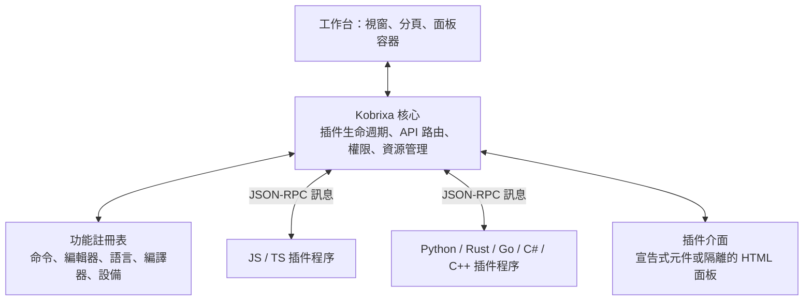

# Kobrixa 插件系統設計

日期：2026-10-14  
狀態：Claude 與 Codex 的設計方向已收斂，尚未實作。本文是唯一的插件系統設計文件；manifest、API、SDK 與新增目錄仍須在實作計畫中細化。

本文合併兩份提案，採用原 Codex 版作為主體，納入 Claude 第一輪五項修改建議及第二輪三項補強。逐項立場與理由保存在[協商紀錄](2026-10-14-plugin-system-negotiation.md)。設計共識不代表承諾發布日期或已完成相關功能。

## 1. 目標與建議架構

採用「小核心＋功能插件＋跨語言 RPC API」，讓 Kobrixa 的產品功能逐步以插件提供，並允許開發者使用 TypeScript、Python、Rust、Go、C#、C++ 等語言編寫插件。

第一階段以 Electron 桌面 IDE 為範圍。`apps/web` 與 `apps/collab` 保持獨立服務；桌面的協作整合可以插件化，但不代表雲端服務需要載入相同的本機插件。

核心原則：

- **核心保持精簡。** 只保留啟動、視窗與介面容器、插件管理、通訊路由、權限與資源管理。
- **功能以插件提供。** 編輯器、語言支援、編譯器、設備連線、Sensor Lab、模擬器與協作都能逐步拆出。
- **內建與第三方插件共用公開契約。** 內建插件隨應用程式附送並預設啟用，維持安裝後即可使用的體驗。既有 React UI 僅允許 §6.2 列出的過渡例外，須逐項記錄移除條件；第三階段以馬達測試完整使用公開 API 作為必要驗收。
- **協定優先於 SDK。** 跨語言能力來自共同通訊契約，各語言 SDK 負責提供方便的呼叫方式。
- **按需啟動。** 先讀取插件宣告，等使用者開啟相關文件、命令或面板時才啟動程序。
- **逐步遷移。** 保留既有函式庫與測試，先增加插件轉接層，再調整功能組裝方式。

「所有功能都是插件」仍需要一個能獨立啟動的核心。插件載入、停用、問題診斷與復原機制不能依賴一般功能插件，否則插件出錯時可能失去復原能力。



插件應以完整功能為單位，不必把每個按鈕或函式拆成一個插件。

## 2. 與現有架構的銜接

目前專案已經有適合插件化的邊界：

- [`LanguageFrontend`、`CompilerBackend`](../../../packages/compiler/src/contracts.ts) 定義編譯前端與後端介面。
- [`BuildSession`](../../../packages/compiler/src/build-session.ts) 負責編譯協調、IR 驗證、取消與成品提交。
- [`KobrixaIR`](../../../packages/ir/src/types.ts) 已有版本，並提供 [JSON 序列化](../../../packages/ir/src/serialize.ts)。
- [`DeviceTransport`、`DeviceSession`](../../../packages/device/src/contracts.ts) 提供設備操作契約。
- 現有 [Electron 架構](../../zh-TW/architecture.md) 已分開 renderer、preload 與 main process。

需要調整的主要耦合點：

| 現況                                        | 建議調整                                             |
| ------------------------------------------- | ---------------------------------------------------- |
| 專案 manifest 固定接受 `bp` 與 `ev3-native` | 改為依已註冊的語言與目標驗證，保留舊 manifest 相容性 |
| 建置 worker 直接建立 Basic Plus 與 EV3 實作 | 從功能註冊表選擇對應提供者                           |
| 編譯結果與提交流程固定圍繞 `.rbf`           | 改為通用 `artifacts[]` 契約，由後端宣告成品類型      |
| 語言 worker 直接依賴 Basic Plus 分析器      | 加入語言服務提供者介面                               |
| 工作台直接匯入與組裝功能面板                | 增加命令、面板、設定與選單擴充位置                   |
| 設備服務直接建立 USB／Wi-Fi transport       | 改為註冊設備提供者，保留集中管理的操作規則           |

遷移時維持「compiler 與 device 函式庫不依賴 Electron」的方向，讓未來 CLI 也能重用。

## 3. 核心與插件的責任

| 部分                         | 放置位置     | 職責                               |
| ---------------------------- | ------------ | ---------------------------------- |
| 啟動、視窗、插件安裝與復原   | 核心         | 沒有功能插件也能啟動並處理問題插件 |
| API 路由、權限、資源租約     | 核心         | 驗證呼叫、管理受控資源存取         |
| Monaco 編輯器整合            | 內建插件     | 編輯器、文件操作、編輯命令         |
| Basic Plus                   | 內建插件     | 語言分析、補全、格式化與產生 IR    |
| EV3 編譯後端                 | 內建插件     | IR → `.rbf`                        |
| EV3 USB／Wi-Fi               | 內建設備插件 | 裝置探索、連線與傳輸               |
| Sensor Lab、馬達測試、模擬器 | 各自獨立插件 | 使用設備或模擬 API 提供功能        |
| 協作、檔案總管、主題、範例   | 各自獨立插件 | 透過公開擴充介面接入               |

必要的設備仲介服務可作為受信任的內建服務插件，與核心的權限及資源租約機制合作。一般功能插件不自行管理彼此競爭的實體設備控制權。

## 4. 跨語言通訊與執行方式

### 4.1 契約組成

公開 API 使用三層設計：

1. **JSON-RPC 2.0**：定義請求、回應、通知與錯誤。
2. **Zod 定義與產出的 JSON Schema**：Zod 作為撰寫來源，JSON Schema 作為提交至儲存庫的跨語言公開契約。
3. **語言 SDK**：將通訊包裝成各語言熟悉的函式與物件。

JSON-RPC 本身與傳輸方式無關，適合讓不同語言交換結構化訊息。參考 [JSON-RPC 官方規格](https://www.jsonrpc.org/specification)。

協定定義集中在 `packages/plugin-protocol`。TypeScript 型別由 Zod 推導，使用 `z.toJSONSchema()` 產生固定 dialect 的 JSON Schema 並提交到儲存庫；其他語言 SDK 從公開 schema 產生型別與驗證程式。核心沿用 Zod 驗證，不必為正式執行額外引入 JSON Schema 驗證器。

為避免兩套驗證語意不同，採用以下約束：

- Wire schema 限用可忠實表達為 JSON Schema 的 JSON 資料型別與檢查。
- 不在 wire schema 中使用無法匯出的 `transform`、隱含 coercion 或未公開的自訂 refinement。需要額外語意檢查時，另外文件化規則、錯誤碼與測試案例，由負責操作的宿主或提供者執行。
- 明確定義未知欄位、預設值及 input／output 語意，避免 SDK 接受但宿主拒絕，或宿主默默修改輸入。
- 匯出遇到無法表示的型別時必須失敗，不得改為 `{}`／`any` 放寬驗證。
- CI 重新產生 JSON Schema 並檢查與已提交版本一致；另以共用的有效／無效訊息案例驗證跨語言行為，不能只比較檔案差異。

Zod 官方文件列出 JSON Schema 匯出能力與不可表示的型別，見 [Zod JSON Schema 文件](https://zod.dev/json-schema)。TypeScript interface 不能作為唯一公開規格，核心與 SDK 都須在通訊邊界驗證資料。

### 4.2 執行模式

| 插件語言               | 執行方式                                       | 傳輸方式                       |
| ---------------------- | ---------------------------------------------- | ------------------------------ |
| JavaScript／TypeScript | Electron `utilityProcess`                      | MessagePort 傳遞 JSON-RPC 訊息 |
| Python                 | 獨立程序；第一階段使用開發者指定的本機 runtime | stdin／stdout                  |
| Rust／Go／C++          | 對應平台的原生執行檔                           | stdin／stdout                  |
| C#                     | 隨包附帶必要 runtime，或 self-contained 發布   | stdin／stdout                  |

兩類傳輸共用同一套 API 語意。`utilityProcess` 提供 Node.js 與訊息埠，但不支援可寫入的 stdin，因此必須提供 MessagePort adapter，不能直接沿用 stdio adapter。參考 [Electron utilityProcess 文件](https://www.electronjs.org/docs/latest/api/utility-process)。

stdio 協定使用 `Content-Length` 訊息邊界，stdout 僅輸出協定訊息，stderr 用於日誌。解析器應處理分段接收、連續多筆訊息與訊息大小限制。

一般 JSON 傳遞控制資料；大型 IR、圖片、音訊與建置成品透過受控的 blob／串流介面傳送。資源 handle 必須綁定擁有者、工作階段與有效期限。協定不假設插件能直接讀寫宿主檔案系統。

功能參數、工作區上下文與授權能力經握手及 API 傳遞，不以環境變數、程序 ID 或工作目錄作為 API 語意。程序啟動器仍可使用環境變數及工作目錄配置 runtime，但這些是執行器細節。stdio 分幀只屬於 stdio adapter，不成為 MessagePort 或未來 WASM adapter 的必要條件。

第一階段提供 JS／TS SDK 與 Python 開發版 SDK。Python 僅支援開發目錄載入，使用開發者明確指定的本機 runtime；管理 runtime 與正式 Python 套件移至第四階段。其他語言可在開發模式依公開協定實驗，官方 SDK 逐步補上。

### 4.3 插件語言與使用者程式語言分開

用 Python 寫插件，不代表該插件必須讓 IDE 支援 Python。Python 插件可以提供 Sensor Lab，Rust 插件也可以實作 Basic Plus 編譯器。

若插件提供新的編譯前端，仍須產生有效的 KobrixaIR。支援某語言的插件執行環境，也不代表 EV3 能執行該語言完整的標準函式庫。

### 4.4 WASM 的分發與隔離價值

保留 Process／管理 runtime 與 WASM 並存的路線。對工具鏈與依賴相容的純運算插件，例如編譯前端、格式化與靜態分析，推薦評估 WASM，以減少平台專屬產物並支援離線分發；它不只是未來執行不可信程式的沙箱選項。

WASM 不加入第一至第三階段，也不作為第四階段發布的必要條件。宿主仍須附帶相容的 WASM runtime 並定義可用的 imports／WASI 能力；不能承諾任意 Python 或原生依賴都能變成一個小型跨平台檔案。各語言支援程度不同，參考 [WebAssembly Component Model 語言支援](https://component-model.bytecodealliance.org/language-support.html)。

未來 WASM adapter 應維持相同 API 語意，具體 ABI、WIT 與 SDK 綁定另寫設計；不假設 JSON Schema 可直接無損轉成所有 WIT 契約。第一階段先維持通訊與資源契約不依賴程序模型。

## 5. 公開 API 與版本契約

### 5.1 API 分組

以下名稱與方法是新 API 草案，尚未實作。

| API                   | 用途                                             |
| --------------------- | ------------------------------------------------ |
| `commands`            | 註冊、執行命令，連接選單與快捷鍵                 |
| `workspace`           | 讀取專案快照、列出檔案、提交檔案變更             |
| `editor`              | 取得文件、選取範圍、套用可復原的編輯             |
| `ui`                  | 通知、樹狀清單、表單、表格、圖表與面板           |
| `languages`           | 註冊語言、宣告式 tokenizer／編輯設定與語言服務   |
| `diagnosticHelp`      | 註冊有命名空間的診斷說明、翻譯與說明資源         |
| `build`               | 註冊編譯前端、後端，回報診斷與建置進度           |
| `devices`             | 註冊設備提供者、取得 session、訂閱讀值與執行操作 |
| `settings`／`storage` | 插件設定與插件專用儲存空間                       |
| `services`            | 提供與呼叫有版本的插件服務                       |

插件之間透過公開 API 或 `services` 合作，不直接匯入彼此的內部程式碼。相依需求寫進 manifest，由核心檢查缺失、版本衝突與循環相依。

語言補全、跳轉、診斷可逐步接入 LSP，Monaco 端仍需轉接層。編譯、部署與硬體控制使用 Kobrixa 自己的 API。參考 [LSP 官方規格](https://microsoft.github.io/language-server-protocol/specifications/lsp/3.17/specification/)。

### 5.1.1 不需要啟動程序的貢獻點

`contributes.languages` 可宣告副檔名、語言 ID、tokenizer 資源、註解規則、括號配對與自動閉合等設定。宿主讀取 manifest 與封裝的資料資源即可註冊，無須為了語法上色啟動插件程序。正規表示式以受驗證的 pattern／flags 資料表達，不允許宣告夾帶任意 JavaScript 函式；複雜語意功能再交給語言服務。

宣告式 tokenizer 仍會在 renderer 執行正規表示式，不因沒有插件程序就安全。一般 Monaco worker 的存在也不代表自訂 Monarch 規則已移出 UI 執行緒。宿主必須：

- 在註冊前限制每個 pattern 的長度、規則總數、狀態總數、封裝語法資源總大小，以及 include 展開後的規則數；拒絕無效 flags、狀態引用與循環 include。
- 對 tokenizer 及其他會在 renderer 執行的插件正規表示式（例如縮排規則）使用同一套輸入驗證，不能藉另一個貢獻欄位繞過限制。
- 顯式設定 Monaco 的 `maxTokenizationLineLength`；達到所設閾值的長行跳過語法上色，仍保留文字編輯。插件不得提高宿主上限。
- 語法資源驗證失敗時不註冊該貢獻，回報是哪個插件及哪項限制失敗，並保留純文字編輯；停用時回收已註冊的 tokenizer／language configuration。
- 將只有靜態貢獻、沒有 entrypoint 的插件一併納入 §8.1 的停用與安全模式。停用判斷必須早於語法資源註冊和專案文件還原。

上述上限是資源限制，不是完整的 ReDoS 防護：短 pattern 對短輸入仍可能產生災難性回溯；同一個 UI 執行緒上的計時器或 Promise 逾時也不能中斷正在執行的同步正規表示式。參考 [Node.js 對事件迴圈與 ReDoS 的說明](https://nodejs.org/learn/asynchronous-work/dont-block-the-event-loop)。v1 仍採可信插件模型；若未來要接受不可信語法規則，須另行採用受限且有時間複雜度保證的規則引擎，或可終止的非 UI 執行緒分詞架構並驗證 Monaco 整合，不能把長度限制當成已解決隔離。

具體數值在第二階段實作計畫中固定到有版本的限制常數與驗收案例，在開放 tokenizer 註冊之前落實；不能使用無上限的預設。

`contributes.diagnosticHelp` 可註冊診斷碼、可選 `helpKey`、英文／繁體中文說明、原因、修正步驟、範例及說明資源。以宿主填入的 `source`（提供者插件 ID）、原始 `code` 與可選 `helpKey` 組成查詢鍵，避免覆蓋其他插件與內建診斷碼；不把插件 ID 加到 `code` 字串前面。未知代碼仍保留原始診斷訊息。停用插件時解除它的註冊。

現有 [`@kobrixa/compiler/diagnostic-help`](../../../packages/compiler/src/diagnostic-help.ts) 是 IDE 與網站共用的內建目錄。第三方插件的說明載入桌面端擴充目錄，不自動上傳或發布到官網。診斷說明與 Quick Fix 是獨立能力：註冊說明不會自動產生修正，Quick Fix 仍由語言服務提供帶文件版本的編輯。

### 5.1.2 診斷來源契約與相容遷移

第二階段採用由宿主填入的 `source`，不採用 `<plugin-id>/` 診斷碼前綴。現有 [`Diagnostic`](../../../packages/compiler/src/contracts.ts) 尚無此欄位，需同步調整契約與消費端：

- 共享 `Diagnostic` 在相容遷移時增加 `source?: string`，讓不經 Electron 的既有編譯函式庫仍能回傳原格式；經插件宿主發布到 UI、建置結果或診斷服務的型別與 wire schema 則要求 `source` 必填。這個差異必須在型別與驗證器中明確表示，不能讓插件發布缺少來源的診斷。
- 插件提交的診斷輸入不接受自行設定 `source`。宿主依已驗證的通道及註冊提供者填入來源；同程序的內建 adapter 由宿主註冊身分決定。核心自行產生的診斷使用保留來源 `kobrixa.core`，第三方不得註冊此身分。
- 在前端、IR 驗證、後端與建置協調各自的診斷進入宿主時加註來源，彙整時保留已驗證的來源，不把整個建置結果統一覆寫成某一個插件。缺少來源的舊資料只由已知的內建相容 adapter 補值，不以診斷碼猜測任意外來資料的提供者。
- 說明查詢先找 `(source, code, helpKey)`，再退回相同 `(source, code)`。只有已知的內建來源可轉接現有內建目錄與官方 URL；第三方即使回傳 `BP1015`，也不能退回 Basic Plus 的同名說明。
- 現有內建 `code`、`helpKey` 與官方說明網址保持不變。第三方說明只解析自己的封裝資源或受控連結，不透過舊有官方 URL 產生器偽裝為內建診斷。
- 診斷的快取／去重、Monaco marker、說明面板及 Quick Fix 請求／相等比較／路由一併納入 `source`。Quick Fix 仍檢查已發布的診斷、session 與文件版本，不能只憑 UI 傳來的 `source` 或 `code` 選擇提供者。

目前 [`quickFixRequestSchema`](../../../apps/desktop/src/main/language/quick-fix-request.ts) 限制內建代碼格式，[`sameDiagnostic`](../../../apps/desktop/src/shared/quick-fixes.ts) 也未比較來源；第二階段須一起調整，不能只增加一個未被使用的欄位。第一階段先在通道與註冊表保留可信提供者身分，不提前要求所有既有編譯函式庫改版。

### 5.2 共通呼叫規則

- 非同步呼叫都有 request ID、逾時、取消與結構化錯誤。
- 呼叫者身分由宿主綁定的通道判定，不能信任訊息自行宣告的插件 ID。
- 文件操作帶文件版本，避免插件用舊分析結果覆蓋新內容。
- 資源使用工作區 ID、文件 URI、設備 session ID 等受控識別碼，避免把任意本機路徑當成公開存取能力。
- 事件訂閱可以解除，插件停用時自動回收。
- 高頻感測資料批次傳送，設定緩衝上限與降採樣策略。
- 取消是協定要求，不代表運算已停止；超過寬限期仍未回應時，由宿主終止程序並清理作業。

現有 `AbortSignal` 不能直接跨語言傳遞。SDK 必須將取消訊息轉為各語言的取消機制；同步運算也需要合作式取消檢查或宿主終止作為最後手段。

### 5.3 版本管理

分別管理三種版本：

- **插件套件版本**：插件自身的發布版本。
- **插件 API 版本**：宿主與插件之間的通訊與功能契約。
- **IR 版本**：編譯前端、驗證器與後端共同接受的資料格式。

啟動握手確認 API 版本範圍、已授予權限、可用功能與 IR 相容性。遇到不相容契約時提供明確錯誤，不嘗試默默執行。

## 6. 插件介面擴充

### 6.1 一般功能使用宣告式 UI

插件提交 UI 描述與資料，由 Kobrixa 渲染，例如表格欄位、表單欄位、樹節點及按鈕對應命令。

Python 開發者不必撰寫 React，也能提供符合主程式樣式的面板。核心統一處理主題、基本無障礙行為與元件呈現；插件提供功能資料、翻譯與事件處理。

### 6.2 複雜功能使用隔離的 HTML 面板

模擬器、自訂視覺化或特殊編輯器可使用 HTML／JS 介面，運算仍由 Python 或 Rust 處理。

面板透過受限橋接 API 呼叫宿主，保持 sandbox、context isolation 與停用 Node integration。每個面板的訊息都要驗證來源與資料，並限制導覽、資源載入及網路存取。參考 [Electron 安全建議](https://www.electronjs.org/docs/latest/tutorial/security)。

現有 React 介面直接掛載工作台僅屬於遷移期間的例外，不是另一套永久插件 API。第三方插件使用宣告式 UI 或隔離面板，不將任意 React 程式碼注入主工作台。內建功能的新能力也應使用公開契約；公開 API 不足時先補契約，不新增私有捷徑。

下表是根據既有 renderer 模組建立的過渡例外清單。插件 ID 是規劃名稱，並非宣稱目前已存在這些插件；尚未轉接的功能沿用現有組裝方式。核心的通用 React 容器與渲染器實作不算插件私有通道。

| 規劃內建插件            | 可暫時保留的既有介面                          | 退出例外的目標                                        |
| ----------------------- | --------------------------------------------- | ----------------------------------------------------- |
| `kobrixa.motor-test`    | `renderer/device/motor-test-controls.tsx`     | 第三階段必須只使用公開宣告式 UI、命令與 `devices` API |
| `kobrixa.sensor-lab`    | `renderer/device/sensor-lab-panel.tsx` 與圖表 | 公開表單／圖表，必要時使用隔離面板                    |
| `kobrixa.device-ev3`    | 設備連線、監測與遠端檔案面板                  | 公開面板與設備 API                                    |
| `kobrixa.simulator`     | `renderer/simulator`                          | 隔離面板與公開模擬／設備服務                          |
| `kobrixa.collaboration` | `renderer/collab`                             | 公開面板與協作服務                                    |
| `kobrixa.editor`        | `renderer/editor`                             | 透過文件化的編輯器掛載與貢獻契約整合                  |
| `kobrixa.workspace`     | `renderer/workspace`                          | 公開樹狀清單、面板與工作區 API                        |
| `kobrixa.settings`      | `renderer/settings` 中的既有設定介面          | 公開設定 schema 與通用設定渲染器                      |
| `kobrixa.updates`       | `renderer/updates`                            | 公開通知／面板及受控更新服務                          |

每個使用例外的遷移變更必須記錄實際私有依賴、缺少的公開能力、退出條件與預定移除里程碑；未列出的內建功能不得自動沿用例外。完成公開 API 遷移後即移出清單，其餘例外在第三階段檢查點逐項追蹤，不將可信身分當成無期限豁免。

第三階段以 `kobrixa.motor-test` 作為必要驗收：它的完整表單、操作、進度、錯誤與停止流程只能透過公開宣告式 UI、命令與 `devices` API 完成，不能直接匯入工作台私有 controller、呼叫舊的功能專屬 preload 通道或掛載私有 React 元件。驗收要保留設備獨占、協作控制權、取消與停止的既有行為，並確認功能邊界中沒有私有 import／通道；若做不到，第三階段尚未完成。

## 7. Manifest 與 SDK 範例

以下範例描述預計提供的開發體驗，套件與方法尚不存在。Python 範例在第一階段限開發目錄載入；本機 interpreter 由開發者設定，這份 manifest 不觸發 runtime 下載或正式套件安裝。

### 7.1 `kobrixa-plugin.json`

```json
{
  "id": "acme.line-count",
  "version": "1.0.0",
  "apiVersion": "^1.0.0",
  "runtime": {
    "kind": "python",
    "entry": "main.py"
  },
  "activationEvents": ["onCommand:acme.line-count.run"],
  "permissions": ["editor.read", "ui.notifications"],
  "contributes": {
    "commands": [
      {
        "id": "acme.line-count.run",
        "title": "計算目前文件行數"
      }
    ]
  }
}
```

插件 ID 與命令 ID 採命名空間，避免衝突。完整 manifest 還需要支援相依插件、顯示名稱與翻譯、平台與架構、runtime 版本需求及發行資訊。

### 7.2 Python 插件

```python
from kobrixa import Plugin

plugin = Plugin("acme.line-count")

@plugin.command("acme.line-count.run")
async def count_lines(ctx):
    document = await ctx.editor.get_active_document()
    if document:
        count = len(document.text.splitlines())
        await ctx.ui.show_message(f"目前文件有 {count} 行")

plugin.run()
```

SDK 負責訊息解析、請求分派、資料轉換、取消、錯誤處理與事件訂閱管理，插件作者專注在功能本身。

## 8. 生命週期、失敗處理與權限

### 8.1 生命週期

```text
安裝 → 驗證 → 等待啟用事件 → 啟動／握手 → 提供功能
                                          ↓
                               停用／當機 → 回收資源
```

預設按需啟動，每個第三方可執行插件使用獨立程序。停止時先要求正常結束，逾時才終止程序。

命令、面板、事件訂閱、暫存成品與資源租約都綁定插件生命週期。當機後可以有限次重啟，但不得自動重播上傳、執行程式或馬達控制等有副作用的操作。

核心提供停用第三方插件的復原啟動方式，涵蓋可執行與只有靜態貢獻的插件。安全模式的停用判斷在載入插件語法／主題／其他貢獻與還原專案文件之前執行，不能等插件程序啟動才套用。被停用的語言以純文字顯示，工作區與來源檔案仍可開啟。

復原入口必須可在 renderer 沒有回應時從下一次啟動使用，不能只依賴卡住畫面內的設定按鈕。停用狀態持久保存，問題插件不因重啟就自動恢復；問題解決後再由使用者明確重新啟用。一般停用也要解除所有靜態註冊與程序資源。當 renderer 已被同步規則卡住時，不承諾能在同一個程序中即時解除，改以核心控制的重新啟動進入安全模式。

### 8.2 程序隔離的實際界線

獨立程序提供當機隔離，不自動限制插件讀取檔案或連網。Python、Node.js 與原生程式仍可能直接使用作業系統 API，因此 manifest 權限只能約束經過 Kobrixa 的呼叫。

第一版定位為「可信任的本機插件」。安裝介面需要清楚呈現執行模式與信任需求，不能把 API 權限清單描述為完整的作業系統沙箱。

若之後要接納不可信任程式，需要另行實作 OS 沙箱或受限 WASM 執行環境。WASM 同時具有 §4.4 的分發價值，並可透過宿主提供的 imports 控制外部能力；仍須配置 I/O 能力、資源限制，並驗證各語言工具鏈與相依套件的相容性。參考 [Wasmtime 安全模型](https://docs.wasmtime.dev/security.html)。

### 8.3 EV3 控制

Sensor Lab、馬達測試與協作功能共用設備仲介服務，由它處理獨占操作、控制權、取消與有限逾時。

插件失效時撤銷控制租約，連線可用時嘗試停止設備。程序終止不代表實體馬達已停止，斷線時也不能保證停止指令送達。

延續現有協作控制權規則，並在每次受控設備操作前檢查。原生插件若可以直接存取 USB 或網路，仍可能繞過仲介；限制這種存取需要額外的 OS 沙箱，不能只依賴 API 權限。

## 9. 正式打包、安裝與發布（第四階段）

前三階段以內建插件與明確啟用的開發模式驗證契約，不向一般使用者正式開放第三方可執行插件。第四階段完成發布與復原驗收後，才開放可信任的第三方本機插件；這不等於已具備不可信程式沙箱。

正式插件套件包含 manifest、程式碼、資源、必要 runtime 或平台執行檔，以及完整性資訊。第四階段開始前另寫打包提案，決定格式、runtime 管理、依賴隔離、更新、離線安裝與三平台驗收條件。

- Python 插件使用管理好的執行環境或隨包附帶 runtime。打包提案應評估按平台、版本與完整性識別共用唯讀 runtime，插件依賴各自隔離，避免默認每個插件都重複附帶一整份 interpreter。
- Rust／Go／C++ 等依支援的平台與 CPU 架構提供執行檔。
- 不假設一般使用者已安裝 Python、編譯器或開發工具。
- 開發模式可以使用本機 runtime；正式發布需提供可重現的 runtime 與相依版本。
- 安裝前檢查套件結構、平台相容性、相依需求與完整性，解壓時限制所有路徑在安裝目錄內。
- 使用分版本安裝目錄，保留前一個可用版本，更新失敗時可回退。
- 雜湊用於完整性檢查；若要驗證發布者身分，需要另外建立簽章與信任機制。

第一階段先提供開發目錄載入；第四階段補齊面向一般使用者的本機套件安裝與復原。插件市集及 WASM Host 可在獨立提案與驗收後加入，沒有綁定發布時程。

## 10. 建議目錄

```text
packages/plugin-protocol/     Zod 定義、產出的 JSON Schema、共用契約案例
packages/plugin-runtime/      載入、生命週期、路由與資源回收
packages/plugin-sdk-js/       JS／TS SDK
sdks/python/                 Python SDK（第一階段限開發模式）
plugins/                     內建功能插件
  basic-plus/
  backend-ev3/
  device-ev3/
  sensor-lab/
  motor-test/
  simulator/
  collaboration/
```

`frontends/basic-plus`、`packages/backend-ev3` 與 `packages/device` 先保留為函式庫。`plugins/*` 負責註冊功能及轉接 API，避免為了插件化立即重寫既有實作。

## 11. 分階段落地與驗收

| 階段              | 主要工作                                                                                                                         | 完成標準                                                                                                  |
| ----------------- | -------------------------------------------------------------------------------------------------------------------------------- | --------------------------------------------------------------------------------------------------------- |
| 1：建立插件基礎   | Zod／JSON Schema、註冊表、MessagePort／stdio adapter、JS／TS SDK、Python 開發版 SDK、最小命令／通知 API、Basic Plus 編譯入口轉接 | TS 與 Python 開發插件可載入、執行、停用；不要求管理 Python runtime；Basic Plus 仍可編譯；當機不影響工作台 |
| 2：插件化編譯鏈   | 完整包裝 Basic Plus 與 EV3 後端，泛化語言／目標選擇與成品契約，加入有資源上限的語言靜態貢獻、診斷說明與 `source` 契約            | 現有範例、bytecode 與取消測試通過；靜態資源受限且可由安全模式停用；診斷來源隔離與舊網址相容               |
| 3：開放介面與設備 | 面板／設定擴充、設備提供者，搬移 Sensor Lab 等內建功能                                                                           | 馬達測試全程只用公開宣告式 UI 與公開 API；功能可獨立啟停，設備鎖與協作控制權保持正確；第三方仍限開發模式  |
| 4：完善正式發布   | 先完成打包提案，再做管理 runtime、正式 Python 套件、套件驗證、相依解析、版本回退、開發 CLI，逐步增加其他 SDK                     | 三個桌面平台可離線安裝與復原問題插件；通過後才向一般使用者開放可信第三方插件                              |

第二階段不能只替換 `new BasicPlusFrontend()`。現有 `BuildSession` 的輸出處理也固定圍繞 `.rbf`，需要一起改為通用成品契約，由 EV3 後端宣告成品類型，宿主負責驗證與提交。既有 IR 驗證、取消及失敗清理行為應保留。

測試重點包括 schema 產物一致性與語意一致性、跨語言協定互通、不相容版本、格式錯誤與過大訊息、插件當機、取消逾時、資源回收、過期文件修改，以及設備操作不得在重啟後自動重播。

第二輪補強另列必要驗收：

- 過大 pattern／規則數／狀態數／展開資源在註冊前被拒絕；超長行回退為無上色；安全模式在還原文件前阻止只有靜態貢獻的插件註冊。ReDoS 壓力案例在可終止的隔離測試程序執行，避免卡死測試 runner；這些案例不構成任意規則安全的證明。
- 兩個插件使用相同 `code`／`helpKey` 時，診斷、說明、快取及 Quick Fix 不串用；偽造 `source` 被拒絕；內建診斷碼和官方說明 URL 不變。
- 馬達測試經公開 API 完成正常、錯誤、取消、停止與無控制權流程，且功能模組不存在私有 UI 掛載或私有 IPC 相依。

第一個實作里程碑是一個 TS 插件、一個僅限開發模式的 Python 插件，以及插件化的 Basic Plus 編譯入口。Basic Plus 先做最小轉接並沿用既有 EV3 後端與建置行為；完整的通用成品契約在第二階段完成。用這三個案例驗證跨語言、最小 UI 接入和核心功能遷移，確認 API 足夠好用後，再擴大到整個 IDE。

## 12. 文件與後續實作計畫

設計提案統一放在 `docs/superpowers/specs/`，不在 `docs/en` 與 `docs/zh-TW` 留下單語版本的正式產品規格。開始實作、變更公開契約時，同步更新英／繁中 architecture、相關產品文件與 roadmap，並清楚標記規劃與已實作的能力。

下一步另寫第一階段實作計畫，細化 schema、兩種 adapter、握手與取消、開發插件載入、Basic Plus 轉接及驗收案例。第一階段需保留宿主可信身分，以及載入任何貢獻之前的停用判斷；完整 tokenizer 限制與診斷 `source` 遷移在第二階段，馬達測試公開 API 驗收在第三階段。本文件只定案上述設計方向，不開始修改產品程式碼。

合併已確定的三項取捨：第一階段同時驗證 TS 與 Python，但 Python 僅限開發模式；正式分發保留 Process／管理 runtime，並為相容的純運算插件保留 WASM 路線；一般使用者的第三方插件開放以第四階段完成驗收為條件。WASM 的實作時程及管理 runtime 的具體方案留給後續專項提案。
