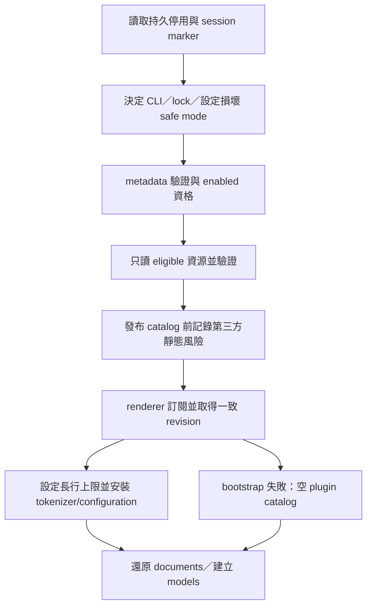
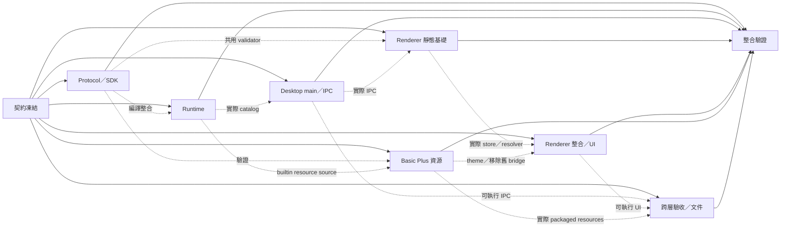

# 靜態語言貢獻設計（第二階段 2C）

日期：2026-10-17  
狀態：正式設計；依研究提案與使用者決定定稿，主要實作已交付，第二階段驗收尚未全部完成；詳見下方實作狀態。

- 上層設計：[插件系統設計](2026-10-14-plugin-system-design.md)（§5.1.1、§8.1）
- 前一子專案：[2B-1 診斷來源契約](2026-10-16-plugin-system-2b1-diagnostic-source-design.md)、[2B-2 語言服務提供者](2026-10-16-plugin-system-2b2-language-services-design.md)
- 研究依據：[2C 設計提案](../../../.superpowers/sdd/2c-design/codex-design.md)

## 實作狀態（2026-10-17）

第二階段已合併至 `0ba37ba`。已交付子專案：[2A](2026-10-16-plugin-system-2a-build-chain-design.md)、[2B-1](2026-10-16-plugin-system-2b1-diagnostic-source-design.md)、[2B-2](2026-10-16-plugin-system-2b2-language-services-design.md)、[2C](2026-10-17-plugin-system-2c-static-languages-design.md)。整體狀態與必要驗收見[主規格的待驗收清單](2026-10-14-plugin-system-design.md#第二階段待驗收項目)及[收尾稽核](../../../.superpowers/sdd/stage-2-closeout/audit-report.md)。

已交付 API 1.4.0 的靜態語言與 static runtime、共用且有資源上限的 JSON／regex 驗證、catalog 註冊與撤銷、所有 model 的詞法路由、長行上色限制、停用／安全模式與復原標記。純靜態診斷說明無須 entrypoint 或程序。Basic Plus 的專案／frontend／service／Monaco ID 均為 `bp`，插件為 `kobrixa.basic-plus`，`tokenPostfix: ".basic-plus"` 保留。

保留的排除範圍與待辦：

- 完整 ReDoS 防護、不可信 grammar sandbox／可中斷 tokenizer 引擎、第三方服務或跨插件 grammar／service 配對仍排除；S09 隔離壓力驗收的通過範圍見下文，V02 真實卡住後復原的人工驗收仍待完成。
- 檔案關聯 UI、glob／完整檔名／首行／複合副檔名偵測、主題貢獻、marketplace／安裝器及新來源語言隱式推斷仍排除。
- 生命週期變更時全量重讀資源、序列啟動可能累積 N×5 秒的無回應資料夾延遲、偽造註冊回報使用通用錯誤碼、同 generation 的磁碟修改可能被較舊回報隔離至 Reload，保留為效能與邊界介面待辦。
- 僅顯示首次失敗的載入橫幅、既有重新連結／解除連結對話框競態仍待整理；原生對話框持有 controller 佇列是已接受的操作限制。2B-2 的 N2 仍未處理。

驗證依稽核與 [2C 進度紀錄](../../../.superpowers/sdd/2026-10-17-plugin-system-2c-static-languages/progress.md)，並補充以下 S09 執行結果。

**S09：** 隔離的惡意分詞驗收已於 2026-10-17 在沙箱外的 macOS arm64（Darwin 24.6.0）通過，使用 `tests/desktop/static-languages-stress.mjs` 與 `tests/desktop/static-languages-run.mjs` 的 `hostile-tokenization`／`recover-hostile` 階段（`pnpm test:static-languages:smoke`）。[壓力測試日誌第 112–114 行](../../../.superpowers/sdd/stage-2-closeout/stress-smoke.log#L112-L114)記錄：renderer 進入正規表示式約 5 秒後，由父程序強制終止（`code: null`、`signal: SIGKILL`）；以 `unclean-exit` 原因成功復原；惡意插件已個別停用，且在 Restore 後仍未註冊；內建 Basic Plus 分詞正常；新增實際耗時 6.1 秒。5 秒內未觀察到 `unresponsive` 事件，依設計此事件並非必要條件。這項驗收與資源上限不證明任意規則安全，也不構成完整 ReDoS 防護。其他平台仍未驗證。

V01–V03 人工驗收仍待完成。V04 保留為已記錄的環境例外：完整桌面 smoke 停在既有的 `tests/desktop/monitor-smoke.mjs:332` 逾時（`visibilityState === "hidden"`），亦已在 2C 前的基底 `247db48` 重現；不得將完整測試套件記為通過。較早的執行環境限制已由後續成功的自動化紀錄部分取代，但不因此關閉這些不同的驗收項目。

下文保留本子專案核准時的設計基線；「實作前背景」與歷史版本範例用於解釋遷移原因，不代表目前仍未實作。原先交給後續子專案的工作，以上方交付狀態為準。

## 1. 背景、範圍與目標

**實作前背景（2026-10-17，2C 實作前）：** 2B-2 已將動態語言功能交給 `LanguageBinding` 選定的內建提供者，但 Basic Plus 的 Monarch tokenizer、語言設定與 Monaco 註冊仍留在 renderer companion。通用 renderer 仍以副檔名或「非 JSON」推定 Basic Plus，沒有靜態貢獻的完整停用、復原與資源驗證流程。

**目標：** 以 `contributes.languages` 宣告詞法語言、顯示名稱、副檔名與兩份有版本的 JSON 資源。main process 驗證、決定 ownership 並發布 catalog；renderer 以單一管理器註冊 Monaco、追蹤所有 models 並處理撤銷。語法上色不啟動插件程序，資源失敗時保留純文字編輯，Basic Plus 的既有詞法與編輯行為保持相容。

**使用者決定（2026-10-17）：**

1. 第二階段允許可信 development 第三方插件提供靜態語言；`languageServices` 維持 builtin-only。
2. Language configuration 只接受有版本的 JSON resource，不接受 inline configuration。
3. Basic Plus 的 Monaco language id 改為 `bp`，與 frontend/service 相同；`tokenPostfix: ".basic-plus"` 保留，主題不變。
4. 不同靜態語言宣告同一 extension 時，global mapping 為 ambiguous，回報衝突並退回 `plaintext`；適用的 project `LanguageBinding` 可使用同 owner 的 static language 消歧義。沒有隱式優先序，也不新增 file-association UI。
5. 內建語言服務與 Basic Plus 維持必要且不可停用，沿用 `PLUGIN_E_BUILTIN_REQUIRED`；safe mode 只停用第三方。

**不在範圍內：**

- 完整 ReDoS 防護；本設計不保證 ReDoS-proof。
- 不可信 grammar sandbox、可終止 tokenizer worker 或替代 regex 引擎。
- 第三方 `languageServices`、language-service RPC、跨插件 grammar/service pairing。
- File-association UI、glob、完整 filename、first-line 偵測、複合副檔名或 dialect 配對。
- Theme contributions；現有 Kobrixa 主題仍由宿主初始化。
- Marketplace、下載安裝、新語言的隱式專案推斷，或 Basic Plus 演算法變更。

## 2. Manifest 與 runtime 契約

### 2.1 API 1.4.0 與 static runtime

`PLUGIN_API_VERSION` 升為 **`1.4.0`**。protocol、公開 JSON Schema 的 `$id`、JS SDK 匯出、Python SDK 常數／schema 與 conformance fixtures 必須同步。既有符合 host API range 的 1.x 插件繼續載入；使用本能力的插件宣告 `apiVersion: "^1.4.0"`，避免舊 host 忽略新欄位。無須新增 tokenizer registration RPC。

`runtime` 仍為必填，新增嚴格 variant **`runtime: {kind:"static"}`**：

- 只接受 `kind`，不接受 `entry` 或未知 runtime 欄位。
- 不得宣告 `activationEvents`、`permissions`、`contributes.commands`、`frontends`、`backends`、`languageServices`，即使值是空陣列亦不合法。
- 至少有一項非空 `languages` 或有效的 `diagnosticHelp` 宣告；空 `languages` 陣列不算有效貢獻。資源讀取失敗依 §5 隔離，不反過來將已合法的 runtime 宣告判為空插件。
- 永遠不進 launcher、activation、supervisor 啟動或 handshake。設定頁應呈現靜態貢獻的啟用狀態，不以沒有 PID 判定不可用。

`node`／`python` 插件也可同時提供靜態語言；讀取、驗證與註冊這些資料不觸發其程序。builtin 保留 `{kind:"builtin"}`，身分由 host source 決定，第三方不能以 manifest 自稱 builtin。既有 runtime variants 的相容行為不變；更新 `PluginSummary.runtime`、runtime narrowing 與 manager 程序建立條件。

第三方 compiler 禁令仍適用。來源限制先於 static runtime 語意檢查；任何非 builtin source 宣告 `languageServices`（包含空陣列）仍回報 `PLUGIN_E_LANGUAGE_SERVICE_REQUIRES_BUILTIN` 並使插件 invalid，不得因新增 static runtime 放寬或以一般 manifest 錯誤取代此規則。

### 2.2 `contributes.languages`

以下為 Basic Plus manifest 的新增部分；原有 plugin id、`runtime: {kind:"builtin"}`、frontend 與 service 宣告保留：

```json
{
  "apiVersion": "^1.4.0",
  "contributes": {
    "languages": [
      {
        "id": "bp",
        "extensions": ["bp", "bpi", "bpm"],
        "aliases": ["Basic Plus", "Basic+"],
        "tokenizer": { "version": 1, "path": "language/tokenizer.json" },
        "configuration": { "version": 1, "path": "language/configuration.json" }
      }
    ]
  }
}
```

| 欄位            | 必要性與規則                                                                                                                            |
| --------------- | --------------------------------------------------------------------------------------------------------------------------------------- |
| `id`            | 必填，沿用 `compilerIdSchema`：`^[a-z][a-z0-9-]{0,31}$`。同插件不得重複；同時是公開詞法身分與 Monaco id。                               |
| `extensions`    | 必填，1–16 筆且不重複；每筆符合 `^[a-z0-9]{1,16}$`，無前導點。檔名最後一段副檔名以大小寫不敏感比對。                                    |
| `aliases`       | 可省略；若提供為 1–8 筆不重複的單行純文字，每筆 1–80 個 Unicode code points。第一筆為顯示名稱，省略時使用 id；不參與 ownership 或解析。 |
| `tokenizer`     | 必填、嚴格 `{version:1,path}`，指向 tokenizer JSON。                                                                                    |
| `configuration` | 必填、嚴格 `{version:1,path}`，指向 configuration JSON；內容可為 `{}`，代表 Monaco 預設。禁止 inline configuration。                    |

`languages` 最多 8 筆；每筆及其 resource declaration 均為 strict object。manifest 與 `contributes` 外層沿用既有 forward-compatible loose object，不因此忽略已知欄位錯誤。resource path 沿用 diagnostic-help grammar，最多 600 字元：

```text
^(?:[A-Za-z0-9_][A-Za-z0-9_.-]{0,63}/){0,7}[A-Za-z0-9_][A-Za-z0-9_.-]{0,63}\.json$
```

只接受封裝內相對 `.json` 路徑；禁止 absolute path、`..` segment、反斜線與 URL。兩份 JSON 本體不重複 `version`。resource version 1 與 `STATIC_LANGUAGE_FORMAT_VERSION = 1`、`STATIC_LANGUAGE_LIMITS_V1` 綁定；格式或限制的不相容變更必須另增版本，插件不能自行提供或提高上限。

同插件同 id 同時宣告 frontend/service 時，static `extensions` 必須與 frontend `sourceExtensions`／service `extensions` 集合完全相同，否則 `PLUGIN_E_MANIFEST`。frontend/service 沒有 static contribution 仍合法；靜態語言也不需要 frontend/service。

## 3. 宣告式 Monarch v1 與 language configuration

### 3.1 資料結構

Zod 是 schema 的唯一來源，必須可匯出 draft-2020-12 JSON Schema；結構 schema 不使用無法匯出的 refine/transform。公開資源 schema 定義為 `static-language-tokenizer-v1` 與 `static-language-configuration-v1`。跨欄位、引用、合計與 regex 語意由共用純 validator 檢查。所有下列 objects 均為 strict；states、lists、rules、cases 保留陣列順序，不依賴 JSON object key 順序。

```ts
type RegexData = { pattern: string; flags: "" | "i" };
type Pair = { open: string; close: string };
type TokenAction = {
  token: string; // literal token 或 @brackets
  next?: string; // @<existingState>、@pop、@popall
  bracket?: "@open" | "@close";
};
type Action =
  | TokenAction
  | {
      cases: { when: string; action: TokenAction }[];
    };
type Rule = { regex: RegexData; action: Action } | { include: string };
type StaticLanguageTokenizerV1 = {
  ignoreCase: boolean;
  defaultToken?: string;
  tokenPostfix?: string;
  lists?: { name: string; words: string[] }[];
  brackets?: (Pair & { token: string })[];
  states: { name: string; rules: Rule[] }[];
};
type StaticLanguageConfigurationV1 = {
  comments?: { lineComment?: string; blockComment?: Pair };
  brackets?: Pair[];
  autoClosingPairs?: (Pair & { notIn?: ("string" | "comment" | "regex")[] })[];
  surroundingPairs?: Pair[];
  indentationRules?: {
    increaseIndentPattern: RegexData;
    decreaseIndentPattern: RegexData;
    indentNextLinePattern?: RegexData;
    unIndentedLinePattern?: RegexData;
  };
  onEnterRules?: {
    beforeText: RegexData;
    afterText?: RegexData;
    previousLineText?: RegexData;
    action: {
      indentAction: "none" | "indent" | "indentOutdent" | "outdent";
      appendText?: string;
      removeText?: number;
    };
  }[];
  wordPattern?: RegexData;
};
```

上述 TypeScript 表達資料形狀；以下限制同樣是強制契約，不能只靠 TypeScript 型別驗證：

| 項目            | 規則                                                                                                                                                                                |
| --------------- | ----------------------------------------------------------------------------------------------------------------------------------------------------------------------------------- |
| `name`          | `^[a-z][a-z0-9_]{0,31}$`；state 與 list 各自不得重複。state 保留 `pop`、`popall`、`push`；list 保留 `default`、`eos`。                                                              |
| Map keys        | 所有會轉為 map key 的名稱拒絕 `__proto__`、`constructor`、`prototype`；查找限 own properties。adapter 為 lists 產生 `list_<name>` 內部鍵，不複製任意頂層屬性。                      |
| States          | 1–64 個，必須含 `root`，起點固定為 `root`；各 state 的 rules 可空，但仍受全語言合計限制。所有 states（含不可達者）都驗證。                                                          |
| Literal token   | 空字串或符合 `^[a-z][a-z0-9_.-]*$`，最多 80 code points。`defaultToken` 省略時為空 token。`@brackets` 只允許在 `TokenAction.token`。                                                |
| `tokenPostfix`  | 若提供，符合 `^\.[a-z][a-z0-9_.-]*$`，最多 80 code points；省略時為 `.` 加 language id。                                                                                            |
| Lists           | 最多 32 組；每個 word 為 1–64 code points，全部 lists 合計最多 4,096 words。同 list 依 `ignoreCase` 判定重複並拒絕；不同分類可包含相同 word，由 cases 順序決定分類。                |
| Cases           | 1–32 分支，`when` 不重複；允許 `@<existingList>`、`@eos`、`@default`。最後必須且只能有一個 `@default`；分支只能為 `TokenAction`，不得巢狀 cases。                                   |
| Pairs／comments | 每個 `open`、`close`、`lineComment` 為 1–16 code points；tokenizer brackets、configuration brackets、autoClosingPairs、surroundingPairs 各最多 32 組。`notIn` 最多 3 筆且不得重複。 |
| `onEnterRules`  | 最多 32 筆；`appendText` 為 0–256 code points，`removeText` 是 0–256 的整數；adapter 明確轉為 Monaco 的 indent enum。                                                               |
| 字串            | 不接受控制字元；regex source 的文字 escape（例如 JSON 中的 `"\\t"`）可表達控制字元匹配。除長行門檻外，字串長度均以 JSON 解碼後的 Unicode code points 計量。                         |

### 3.2 允許與拒絕的能力

| 能力                  | v1 規則                                                                                                                                                                |
| --------------------- | ---------------------------------------------------------------------------------------------------------------------------------------------------------------------- |
| 有序 rules、`include` | 允許；`include` 僅能為同 tokenizer 的 `@<existingState>`。禁止缺失引用與 include cycle。                                                                               |
| `next`                | 只允許 `@<existingState>`、`@pop`、`@popall`；明確 state transition 可有循環。禁止 `@push`、動態 `$1`／`$S2` state、dot-state fallback。                               |
| Bracket tokens        | 允許 literal bracket table、`bracket: "@open"/"@close"`；`@brackets` 要求非空 tokenizer bracket table，且不能再指定 `bracket` override。configuration 配對表另行驗證。 |
| Regex                 | 允許一般 ECMAScript literal、character class、alternation、量詞、捕獲／非捕獲群組、anchors 與 lookahead；依 §3.3 的語法、flags、AST 與消耗規則驗證。                   |
| 任意程式碼            | 禁止 functions、callback、JS module resource、imports、remote URL、外部 include、`eval`、`new Function`；JSON 字串不能被當成 JavaScript 執行。                         |
| 任意 case guard       | 禁止 regex guard、`~`、`!~`、`==`、capture/state substitution，避免繞過 regex validator。                                                                              |
| Action shortcuts      | 禁止 `group`、capture-action array、tuple rule shortcuts、遞迴 action；regex 群組合法時，action 仍只作用於整個 match。                                                 |
| 非消耗／嵌入功能      | 禁止 `@rematch`、`goBack`、`switchTo`、`nextEmbedded`、`log`。                                                                                                         |
| 其他 Monarch 設定     | 禁止自訂 regex macro、任意頂層屬性、`unicode`、`includeLF`、`start`；未列出的欄位一律拒絕。                                                                            |

### 3.3 Flags、macro、`$S` 與零寬規則

**Flags：** 每個 regex 必填 `flags`，只接受 `""` 或 `"i"`；拒絕重複 flags 及 `g/y/d/m/s/u/v` 等其他值。tokenizer 每條 regex 的 flags **必須恰等於 `ignoreCase ? "i" : ""`**，混用即拒絕。configuration 每條 regex 可獨立選 `""` 或 `"i"`，adapter 以 `new RegExp(pattern, flags)` 建立。

此規則對應目前鎖定的 `monaco-editor@0.57.0`：Monarch 取 RegExp 的 `.source` 後，以 language-level flags 重建 regex，不能讓作者指定的 flags 靜默失效。升級 Monaco 必須重跑 adapter conformance。

**Macro 與 escaping：** wire `pattern` 是一般 ECMAScript regex source，不具有 Monarch macro 或 state interpolation 語意。tokenizer adapter 必須將每個 literal `@` 轉成 `@@`，由 Monarch 還原；不得把未轉換的 source 直接交給 macro expander。必測 `@`、`@@`、`@name`、反斜線後的 `@` 與 literal `$`，確保 wire 語意不變。configuration 不經 Monarch，不做這項 `@` doubling。

共用 validator 拒絕 source 中會觸發 `$S`／`$s` 加數字的形式（以 `/\$[Ss][0-9]/` 偵測），包括前方有反斜線、企圖表達 literal `$S1` 的 escaped 形式；反斜線不能用來豁免。action/state 名稱也不能使用 substitution。必須檢查原始及 adapter escape／anchoring 後的 pattern，不能以轉換繞過長度或語法規則。

**零寬規則：** tokenizer rule 的最低消耗長度必須至少 **1**。共用 validator 以 regex 語法 AST 保守計算：斷言消耗為 0、串接相加、alternation 取最小值、量詞採最低重複次數；無法證明最低消耗至少 1 即拒絕。拒絕 backreference、lookbehind 與不支援的 AST 構造；保留 Basic Plus 使用的 lookahead。不得透過執行 `.test()` 或掃描範例字串猜測是否可能零寬。

configuration regex 共用相同語法、flags、大小與 AST validator，但以明確用途參數允許零寬 match（例如縮排的 `^`）。這不是另一套較寬鬆的驗證入口，也不是 ReDoS 證明。

## 4. `STATIC_LANGUAGE_LIMITS_V1`

在 `packages/plugin-protocol/src/static-language-limits.ts` 匯出不可變的 `STATIC_LANGUAGE_LIMITS_V1` 與 `STATIC_LANGUAGE_FORMAT_VERSION = 1`。下列數值為正式 v1 契約，不能交由插件覆寫或在發布後無聲更改。

| 常數                        |             精確值 | 計量與範圍                                                                                                                   |
| --------------------------- | -----------------: | ---------------------------------------------------------------------------------------------------------------------------- |
| `patternLength`             |              2,048 | 原始解碼 pattern 的 code points，最少 1。                                                                                    |
| `compiledPatternLength`     |              4,096 | adapter escape／anchoring 後 source 的 code points。                                                                         |
| `rulesPerLanguage`          |              1,024 | 全部 states 的原始 rule entries 合計；每個 include entry 也算 1。                                                            |
| `regexesPerLanguage`        |              1,024 | tokenizer、最多 4 個 indentation 欄位、onEnter 全部 regex 欄位及 wordPattern 合計；重複內容仍逐次計數。                      |
| `statesPerLanguage`         |                 64 | 包含未被引用的 states。                                                                                                      |
| `resourceFileBytes`         | 524,288（512 KiB） | 每份原始 UTF-8 resource，含 BOM。                                                                                            |
| `resourceBytesPerLanguage`  | 786,432（768 KiB） | tokenizer 與 configuration 原始 bytes 合計。                                                                                 |
| `resourceBytesPerPlugin`    | 1,048,576（1 MiB） | 該插件所有 language resource 引用合計；重複 path 依每次引用計入。                                                            |
| `resourceBytesTotal`        | 8,388,608（8 MiB） | 全部啟用且納入 catalog 的靜態語言資源；與 diagnostic-help 預算分開。                                                         |
| `expandedRulesPerLanguage`  |              8,192 | 每個 state 完整 include 展開後的 rules 再合計；重複 include 不去重。                                                         |
| `expandedRulesTotal`        |             65,536 | 全部啟用且納入 catalog 的語言展開後總量。                                                                                    |
| `includeDepth`              |                 16 | 最長 include 路徑的 edges 數；不是 state 數。                                                                                |
| `regexFlags`                |        `""`、`"i"` | tokenizer 另須與 `ignoreCase` 一致。                                                                                         |
| `listsPerLanguage`          |                 32 | Keyword lists 數。                                                                                                           |
| `wordsPerLanguage`          |              4,096 | 全部 lists 的 words 合計，每字最多 64 code points。                                                                          |
| `casesPerRule`              |                 32 | 每條 cases action 的分支數。                                                                                                 |
| `onEnterRules`              |                 32 | 每個 configuration 的 onEnter rules 數。                                                                                     |
| `languagesPerPlugin`        |                  8 | 每插件 declarations 數。                                                                                                     |
| `languagesTotal`            |                128 | 活動 catalog 的獨立 language ids；reload 同 id 不增加。                                                                      |
| `sessionLanguageIds`        |                256 | 本 renderer session 曾對插件貢獻呼叫 `languages.register()` 的不同 Monaco language ids，包含已撤銷的 shell；不是 plugin 數。 |
| `maxTokenizationLineLength` |         **10,000** | Monaco `line.length`，以 UTF-16 code units 計量；長度 **≥ 10,000** 跳過該行詞法 tokenization，保留文字編輯。                 |

§2、§3 的其他結構上限同樣屬 v1：extensions 1–16 筆／每筆 1–16 字元、aliases 1–8 筆／每筆 1–80 code points、names 最長 32、token/postfix 最長 80、word 最長 64、pair/comment atom 1–16、各配對表最多 32、`notIn` 最多 3、`appendText`／`removeText` 最多 256，以及 resource path 最長 600／最多 7 層目錄。JSON Schema、Zod 與 Python 的字串長度語意必須一致；不能以 JavaScript `.length` 誤算非 BMP 字元。

Include graph 使用三色 DFS 檢查 missing reference、cycle 與所有 states，錯誤列出循環路徑。先 memoize 展開數，以飽和加法在 `limit + 1` 停止，通過才 materialize；不得先配置巨大 arrays 再計數。DAG 最長路徑要獨立計算，不能因 visited cache 漏掉較深的第二條路徑。`next` 只查 state 引用，不當作 include edge。

主 editor、diff original/modified 及所有建立／更新 options 入口必須顯式設定 `maxTokenizationLineLength: 10000`，放在其他 options spread 之後，確保無法被提高。以真實 Monaco 的最終 configuration 與 `tokenize`／`tokenizeEncoded` 驗證 `>=` 邊界，不能只檢查 props 中有數字。

這個閾值不限制 indentation／onEnter／wordPattern 的輸入，也不能阻止短 pattern 對短輸入的災難性回溯。一般 Monaco worker 不代表自訂 Monarch 已離開 UI thread，同執行緒的 timer／Promise timeout 不能中斷同步 regex；可信插件與下一次啟動的復原機制仍是必要前提。

## 5. 驗證、資源載入與錯誤處理

### 5.1 驗證責任與載入順序

| 層                         | 責任                                                                                                                                                    |
| -------------------------- | ------------------------------------------------------------------------------------------------------------------------------------------------------- |
| `plugin-protocol`          | `static-languages.ts` 與相鄰純函式模組提供 schema、regex AST 分析、references、include 計數與 limits；不得依賴 Node 或 Monaco，main／renderer 共用。    |
| Registry／`plugin-runtime` | main 的權威驗證端；先處理 manifest、API、source 身分、持久停用與既有 compiler conflicts，再讀 eligible 資源，檢查 bytes、全部語意、ownership 與總預算。 |
| Renderer adapter           | 防禦性核對 DTO、version、revision，重用純 validator；僅從允許欄位建構新的 Monaco objects，不 spread 外來任意屬性、不讀插件檔案。                        |
| SDK／conformance           | 驗證公開資料契約與匯出一致性；Python 不使用 Python regex 引擎驗證 ECMAScript pattern。                                                                  |

載入必須拆成 metadata／資格及 resource 兩階段：

1. 先載入持久設定、session marker、CLI safe-mode 選項與 safe-mode lock；損壞設定採 fail closed。safe mode 完全跳過第三方 development folders。
2. 非 safe mode 來源讀 manifest，驗證 API、runtime 與宣告，套用持久停用、來源身分及既有 compiler conflict 規則。停用來源可讀 metadata 供設定頁顯示，但不得讀語法資源、分析 regex AST 或編譯 regex；legacy disabled id 在此階段轉為 sourceKey。
3. 只對 eligible declarations 讀 resource；tokenizer 與 configuration 都通過才可發布該 language。不得先註冊 tokenizer 再等待 configuration。
4. 對完整候選集合計算 §6 ownership／conflicts，套用有界預算，原子提交 catalog、問題與新 revision。

Development resource reader 沿用 diagnostic-help 的 `realpath → containment → regular file → bounded read(limit + 1) → UTF-8/BOM → JSON → strict schema → semantic validation`。開啟 handle 後再檢查一般檔案，拒絕 symlink escape、目錄及 stat 後長大的檔案；可抽出 `packaged-json-resource.ts` 共用 reader，但不得放寬 diagnostic-help 的規則。此讀取流程仍不構成第三方可寫目錄的 OS sandbox。

每來源維持 **5,000 ms** deadline，涵蓋 metadata 與全部 resource I/O，不得每份 resource 重新取得 5 秒。metadata 階段逾時沿用 `PLUGIN_E_SOURCE_TIMEOUT`／來源 invalid；metadata 已成功而 resource 逾時，尚未完成的 language 回 `PLUGIN_E_STATIC_LANGUAGE`，不使其他有效能力 invalid。逾時／舊 reload 的 late completion 由 generation 與 operation token 丟棄。先限制 source 長度與數量，才做 syntax compile／AST 驗證；main 不執行文件 tokenization 或 adversarial `.test()`，I/O deadline 不被描述為可中斷同步 regex。

Metadata 可平行讀；resource 使用有界工作佇列，按 `(sourceKey, languageId)` 固定順序計入 plugin/global bytes、語言數與展開規則預算。超量 language 拒絕並釋放暫存後繼續處理可容納的後續項；不得先保留所有來源的完整資源再檢查 8 MiB。未展開 DTO 與暫存資料也須受上述結構／數量限制，不建立無界的複製清單。這是預算分配順序，不能用來替衝突的 id 或 extension 選 winner；衝突集合須完整計算。

### 5.2 Builtin raw resource packaging

Host-only `PluginSource` 的 builtin variant 新增 `resources: Readonly<Record<string, string>>`，key 為 manifest 中的相對 resource path。`apps/desktop/src/main/plugins/builtin.ts` 以 Vite `?raw` import JSON 原始文字，隨 main 的 `.vite` bundle 封裝；不得改成 parse 後 stringify，也不得假定正式版能讀 repository 的 `plugins/` 目錄。

Builtin provider 查 exact key，development provider 走受限檔案 reader；兩者取得原始 UTF-8 bytes 後使用同一 validator、BOM 規則及預算。缺 key 等同 missing file，未被 manifest 引用的 resource 不發布。Builtin 不能繞過 schema、flags、AST 或 limits；manifest 不能指定任意 loader。既有 builtin diagnostic-help catalog 不因 2C 改為此管線。

### 5.3 錯誤碼與 structured problem detail

| 狀況                                                                                             | 問題碼與處置                                                                                    |
| ------------------------------------------------------------------------------------------------ | ----------------------------------------------------------------------------------------------- |
| Manifest 結構、重複 language id、static runtime 語意、同 owner frontend/service extension 不一致 | `PLUGIN_E_MANIFEST`；插件 invalid。                                                             |
| API range、冒充 builtin、第三方 compiler/service                                                 | 沿用既有對應錯誤；第三方 service 必須保留 `PLUGIN_E_LANGUAGE_SERVICE_REQUIRES_BUILTIN`。        |
| Resource 缺失、越界、讀取失敗、resource deadline、大小、schema、regex、引用、include 或總預算    | `PLUGIN_E_STATIC_LANGUAGE`；只拒絕該 language，插件其他有效貢獻仍可用。                         |
| 核心保留 id/extension、frontend ownership、重複 static id、extension ambiguous                   | `PLUGIN_E_STATIC_LANGUAGE_CONFLICT`；依 §6 排除該 language 或該 mapping，不使整個插件 invalid。 |
| Renderer DTO／adapter／Monaco 註冊失敗、session language id 上限                                 | `PLUGIN_E_STATIC_LANGUAGE_REGISTRATION`；隔離該 sourceKey／generation／language。               |
| 嘗試停用 builtin                                                                                 | `PLUGIN_E_BUILTIN_REQUIRED`；維持 2B-2 行為。                                                   |

`PluginProblem` 增加可選 `detail`；其靜態語言內容為：

```ts
type StaticLanguageProblemDetail = {
  languageId: string;
  resourcePath?: string; // manifest 中的相對 path，不是實體檔案路徑
  fieldPath?: string; // 例如 states[2].rules[4].regex.pattern
  limit?: string; // 例如 STATIC_LANGUAGE_LIMITS_V1.patternLength
  allowed?: number | readonly string[];
  actual?: number | string;
  conflictingSources?: {
    pluginId: string;
    sourceKey: string;
    languageId: string;
  }[];
};
```

三個新增靜態語言問題碼均必填 `detail.languageId`；resource 問題填 `resourcePath`／適用的 `fieldPath`，limit 問題填 `limit`、`allowed`、`actual`，衝突列出全部參與插件來源；核心保留衝突另在 message 與 catalog 的 `kind`／`key` 辨識。循環 include 的 `fieldPath` 指向入口、message 包含循環路徑。host 填入 ownership，message 必須含 plugin id，不能借用 compiler 的 `providerKey: language:*`，以免誤判成 service conflict。例如：

```text
acme.toy / toy / language/tokenizer.json / states[2].rules[4].regex.pattern:
STATIC_LANGUAGE_LIMITS_V1.patternLength exceeded (actual 2049, allowed 2048).
```

新增可信 sender wrapper 保護的 `plugins:report-language-registration-failure` IPC，preload 暴露 `plugins.reportLanguageRegistrationFailure()`。payload 僅接受目前 catalog 的 `sourceKey`、`generation`、`languageId`、`revision`、固定 `reason` 與受限的文字 `detail`：

- `reason` 為 `dto-version`、`validation`、`adapter`、`monaco`、`session-language-ids` 之一；文字 detail 最多 **2,048 code points**，不接受任意物件或實體 path。
- main 驗證 sender、catalog revision 與完整 ownership；拒絕偽造／不在 catalog 的來源，忽略過期或重複 report，再由 host 產生 `PluginProblem`，合併既有插件問題 UI。
- 失敗 contribution 從可用 catalog 排除；該 generation 不因新 revision 自動重試。只有 reload 或使用者明確 enable 才清除隔離並開啟新的載入嘗試，避免 report／revision 回授迴圈。

靜態失敗不丟棄工作區；受影響 model 以 `plaintext` 繼續編輯，保留內容、undo、selection、draft 與 view state。狀態標籤顯示「純文字／Plain Text」，插件設定頁顯示完整問題；編輯器可用簡短狀態指向插件設定。這與 2B-2 `LanguageAvailability` 分開，不將仍有效的分析誤標為 service missing。

## 6. Ownership 與解析次序

Frontend 決定編譯／來源收集及 project language；`languageServices` 跟隨同 frontend owner，提供動態能力；`languages` 只定義詞法與顯示／extension 路由。靜態語言不因此可建置，也不改隱式專案的 `bp`／`ev3-native` 預設。

### 6.1 Ownership 與衝突

1. **核心保留：** `plaintext`、`json` 及核心實際安裝的其他 Monaco ids 由顯式核心清單保留；`.json` mapping 也保留。插件占用核心 id 時拒絕其 language；只碰到保留 extension 時拒絕該 mapping，保留該 language 的其他有效 mapping，回報衝突。alias 不參與 ownership。
2. **Frontend owner 保留 logical language id：** 只有同 `pluginId`／`sourceKey` 可提供該 id 的 static contribution；其資源失敗不解除 frontend 的保留。第三方 `id:"bp"` 不能覆寫 builtin grammar，也不能因此讓原有 compiler plugin invalid；只拒絕越權的靜態宣告。
3. **純靜態 id：** 沒有 frontend owner 時，多個 enabled 插件宣告同 id，所有該 id 貢獻均不註冊並回報完整衝突。不得按載入順序、版本號或 builtin 身分選一方；停用其中一方後重算，剩餘唯一來源可恢復。
4. **Extension：** 不同有效 static ids 宣告同 extension，global mapping 為 ambiguous，回報所有來源；只撤銷該 extension mapping，其他 extensions 及語言註冊仍可用。不得依載入順序暗選 winner。
5. **Selected binding：** 已選定且 extensions 支援該檔案的 `LanguageBinding`，只能取同 `pluginId`、`sourceKey`、`language` 的 static contribution。這可消除 extension 歧義；該 owner 的 static 不可用時直接 `plaintext`，不能改取另一插件的 grammar。

Id 衝突對完整 eligible 宣告集合判定，extension 衝突對完整有效 static candidate 集合判定；不能迭代排除 A 後意外讓原本與 A 衝突的 B 成為 winner。停用、reload、資源可用性改變時重算整份結果。

### 6.2 所有 consumer 共用 resolver

解析次序固定為：**核心 route → 適用的 selected binding 同 owner static route（失敗直接 plaintext）→ 唯一 global extension route → plaintext**。沒有適用 binding，包括專案 service unavailable 時，仍可使用無衝突的 global lexical route，保留 2B-2「分析不可用但仍可詞法上色」的行為。

例如 A 提供 `toy-a/.toy`，B 提供 `toy-b/.toy`：沒有 selected binding 的文件／review 使用 `plaintext` 並回報 extension conflict；已明確選定 A 的專案可使用 A grammar。主 editor、狀態標籤、diff／review 必須使用同一 resolver；review 有專案上下文時傳入同一 binding。

移除 `LanguageCompanion.monacoLanguage` 欄位與其全部讀取；companion 不再提供 lexical id。`language-features.ts`、semantic-token selector 從目前 `ModelLanguageRoute` 取得實際 Monaco id，仍檢查 workspace、model URI、binding sourceKey 與 binding epoch。

static failure 不改寫 `LanguageAvailability`，也不重啟有效的 analysis worker。`plaintext` fallback 必須撤銷該 model 的 semantic coloring 並清除舊 tokens；其他動態功能僅能在原 binding／model guard 通過後提供。如需使用 plaintext selector，每個 callback 都必須做相同 guard，不能讓相鄰無關的純文字文件收到該 service 的功能。

## 7. Catalog、renderer manager 與 model 生命週期

### 7.1 Catalog DTO 與 revision

main manager 新增 `staticLanguages()`，經 controller／preload 的 `plugins.staticLanguages()` 傳給 renderer。snapshot/event 新增 `staticLanguagesRevision` 與完整的精簡 `staticLanguageOwners` 清單。所有 owner 身分由 host 填入，不能由 resource 自稱。

```ts
type StaticLanguageOwner = {
  sourceKey: string;
  pluginId: string;
  generation: number;
  languageId: string;
  extensions: string[];
};
type ValidatedStaticLanguage = {
  sourceKey: string;
  pluginId: string;
  generation: number;
  id: string;
  extensions: string[];
  aliases: string[]; // 省略宣告時正規化為 []
  resourceDigest: string; // host 對兩份資源內容產生的穩定 digest
  tokenizer: StaticLanguageTokenizerV1;
  configuration: StaticLanguageConfigurationV1;
  resourceBytes: { tokenizer: number; configuration: number };
  expandedRules: number;
};
type StaticLanguageConflict = {
  kind: "reserved-id" | "reserved-extension" | "frontend-owner" | "id" | "extension";
  key: string; // language id 或無點 extension
  sources: { pluginId: string; sourceKey: string; languageId: string }[];
};
type StaticLanguagesCatalog = {
  formatVersion: 1;
  limitsVersion: 1;
  revision: number;
  languages: ValidatedStaticLanguage[];
  extensionRoutes: Record<string, string | null>; // id；null = ambiguous
  conflicts: StaticLanguageConflict[];
};
```

`extensionRoutes` 只表達 plugin global routes；核心 routes 由宿主管理。不存在的 key 代表沒有 plugin mapping，`null` 沒有隱式 winner。已解決 id ownership，因此非 null id 能唯一對應 `languages` 的 owner；有 extension 衝突的 language 仍可供 selected binding 使用。

DTO 只含可序列化資料；不傳 RegExp、callback、loader 或可供 renderer 讀檔的實體 resource path。保留已驗證但未展開的 includes；renderer 重算並核對展開數與上限後才轉換，避免 IPC 傳送重複展開 arrays。`resourceBytes` 是 host 對原始 bytes 的計量，不能由重新 stringify 推算。

`staticLanguagesRevision` 為 main session 內單調遞增的 catalog revision；enabled 集合、generation、resource digest、aliases、extensions、conflicts／隔離結果改變都使其遞增。它與 2B-2 **binding epoch 分開**：只改 tokenizer/configuration 或 lexical route 不觸發 worker 重啟；service owner／worker 生命週期改變仍依 2B-2 換 epoch。真正 reload service owner 時兩者可各自變動，但不得拿 catalog revision 當 epoch。

### 7.2 Store 競態與單一管理器

每個 renderer window 只有一份 `static-language-store.ts` 與 `static-language-registration.ts` 管理器，普通 editor、diff、review 共用；不能在每個 editor mount 各自註冊。管理器持有曾註冊 id 的 Set、active ownership、tokenizer/configuration disposables、已接受 revision 及所有 live model 的 tracking。

Store 必須先訂閱事件再抓 state/catalog，維護 **highest observed target revision**；只接受不低於 target 的 catalog，過期 in-flight 回覆不得復活舊 generation。snapshot 的 `staticLanguageOwners` 是該 revision 完整有效身分與 extensions 清單（extension ambiguous 的合法 owners 仍列入）。收到新 revision 立即根據清單撤銷已消失／換 generation 的註冊，並重算 extension ambiguity；新 owner 在 resource DTO 完整驗證／安裝前只可 fallback。snapshot 結構錯誤時清空 plugin routes，直到取得一致 catalog；fetch 失敗也不得保留已知遭撤銷的 tokenizer。無身分／路由變化的既存有效註冊可保留到新 catalog 套用。

### 7.3 Register once、dispose、reconcile 與 re-enable

Monaco 0.57.0 的 `languages.register()` 回傳 `void`，沒有對稱 unregister；`setMonarchTokensProvider()` 與 `setLanguageConfiguration()` 才回傳 `IDisposable`。必須採以下流程：

1. **首次 id：** 只呼叫 `languages.register({id})`；不傳 aliases/extensions。這些可變資料只存在 Kobrixa catalog。所有 models 明確套用 resolver 結果，不依 Monaco filename inference 或 `getLanguages()` 判斷啟用。
2. **原子安裝：** 建立並保存 tokenizer/configuration disposables；兩者成功後才公開 active route。任一失敗立刻 dispose 已建立部分，回報 §5.3 問題；留下的空 id shell 不可用來路由。
3. **Disable/remove/reload：** 先撤銷舊 owner 使用資格、解除受影響 model 的動態 attachments，再 dispose tokenizer/configuration；同一輪同步 reconcile 把全部受影響 models 切為 `plaintext` 並清除 semantic-token 高亮。範圍包括隱藏分頁、diff original/modified、review 及正在建立的 models。
4. **保留文件：** 用 `monaco.editor.setModelLanguage()` 更新既有 model，不 destroy/recreate。內容、undo、draft、cursor、selection、view state 都保留；如有另一個有效 route，再明確套用新語言。
5. **Re-enable/reload 成功：** 既存 id 只重新呼叫 provider/configuration setters，不重複 register。重新解析所有 models，已開啟的純文字文件立即恢復上色；reload 失敗不能保留舊 generation 規則。
6. **Session 上限：** 第 257 個不同 plugin-contributed Monaco id 不註冊，回 `PLUGIN_E_STATIC_LANGUAGE_REGISTRATION` 並提示重新啟動；撤銷 id 不扣回累積數。重啟 window 後重新計數。

`replaceModelRoute()` 的比較鍵必須包含 lexical id、static owner/sourceKey/generation 與相關 catalog revision，不能只比較 model/file/binding epoch。model 建立、rename、workspace 切換、reopen、catalog 更新都要重新解析；StrictMode replay 不得建立重複註冊、遺漏訂閱或提前 dispose 仍在使用的 manager。

只有程序 crash 時，靜態貢獻仍可用，因其不依賴程序；若 crash-loop 政策實際停用／隔離整個插件，才連同靜態資源撤銷。`running`／`manager.active` 不是 static lifecycle 的判斷依據。

## 8. Bootstrap barrier、安全模式與復原



`main/index.ts` 保留 `await startPlugins()`；renderer `app.tsx` 的 restoration promise 必須先等待 static bootstrap，再呼叫 `workspace.restoreSession()`。任何可建立 project document model 的入口都受同一 barrier 保護；shell 與插件復原設定頁可先呈現。首次 bootstrap 的等待上限為 **5,000 ms**，此 timeout 只限制等待 IPC，不宣稱能中斷 regex。

IPC 失敗／timeout 時以空 plugin catalog 完成 barrier，顯示靜態語言載入失敗狀態，仍還原文件為 `plaintext`；核心 `json` 等保留。稍後取得最新一致 catalog 可升級既有 models，舊回覆仍受 target revision 防護。文件還原不得與首次註冊競跑。

`SessionMarkerFile` 新增 **`thirdPartyStaticContributions: boolean`**：

- 讀舊 marker 時缺值預設 `false`；新 session 初始化為 `false`。
- controller 在首次交付含第三方靜態語言的 catalog **之前同步持久寫入 `true`**，包含初次 fetch 與後續 enable/reload 的交付；不能等待程序 running 或 renderer 完成註冊。
- 同一 session 保守保持 `true` 到 clean exit，即使使用者稍後 disable，也不能提早清除；避免 revision／註冊競態掩蓋非正常退出。
- 下次啟動若前次 `thirdPartyRunning` 或 `thirdPartyStaticContributions` 為 true 且未正常結束，進入既有 `unclean-exit` safe-mode lock；`rendererUnresponsive` 的 `renderer-unresponsive` 原因優先。
- clean exit 清除／移除 marker；renderer 已掛起時仍保留復原原因。marker 寫入失敗不得交付第三方語法，回報 `PLUGIN_E_STATE_SAVE`，保留 builtin／純文字編輯，確保復原前提成立。

safe mode 不讀第三方資料夾、不註冊第三方 static contribution；無 entrypoint 插件同樣納入停用與復原 UI。退出 safe mode 必須由使用者明確操作，個別持久停用的 sourceKey 不因此自動啟用。`--plugin-dev-dir` 與現有 developer-mode link-folder 是第三方驗收入口，信任說明須涵蓋靜態 regex 可能阻塞編輯器。

復原入口必須可在 renderer 無回應後的下一次啟動使用；不能只靠卡住畫面內的按鈕。同步 regex 已卡住時不保證同程序即時撤銷。Basic Plus 與 builtin services 保持 required、non-disableable；builtin resource 錯誤仍隔離該靜態貢獻並退回 plaintext，由 CI 與封裝驗收阻止這類版本發布。

## 9. Basic Plus 遷移與 renderer 整合

### 9.1 資源與行為相容

1. `plugins/basic-plus/kobrixa-plugin.json` 改為 `apiVersion: "^1.4.0"` 並新增 §2 的 `bp` 宣告；在 `plugins/basic-plus/language/` 新增 `tokenizer.json`、`configuration.json`。
2. Tokenizer 保持 1 個 `root` state、9 條 rules 的順序與語意：空白、單引號註解、完整字串、不完整字串、識別字／keywords cases、數字、運算子、`@`、分隔符號。保留 `ignoreCase: true`、`defaultToken: "invalid"`、`tokenPostfix: ".basic-plus"`，每條 flags 為 `i`。
3. Cases 順序保持 types → booleans → wordOperators → control → keywords → default；wire list name 依 v1 小寫規則將 `wordOperators` 表示為 `word_operators`，不改其內容與優先次序。keyword list 以 parity test 對照 `BASIC_PLUS_KEYWORDS`。
4. Configuration 搬入單引號 line comment、圓／方兩組 brackets、圓／方／雙引號三組 autoClosingPairs 與 surroundingPairs；雙引號保留 `notIn: ["string", "comment"]`。兩條 indentation regex 及 `i` flags 保持不變。實作前沒有 `wordPattern`／`onEnterRules`，資源必須省略兩者，不能在遷移時增加選字或 Enter 行為。
5. Frontend formatter 可保留運算用途的 `BASIC_PLUS_INDENTATION_RULES`；parity test 必須比對 JSON 的 `.pattern`／`.flags` 與 formatter 的 `.source`／`.flags`，並對典型 block／dot identifier 行為比對。keyword list 同樣驗證內容與大小寫語意，避免無檢查的雙份來源。
6. `main/plugins/builtin.ts` 使用 raw resource map，沿通用 reader／validator／catalog 提供；renderer 不直接 import JSON，也不再以 `BASIC_PLUS_INDENTATION_RULES` 註冊設定。
7. 刪除 `basicPlusMonarch`、`registerBasicPlusLanguage()`、editor 的一次性 registration bridge 與對應 `registered` flags。將 `basicPlusThemeRules()` 移至 companion 的獨立 `theme.ts`，由 `editor-theme.ts` 初始化 `kobrixa-light`／`kobrixa-dark`；theme 初始化不依賴語言可用性，bridge 不能保留 tokenizer/configuration。

Monaco id 從 `basic-plus` 改為 `bp`，project `manifest.language`、plugin id、檔案路徑、diagnostic source `kobrixa.basic-plus` 與 help links 不變。遷移測試必須確認既有 session/draft 沒有把 Monaco id 當作持久化真相；所有還原依檔名與最新 catalog 重算 route，不沿用舊 id。`.basic-plus` token postfix 使既有主題 token classes 與色彩不變。

2B-2 的 worker adapter、companion 補全、格式化、signature、結構性編輯與編譯／bytecode 行為保留；`LanguageCompanion.monacoLanguage` 依 §6 刪除，dynamic selectors 改用 route。

### 9.2 移除三處通用 hardcoding

| 位置                                        | 必須替換的行為                                                                                                             |
| ------------------------------------------- | -------------------------------------------------------------------------------------------------------------------------- |
| `renderer/editor/language-routing.ts`       | 移除 `.bp/.bpi/.bpm → basic-plus` 與 companion lexical 覆寫，改用共用 catalog resolver。                                   |
| `renderer/app.tsx`                          | 移除「非 JSON 全部顯示 `t.basicPlus`」；依 resolved route 顯示第一個 alias／id，核心 JSON／Plain Text 使用既有在地化名稱。 |
| `renderer/workspace/file-review-dialog.tsx` | 移除「非 JSON diff models 使用 basic-plus」；兩側使用同一 resolver，提供 project binding 並訂閱 catalog 更新。             |

一般與 diff models 的 create/update、rename、workspace 切換、reopen、隱藏分頁恢復都必須遵循 §7 的 model tracking 與 §4 的長行上限。通用 renderer／shared 不得匯入 `@kobrixa/basic-plus`，亦不得留下 `basic-plus` 或 `bp|bpi|bpm` 的猜語言邏輯。builtin companion composition table 的 `kobrixa.basic-plus:bp` 是合法實作綁定；測試 fixture 與描述 Basic Plus 的產品文案不屬於待刪除 hardcoding。

### 9.3 併入範圍內的 2B-2 minors

- **N1，必做：** `tests/desktop/preload.cjs` 的 `windowChrome` 必須與正式 preload 一樣以 `process.platform === "win32"` guard，只在 Windows 暴露。macOS／Linux 不提供該欄位；由 smoke harness 測試驗證兩種平台分支。
- **N2，限碰觸範圍：** loader 多筆訊息目前被合併在 status row 的單行文字中。如果 T5 因靜態語言不可用狀態整合而修改 `editor/language-status.tsx` 的相同呈現區域，應在該區域改成可區分各訊息、能換行的呈現，保留 `role="status"` 與既有錯誤分類；只調整呈現及其測試，不改 loader／binding 契約。如果 2C 未碰觸該區域，N2 繼續停放，整合紀錄明列未納入原因，不為此擴大重構。

## 10. 測試與驗收

| 層級                | 必要驗收                                                                                                                                                                                                                                                                                                                                        |
| ------------------- | ----------------------------------------------------------------------------------------------------------------------------------------------------------------------------------------------------------------------------------------------------------------------------------------------------------------------------------------------- |
| Schema／SDK         | API 1.4.0、相容的 1.3.x manifests；static-only 無 entry、diagnosticHelp-only static、node/python 混合靜態宣告；禁止 static commands／permissions／activationEvents／entry、未知 strict 欄位；同 owner extension 不一致；第三方 languageServices 即使空陣列仍拒絕。公開與 Python schema 一致，JS/Python 共用 valid/invalid conformance。         |
| Limits              | §2–§4 每項上下界／剛好等於上限與超過 1；多 state 合計、多檔／多語言／多插件總量、configuration regex 合計、巨量 cases／words、重複 path 計費、code points 與 UTF-16 差異。                                                                                                                                                                      |
| Regex／adapter      | flags allowlist、重複 flags、與 `ignoreCase` 不一致、invalid syntax、`@`／`@@`／`@name`／反斜線／literal `$` 的語意 parity、拒絕 `$Sn`／`$sn`（含 escaped 形式）、backreference、lookbehind；拒絕零寬 tokenizer，允許 configuration anchor。以真實 Monaco 驗證 lookahead、escaped quotes 與 case-insensitive keywords。                         |
| Include graph       | 缺 state/list、重複／保留名稱、直接／間接／不可達 state 的 include cycle、16／17 edges、DAG 多路深度、指數展開；先計數再 materialize。合法 `next` cycle 不誤判為 include cycle。                                                                                                                                                                |
| Resource／packaging | traversal、absolute path、symlink escape、目錄、missing file、BOM、stat 後長大、每來源 5 秒 deadline、late completion 不發布；builtin raw provider 使用相同 validator；一個來源失敗不拖垮其他來源；資源失敗保留其他有效能力。                                                                                                                   |
| Ownership           | 核心 json/plaintext 保留、第三方搶 `bp`、frontend resource 失敗不解除保留、兩個純靜態 id 衝突、extension 全／部分衝突、selected binding 同 owner 消歧義、同 owner 缺 grammar 直接 plaintext、無 binding 使用唯一 global route；交換載入順序結果一致，disable/reload 後重算。                                                                    |
| Lifecycle           | static-only 的 launcher／activation／handshake 呼叫為零；只載 node/python tokenizer 不 spawn；enable → disable → enable 的 dispose／register 次數正確；remove、reload、failed reload 不留下舊規則；程序 crash 與整插件隔離分開。                                                                                                                |
| Renderer 競態       | disable event 早於舊 catalog response、最新 fetch 失敗、owner/generation 撤銷立即 fallback、extension conflict metadata 先到、StrictMode replay、多 editor 共用註冊、session 第 256／257 個 id、半套註冊 rollback、過期／重複／偽造 registration report、隔離後無 revision 重試迴圈。                                                           |
| Revision／epoch     | 只改 static digest／alias／extension 時更新 catalog、models 與 UI，不因 lexical revision 重啟 worker；service owner 真正改變時沿用 binding epoch 拒收 stale 動態結果；route 比較不可只看 epoch。                                                                                                                                                |
| Models／UX          | 隱藏分頁、diff 兩側、review 同時回 plaintext，內容／undo／draft／cursor／view state 不變；rename 改 extension、新 catalog 讓已開文件恢復上色；status label 與 model id 一致；fallback 清除 semantic coloring，無關 plaintext 不收到動態功能。                                                                                                   |
| Bootstrap／復原     | 預先停用者不讀語法；safe mode 不碰第三方資料夾；設定損壞 fail closed；no-entry 同受控；marker 在 catalog 交付前同步寫入且 sticky、寫入失敗不交付、舊 marker 缺欄位相容、static-only 非正常退出下次 safe mode；個別停用經重啟／退出 safe mode 仍保留；測試阻擋任何早於 barrier 的 documents restore。IPC 失敗／5 秒 timeout 仍可還原純文字文件。 |
| Builtin required    | UI／API 不能停用 Basic Plus 或內建語言服務，回 `PLUGIN_E_BUILTIN_REQUIRED`；safe mode 保留 builtin；builtin grammar 壞掉只撤銷詞法，不改寫有效 service availability。                                                                                                                                                                           |
| 長行                | 9,999／10,000／10,001 UTF-16 code units；主 editor、diff original/modified、後續 updateOptions 的實際值都為 10000；長行仍可輸入、儲存、undo；以固定 fixture 記錄跳過長行對後續多行 state 的行為。                                                                                                                                               |
| Basic Plus parity   | 舊／新 tokenizer 的 token classes 與範圍一致；完整／未閉合 escaped strings、comments、numbers、dot identifiers、`@`、brackets、自動引號、縮排；keywords／indentation JSON parity、無新增 wordPattern/onEnterRules、light/dark 色彩、舊 session/draft 重新解析成 `bp`；JSON 與未知 extension 不退回 Basic Plus。                                 |
| 防退化              | 既有 completion、formatting、semantic-token、結構性編輯、worker stale／歸屬、UTF-16／BOM、bytecode 測試；generic renderer import/hardcoding 掃描；N1 平台 guard，N2 若納入則測多訊息呈現。                                                                                                                                                      |
| 真實封裝            | 在無 repository 原始碼目錄的 packaged app 驗證內建語法；不需要 raw JSON HTTP fetch 或外部檔案；可信 static fixture 可啟停且無 PID；renderer unresponsive 後下一次啟動的復原入口實際可用。                                                                                                                                                       |

使用第三方 static-only fixture 驗證停用／重啟，使用帶 frontend/service 的測試 builtin fixture 驗證 selected binding 消歧義；不要以「讓產品 Basic Plus 可停用」達成測試。至少包含兩個不同 id 共用 extension、純靜態 id 衝突與惡劣／無效 resource fixtures。

ReDoS 壓力與故意不終止的 patterns 只能放在可由父程序 deadline 強制終止的測試 process，不能放在 vitest 主執行緒，也不能用 Promise timeout 假裝可終止。先以一般 fixture 證明 loader／validator 不執行文件 regex，再於隔離程序測實際 Monaco；通過不表示不可信規則安全。

各任務先跑所屬套件／路徑的必要測試；整合驗收包含 protocol/runtime/desktop tests、schema export/conformance、`pnpm test:python-sdk`、`pnpm -r build`、typecheck、eslint、prettier、`pnpm test`／bytecode、web tests，以及既有 plugins、language-features、highlighting、indentation、completion performance 與 packaged/recovery smoke。重疊測試可共用一次結果，不必重跑相同套件。

2B-2 completion 門檻維持：熱補全 **p95 ≤100 ms**、新變數 **≤200 ms**、**30,000 行 ≤300 ms**。無法在該環境執行的 Electron／packaged／recovery 驗收須列出未執行原因與人工結果，不得以 mock 宣稱通過。所有 acceptance 完成後，才能將 2C 視為可發布。

## 11. 實作切分

### 11.1 T0 契約凍結與寫入 ownership

本節記錄可平行實作的任務邊界，後續 plan 細化步驟與測試命令，不能改寫已定契約。**T0 是短序列的 contract freeze；T1–T7 有互斥 write sets；T8 是 integration。** 本節是未來實作分工，不要求撰寫規格時執行這些任務。

T0 凍結 runtime/schema/limits、validator 輸入輸出、catalog DTO／revision／owners snapshot、structured error detail、report IPC、bootstrap 與 resolver/model route 介面及共用 fixtures。公開資源型別／validator exports 歸 T1，runtime catalog／problem 型別歸 T2，desktop shared／preload bridge 歸 T3，renderer lexical resolver／manager 介面歸 T4，既有 model route 整合歸 T5；T3 使用 type-only 匯入／轉匯出，避免另寫一套 DTO。

以下 paths 相對 repository root；表內 `main/`、`preload/`、`shared/`、`renderer/` 縮寫均位於 `apps/desktop/src/`。write ownership 不是閱讀限制；每個任務獨占其所列模組的測試與 mocks。未列出的共用檔必須先由整合者指派唯一 owner；不可自行跨界。T0 如需 scaffold，必須在 T1–T7 開始前完成並交接，不能留下兩個 writer。

| 任務                             | 唯一可寫檔案集                                                                                                                                                                                                                                                                                                                                                                                                                                 | 交付／依賴                                                                                                                                                                                                                 |
| -------------------------------- | ---------------------------------------------------------------------------------------------------------------------------------------------------------------------------------------------------------------------------------------------------------------------------------------------------------------------------------------------------------------------------------------------------------------------------------------------- | -------------------------------------------------------------------------------------------------------------------------------------------------------------------------------------------------------------------------- |
| **T0 契約凍結**                  | 本 2C spec；contract fixture／必要最小 scaffold（逐檔記錄，完成即交接下列 owner）                                                                                                                                                                                                                                                                                                                                                              | 確認本文決策、函式簽章、exports 與 mock ownership；不保留與後續任務同時寫入的權限。                                                                                                                                        |
| **T1 Protocol、validator、SDK**  | `packages/plugin-protocol/**`、`packages/plugin-sdk-js/**`、`sdks/python/**`、`pnpm-lock.yaml`                                                                                                                                                                                                                                                                                                                                                 | API 1.4.0、static runtime、schema／limits、browser-safe AST validator、SDK／conformance。需新增 regex parser 時由 T1 修改 protocol package 與 lockfile；不改 builtin manifest。其他任務的依賴需求交 T1 統一更新 lockfile。 |
| **T2 Runtime**                   | `packages/plugin-runtime/**`                                                                                                                                                                                                                                                                                                                                                                                                                   | 分階段 registry、bounded reader、builtin resource source type、catalog／revision／ownership／conflicts、manager lifecycle、錯誤與 tests；自備 fixture，不寫產品 builtin 資源。依 T0 介面可先開發，整合依 T1。              |
| **T3 Desktop main／IPC／復原**   | `main/plugins/**`，**排除 `builtin.ts`／`builtin.test.ts`**；`main/index.ts` 及其直接測試；`preload/index.ts` 及其直接測試；`shared/plugins.ts`、新增 `shared/static-languages.ts` 及直接測試                                                                                                                                                                                                                                                  | Catalog/report IPC、可信 sender、session marker、safe-mode 順序、preload/shared API 與 mocks。先 mock T2 manager；不改 `tests/desktop/preload.cjs`。                                                                       |
| **T4 Renderer 靜態基礎**         | 新增 `renderer/editor/static-language-store.ts`、`static-language-registration.ts`、`static-language-adapter.ts`、`static-language-routing.ts` 與四者各自 `.test.ts`                                                                                                                                                                                                                                                                           | Store、adapter、disposables、純 lexical resolver、model tracking。依 T0 介面與 mock API 開發；整合依 T1 validator／T3 IPC。不改 `editor.tsx`／`app.tsx` 或 migration tests。                                               |
| **T5 Renderer 整合／UI**         | `renderer/app.tsx` 及其測試；既有 `renderer/editor/{editor.tsx,language-routing.ts,language-companion.ts,language-features.ts,semantic-tokens.ts,editor-models.ts}` 及各自既有測試；`renderer/workspace/file-review-dialog.tsx` 及測試；`renderer/settings/{plugin-copy.ts,plugins-panel.tsx}` 及測試；`renderer/i18n/**`；N2 若觸及則 `renderer/editor/language-status.tsx`／`language-status.test.ts`                                        | Bootstrap、所有 consumer／selectors／labels、長行設定、model 路由、UI fixtures；依 T4 API 與 T6 theme 函式。不改 companion 實作或 main；N2 僅按 §9.3 納入。                                                                |
| **T6 Basic Plus 資源／主題拆分** | `plugins/basic-plus/**`；`main/plugins/builtin.ts`／`builtin.test.ts`；`renderer/editor/companions/basic-plus/{registration.ts,companion.ts}`；新增 `renderer/editor/companions/basic-plus/theme.ts`、`renderer/editor/editor-theme.ts`、`renderer/editor/static-language-migration.test.ts`，以及 theme 模組直接測試                                                                                                                          | JSON 資源、raw bundling、移除舊 registration／companion lexical id、theme bridge、parity。依 T0 fixture 製作，經 T1 validator 驗證，依 T2 source type 整合，向 T5 交付 theme 初始化函式。                                  |
| **T7 跨層驗收／作者文件**        | 新增 `tests/desktop/static-languages-*`、`tests/desktop/fixtures/static-languages/**`；`tests/desktop/preload.cjs`、`smoke-main.mjs`、`smoke-harness.test.mjs`；需擴充的 `tests/desktop/*plugins*smoke*`、`packaged-smoke.mjs`、`highlighting-smoke.mjs`、`indentation-smoke.mjs`、`language-features-smoke.mjs`、`completion-performance-smoke.mjs`；`docs/en/plugin*`、`docs/zh-TW/plugin*`、兩語系 `language-support.md`／`architecture.md` | Static-only integration、safe mode／recovery／packaging、作者資料格式與信任說明、N1 guard。先依契約寫 fixtures，正式端到端驗收依 T3/T5/T6；不改其他任務的 unit tests 或正式 spec。                                         |
| **T8 整合**                      | 根 `package.json`、CI scripts／workflow 的檢查接線；T1–T7 停止寫入並交接後才接手必要跨層修正                                                                                                                                                                                                                                                                                                                                                   | 串接 exports／測試入口、完整驗收、hardcoding/import 掃描、封裝確認；優先把缺陷退回原 owner。進入最終整合前不得與仍在執行的任務同寫檔案。                                                                                   |

T5 的 app/bootstrap、models 與 dynamic routing 保持同一 owner；T4 新基礎設施與 T6 資源／theme 提供另外兩條 renderer 工作線。若 plan 再細分，必須先重新分配 write sets，尤其不能讓多人同改 `editor.tsx`。T7 的 smoke preload 與 T3 的正式 preload 是不同檔案；N1 只由 T7 寫入。

### 11.2 依賴圖與整合關卡



T0 完成後，T1–T7 可用凍結的 stubs／fixtures 平行開始。虛線代表取得正式整合／驗收結果所需的實際依賴，不要求逐層等完才開工。T7 的端到端結果必須使用實際 IPC、UI 與 packaged resources；T8 在全部 writer 停止後執行最後整合，不能以整合測試名義跨越 ownership。

## 12. 決策紀錄

| 取捨                   | 已定決策                                                                                                                                        |
| ---------------------- | ----------------------------------------------------------------------------------------------------------------------------------------------- |
| 第三方範圍與停用       | 可信 development static languages 開放；languageServices 維持 builtin-only；Basic Plus／builtin services 不可停用。                             |
| Configuration 來源     | 只有 versioned JSON resource；不維護 inline／resource 兩套契約。                                                                                |
| Basic Plus 身分        | Monaco id 統一為 `bp`，保留 `.basic-plus` token postfix；不新增 logical-to-lexical mapping 欄位。                                               |
| Extension 歧義         | Global ambiguous → plaintext 並報衝突；selected binding 只取同 owner；沒有 priority 或 file-association UI。                                    |
| Monarch 相容與執行風險 | 採受限 v1、固定 flags、literal `@` escaping、拒絕 `$Sn`、AST 最低消耗驗證；有界資源不是 ReDoS／sandbox 保證。                                   |
| Monaco 缺 unregister   | 每 session 每 language id 只 register 一次、dispose providers/configuration、保留空 shell；256 上限計量 language ids，不是 plugin ids。         |
| Revision 與復原        | Lexical revision 不取代 binding epoch；marker 在交付前持久化且 sticky，寫入失敗不交付第三方語法；bootstrap 等待上限 5,000 ms 後保留純文字還原。 |
| IPC detail 與資源封裝  | Registration report 只用固定 reason 與最多 2,048 code points detail；builtin 用 raw bundle 維持原始 byte 計量。                                 |
| 2B-2 minors            | N1 納入 smoke preload；N2 僅在相同 status-row 區域被 2C 修改時修正，不擴大 loader 重構。                                                        |
