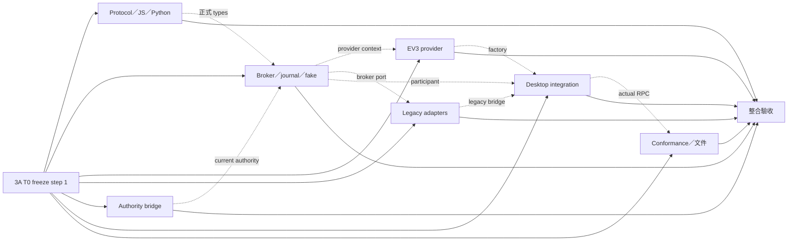

# Kobrixa 插件系統 3A：Device broker 與 builtin EV3 provider

日期：2026-10-17  
狀態：子專案設計；凍結 Plugin API **1.5.0** 的設備契約與實作邊界，尚未實作或完成自動化／MANUAL 驗收。

- Binding authority：[第三階段 umbrella](2026-10-17-plugin-system-stage-3-design.md) §2 決策 1–15、§3.1–3.3、§4.1–4.8 的 3A 列、§5.1、§7 freeze step 1；其決策、版本、矩陣及 hotspot ownership 不變。
- 上層：[主規格](2026-10-14-plugin-system-design.md)；結構沿用 [2A](2026-10-16-plugin-system-2a-build-chain-design.md)、[2B-1](2026-10-16-plugin-system-2b1-diagnostic-source-design.md)、[2B-2](2026-10-16-plugin-system-2b2-language-services-design.md)、[2C §11](2026-10-17-plugin-system-2c-static-languages-design.md#11-實作切分)。程式碼盤點以 §1.1 及各節的 repository citations 為依據，產品決策以 umbrella 為準。
- 本文所有公開 `devices/*`、`events/*` 方法、下列 wire types、broker／provider／lifecycle ports 與新模組路徑均為**新增設計**。標成「現有」者已核對實際程式碼；不把私有 Electron API 說成已存在的插件 API。

## 1. 範圍與交付界線

3A 交付 main 的唯一 device broker、builtin EV3 provider、公開 devices consumption、共享 sampler、recording reservation、authority continuation、fault journal／quarantine、兩個 SDK 與 fake-provider conformance。legacy deploy／run／remote-files／battery／monitor／motor／Lab 的設備存取在本子專案全部轉進 broker，不能等 UI 遷移才取消旁路。

3A 不交付 motor／Lab／device 的公開產品 UI，不修改第三階段既定的 hide／disable 行為，不提供第三方 provider、raw opcode、任意 remote filesystem RPC、公開 deploy API、通用 services bus、多設備 UX、HTML panel、managed Python 或產生式 Python bindings。`kobrixa.ev3` 編譯後端與 `kobrixa.device-ev3` provider 分開；前者的必要 builtin 政策保持不變。

1.5.0 的 motion consumer 須取得 host 簽發的 UI lifetime binding；3A 先以可信 host fixture 接入。沒有 3B-1 的真實 panel／gesture port 時，產品 motion 顯示 unavailable，不能用插件 timer 或 legacy channel 補洞。3C 仍須另以 1.6.0 完成 public-only motor proof。

### 1.1 已核對的遷移起點

| 現有來源                                                                                                                                                                   | 已存在的責任／需要改變之處                                                                                                                                                                                                                  |
| -------------------------------------------------------------------------------------------------------------------------------------------------------------------------- | ------------------------------------------------------------------------------------------------------------------------------------------------------------------------------------------------------------------------------------------- |
| [`main/device/device.ts`](../../../apps/desktop/src/main/device/device.ts) 的 `DeviceService`                                                                              | 建立 `UsbTransport`／`WiFiTransport`，持有 session、foreground／monitor maps、USB recovery；`withMotorTest` 維持整段 foreground ownership。移出 transport 與 EV3 實作，留下 legacy façade；仲裁歸 broker。                                  |
| [`motor-test-service.ts`](../../../apps/desktop/src/main/device/motor-test-service.ts)、[`motor-test-image.ts`](../../../apps/desktop/src/main/device/motor-test-image.ts) | renderer sender／test ID、finite motion、helper token、preflight、readback。抽出 provider engine；不能原封不動保留 renderer owner 或只查取消 signal。                                                                                       |
| [`monitor-service.ts`](../../../apps/desktop/src/main/device/monitor-service.ts)                                                                                           | 單 clock、500 ms post-poll delay、visible／recording demand。轉成 principal 計數與 subscriptions；不再以單一 `visible` 欄位互相撤銷 demand。                                                                                                |
| [`file-batch.ts`](../../../apps/desktop/src/main/device/file-batch.ts)、[`remote-files.ts`](../../../apps/desktop/src/main/device/remote-files.ts)                         | main 擁有 local paths、native dialogs、plan 與 partial results；確認等待目前無 TTL，batch 取消主要在 entry 邊界。增加 lease 與每個 transfer exchange 的續行檢查。                                                                           |
| [`packages/device/src/contracts.ts`](../../../packages/device/src/contracts.ts)、[`session.ts`](../../../packages/device/src/session.ts)                                   | `DeviceSession` 是可信函式庫介面，不是 wire；`EV3DeviceSession` 包含多 chunk transfer、rename 的 copy／verify／remove，現有 file exchanges 為 10 秒。新增底層 boundary hook；file-transfer exchange 保留 10 秒，其餘普通 exchange 為 5 秒。 |
| [`motor.ts`](../../../packages/device/src/motor.ts)                                                                                                                        | motor exchange 2 秒、USER_SLOT guard、token ownership；provider 重用，broker 不匯入 opcode。                                                                                                                                                |
| [`main/collab/device-control.ts`](../../../apps/desktop/src/main/collab/device-control.ts)                                                                                 | `DeviceControlGate` 目前 `false` 才限制、缺值／`null` 放行；`rememberBatch` 已拒絕偽造 download。改為可信 context registry，保留 main plan 分類。                                                                                           |
| [`main/ipc.ts`](../../../apps/desktop/src/main/ipc.ts)、[`main/index.ts`](../../../apps/desktop/src/main/index.ts)                                                         | trusted sender、feature 私有 IPC、motor／Lab 組裝、close／disconnect hooks。由 desktop integration owner 接 broker factories／adapters。                                                                                                    |
| [`UpdateOperationGate`](../../../apps/desktop/src/main/updates/service.ts)                                                                                                 | 依 channel 名稱限制更新期間工作；新增 operation-class port，插件 RPC 與 legacy 走同一判斷。                                                                                                                                                 |
| [`SensorLabService`](../../../apps/desktop/src/main/sensor-lab/service.ts)                                                                                                 | 共用 monitor stream、fresh sample、錄製／checkpoint；3A 僅更換設備 dependencies，recorder／資料遷移歸 3D／3B-2。                                                                                                                            |
| [`BatteryStatus`](../../../apps/desktop/src/renderer/device/battery-status.ts)、[`ExecutionController`](../../../apps/desktop/src/renderer/execution/execution.ts)         | battery 30 秒輪詢並接受 monitor snapshot；execution 的 `withFiles`／`withMonitor` 是 UI 協調。它們不能作為主程序授權或鎖。                                                                                                                  |
| [`methods.ts`](../../../packages/plugin-protocol/src/methods.ts)、[`rpc.ts`](../../../packages/plugin-protocol/src/rpc.ts)                                                 | 現有四個 requests、兩個 notifications；failure envelope 只有 numeric code／message。新增業務 result union，保留舊 envelope。                                                                                                                |

## 2. 決策紀錄

下表是由 umbrella 與現有程式導出的工程決定；A13–A18 記錄 [umbrella §2 決策 10–15](2026-10-17-plugin-system-stage-3-design.md#2-決策紀錄) 的最終約束，不重新開啟產品選項。

| 編號 | 決定與理由                                                                                                                                                                                                                                                                                                            |
| ---- | --------------------------------------------------------------------------------------------------------------------------------------------------------------------------------------------------------------------------------------------------------------------------------------------------------------------- |
| A01  | broker 是 main 唯一 ownership／authority／deadline owner；provider 保留 EV3 transport、helper 與 firmware knowledge。函式庫內 `exclusive` 可保留為重入斷言，不能成為第二個排程器。                                                                                                                                    |
| A02  | operation 先 prepare 再 start；prepare 不做 I/O、不占 foreground。start 原子消耗 reference，接受後立即回 snapshot，完成走 query／event，避免長 motion RPC 形成第二次啟動。                                                                                                                                            |
| A03  | 不提供 public keepalive／lease-renew RPC。motion intent 只由 3B-1 host port 更新；取得 reference 不代表能延長 gesture、panel 或 firmware clock。                                                                                                                                                                      |
| A04  | finite motion 與 legacy program launch 都在可能發動設備前提交 pending safety marker。一般 user program 不被改成 30 秒有限 motion；其 launch 工作有期限，持續執行的風險另由 active marker／stop 管理。                                                                                                                 |
| A05  | `dispatch`、`movement`、`stopConfirmation` 分開。transport timeout、程序退出、取消、helper 檔案刪除成功均不能證明停止。                                                                                                                                                                                               |
| A06  | 依 umbrella §2 決策 15，EV3 file-transfer exchanges（含 helper upload）維持現有 10 秒，其他 ordinary exchanges 5 秒，motor exchanges 2 秒。取消、15 秒 stop 與 overall deadlines 不延長；USB／Wi-Fi 大檔案證據見 A-M01／A-M06。                                                                                       |
| A07  | confirmation lease 固定 120 秒 idle／自 plan 建立最多 600 秒；開始 transfer 後仍受同一 file／deploy 600 秒總期限，確認不重置總期限。                                                                                                                                                                                  |
| A08  | journal 使用 core 獨立 atomic store，不借用 feature storage namespace。5 秒 commit bound；失敗／逾時阻擋新風險工作，已發生的停止仍立即執行。                                                                                                                                                                          |
| A09  | physical identity 優先 serial；address／HID path 不足以跨重連確認同一 brick。弱身分 fault 需 core 明確配對目前設備與 read-only idle reconciliation，不能按同 IP 自動解除。                                                                                                                                            |
| A10  | 共用 result／event schema 在 1.5.0 建立；不改 1.4.0 `initialize`／`command/execute` envelope。額外能力以握手後 `devices/negotiate` 查詢，舊 consumer 不收到新增通知。                                                                                                                                                 |
| A11  | sampler 原始 frame 與 display stream 分開；recording 可取保留 samples 或精確 gap，不回填成功值。reserve 不改 mode、不賦予 control。                                                                                                                                                                                   |
| A12  | retirement 即刻撤銷一般 authority；stop cleanup 有獨立 signal／15 秒期限，recording final data 透過與 3B-2 對齊的 drain port。feature deactivate 不承擔安全責任。                                                                                                                                                     |
| A13  | umbrella §2 決策 10：desktop integration owner 在任何 provider／journal／persistence 初始化前取得 Electron `app.requestSingleInstanceLock()`，以唯一 `ProfileWriterLock` port 供 journal 與 3B-2 共用。第二次啟動聚焦既有視窗後退出，不建立 native file-lock addon 或第二個降級 runtime；文件／smoke 記錄此行為變更。 |
| A14  | umbrella §2 決策 11：3B-1 的右側「插件工具／Plugin tools」pane（`rightPanel: "plugins"`）以 motor-test／sensor-lab／device-ev3 為 sibling tabs，與 EV3／collaboration panes 互斥，motor 離開 monitor card。3A 接收真實 tab／pane visibility，切換停止 motor、保留 Lab background recording。                          |
| A15  | umbrella §2 決策 12：使用者 Disconnect 是一個 core action，先顯示 motor stop/readback、recording end/save 進度，成功後才斷線；失敗保留 blocker／retry。plugin `devices/disconnect` 仍不能強斷其他 owner，active operation／reservation 時回 busy。                                                                    |
| A16  | umbrella §2 決策 13：OS suspend 撤 motion intent、要求 stop/readback，結束並保存背景 Lab recording；OS 未留足時間則保留 unconfirmed／interrupted／最後 committed checkpoint。wake 不自動恢復 motion 或錄製。                                                                                                          |
| A17  | umbrella §2 決策 14：本階段三個 optional builtins 預設啟用，一般使用者可在插件設定逐一切換，無需 developer mode；3A 消費 3B-1 的持久化 enable／safe-mode policy，不把 provider 的 builtin 身分當成永久啟用。                                                                                                          |
| A18  | umbrella §2 決策 15：file-transfer 維持經硬體驗證的 10 秒；不實施先前 5 秒縮限，也沒有待硬體結果決定的替代 timeout。驗收仍確認 10 秒 exchange 內失權／取消／stop 的安全收尾，不足證據時標未驗，不默改數值。                                                                                                           |

## 3. 身分、世代與 authority

### 3.1 固定詞彙與 handle

| 詞彙                              | 凍結語意                                                                                                                                                                                                                                           |
| --------------------------------- | -------------------------------------------------------------------------------------------------------------------------------------------------------------------------------------------------------------------------------------------------- |
| `pluginId`                        | 已驗證 manifest 顯示／宣告 namespace；request 不接受用它自稱 caller。                                                                                                                                                                              |
| `sourceKey`                       | 現有 registry 根身分。`developmentSourceKey` 為 resolved directory 的 SHA-256 前 16 hex，格式 `dev:<16 hex>`；builtin 為 `builtin:<id>`。不以改 manifest ID 移轉資料或權限。                                                                       |
| `generation`                      | execution／service generation；reload、executable metadata change、retirement、disable、crash／restart 撤銷舊 authority。                                                                                                                          |
| `staticGeneration`                | 現有 static contribution 世代；其 DTO 的 `generation` 不能拿來授權 execution。                                                                                                                                                                     |
| `uiResourceGeneration`            | 3B-1 resource／panel binding 世代；replace／retry 撤銷舊 scope，不延續 motion。                                                                                                                                                                    |
| `hostEpoch`／`processEpoch`       | 每次 host 啟動／process instance 的隨機不透明 ID；即使 generation 數字重用也不接受舊資源。                                                                                                                                                         |
| `providerGeneration`／`sessionId` | provider factory lifetime／每次連線的新 ID。UI process restart 不等同 provider restart；reconnect 不繼承操作、訂閱、gesture 或 reservation。                                                                                                       |
| `principal`                       | host 的 source、plugin、execution generation、兩個 epoch、authorityContext 關聯。core principal 在不同內部 union branch，不擴張現有 public sourceKey regex。                                                                                       |
| `authorityContext`                | workbench／room 的可信 binding 與 epoch；插件可傳回已簽發 reference，不能選 window、role、holder、room epoch。                                                                                                                                     |
| `operation`／`lease`              | operation 是一次工作及其 retained outcome；lease 是可續行資格與期限。沒有任意續租權，也不是 collaboration holder。                                                                                                                                 |
| `reservation`                     | 一個 recording 的 mode pins／motion 排除／sampler demand；不占 foreground、不含設備寫入權。                                                                                                                                                        |
| `panelInstance`／`gesture`        | host UI lifetime／實際 hold 意圖；gesture 不能由普通 timer 生成，panel heartbeat 不能創造 gesture。                                                                                                                                                |
| `revision`／`sequence`            | revision 的表示法依 domain：device／UI snapshot 為 `Counter`，settings／records 使用 3B-2 的 `SettingsRevision`／`RecordRevision`；不得跨 API 比較、排序或轉型。sequence 為 `Counter`，比較範圍含 owner、generation、epoch，本身不構成 authority。 |

所有新增 wire object 採 strict schema，未列出的欄位拒絕；optional 欄位缺省與 `null` 不混用。下列縮寫在本文是正式 schema alias：

```ts
// 新增；wire 上均為 JSON，品牌型別僅供 TS 編譯檢查。
type Handle = string; // UUID v4，小寫 canonical；host 產生、永不重用。
type Counter = number; // integer，0..Number.MAX_SAFE_INTEGER。
type Timestamp = number; // Unix epoch milliseconds，0..Number.MAX_SAFE_INTEGER。
type BoundedId = string; // 1..64 ASCII，^[A-Za-z0-9][A-Za-z0-9:._-]*$。
type SessionRef = { sessionId: Handle };
type OperationRef = { operationId: Handle };
type ReservationRef = { reservationId: Handle };
type SubscriptionRef = { subscriptionId: Handle };
type ResourceOwner = {
  sourceKey: string; // 沿用 registry sourceKey 語法、max 160。
  pluginId: string; // 沿用 namespacedIdSchema。
  generation: Counter;
  hostEpoch: Handle;
  processEpoch: Handle;
};
```

host lookup key 含 ResourceOwner 全部欄位；device resource 再含 provider source／providerGeneration／sessionId，motion 再含 context epoch／scope／gesture。這些 association 存在 host map，不從 caller 傳入的 descriptor 重建。foreign、未發行、已撤銷的 handle 均回 `PLUGIN_E_STALE_RESOURCE`，不透露另一 owner 的 operation／subscription 是否存在。

新增 host-only `Principal` 正式型別如下；`JournalOwner` 在 §7.1 定義。兩 branch 只由 host constructor 建立，不是可從 JSON parse 的授權物件。3B-1／3B-2 使用這個 principal port 或其 owner projection，不自行另定可偽造的 caller DTO。

```ts
type AuthorityBinding = { ref: Handle; epoch: Handle } | null;
type Principal =
  | { kind: "plugin"; owner: ResourceOwner; authorityContext: AuthorityBinding }
  | (Extract<JournalOwner, { kind: "core" }> & { authorityContext: AuthorityBinding });
```

operation tombstone 至少保留於同 process lifetime 的 bounded cache；被淘汰的 ID 仍永不重新配置，lookup miss 拒絕，因此延遲 start 永不復活。新的 process 不得 query／stop 舊 principal 的操作；core retained fault view 可提供獨立安全停止，不把舊 handle 轉交新 process。持久化 namespace 不綁 transient epoch，journal 記錄也不成為可執行 capability。

### 3.2 Host authority context

新增內部 `AuthorityContextRecord`：

```ts
// host-only；不得從 plugin JSON 建立。
type AuthorityContextRecord = {
  ref: Handle;
  epoch: Handle;
  workbenchInstance: Handle;
  state: "local" | "joining" | "room" | "unsynced" | "invalid";
  roomBinding: Handle | null;
  connected: boolean;
  synced: boolean;
  role: "host" | "editor" | "viewer" | null;
  isHolder: boolean;
};
```

可信 main-frame IPC 建立／更新 context；navigation、window destroyed、room join／leave／reconnect、demotion、grant／reclaim／release 或同步資格改變均推進 epoch，撤銷舊工作 continuation。`local` 必須是 workbench 已明確回報離開協作的有效狀態，不能用沒有 holder 記錄代替。無 context、joining、unsynced、invalid、viewer 或非 holder 全部拒絕 consequential writes。離開房間取得新的 local context，也不續行已撤銷的 upload／motion。

`devices/context` 的公開 snapshot 只含 `{contextRef: Handle | null, revision: Counter, state: "local" | "allowed" | "restricted" | "unbound", reason: "local" | "holder" | "joining" | "unsynced" | "not-holder" | "viewer" | "window-lost" | "unbound"}`。不暴露 room participant IDs 或可自行設定的 role。process 可有 host 綁定的預設 workbench；多個 invocation 各持自己的 contextRef，不使用「最後一次 command 的全域 context」。3B-1 將此 reference 放入其 command invocation context；1.5.0 fixture 由 host binder 提供。

read／browse／download／connection management 不要求 holder，但仍驗證 source、session、enable、operation class 與 ownership。普通 consumer 不能用 connect／disconnect 替換另一人的 active foreground／recording；回 `PLUGIN_E_DEVICE_BUSY`。依 umbrella §2 決策 12，使用者只需一次 Disconnect，由 core 顯示停止／保存進度、完成 stop/readback 與 recording end/save 後才斷線，無需先另按 Stop。停止自己的操作與 core recovery stop 不因失權而被禁止。

### 3.3 Admission 與 continuation

admission 順序固定：wire validation → caller binding／版本 → permission → source lifecycle → handle ownership／session → capability → operation-class gate → authority／UI scope → journal health／quarantine → reservation／foreground conflict。處理 foreign handle 時先隱藏 owner 資料；錯誤先後不得造成資料洩漏。

broker 在 start 消耗 reference 與保留 foreground 之間不 `await`；保留後才 drain 已開始的 monitor exchange。每個 await 返回先驗 current owner／session／epoch／deadline／cancel，再採用結果；每個 consequential exchange 的送出之前再驗一次。兩次檢查間不可插入另一個 await；不以事前拿到的 boolean authorize 後續步驟。

失權先同步撤銷 lease／新副作用資格，再發出事件與 stop。已送 exchange 等其既有有界結果，不因搶鎖而 abort USB read；下一個 upload chunk、helper run／arm、pulse、mode write、rename remove、batch entry 均不開始。已發生的 partial writes 保留，無 rollback 宣稱。cleanup 不得藉安全名義刪任意檔案：只有停止／readback／關閉既有 transfer handle；helper 檔案刪除仍需一般 write authority，失權時留檔並回 bounded warning。

## 4. Manifest、capability 與相容性

### 4.1 Provider 與 consumer 宣告

新增 `contributes.deviceProviders` 是 strict entries array，最多 1 個，builtin 正常宣告必須有 1 個；entry 為 `{id: namespacedId, capabilities: CapabilityId[]}`，capabilities 非空、最多 5 個且唯一。產品註冊為：

```json
{
  "id": "kobrixa.device-ev3",
  "capabilities": [
    "connection.v1",
    "telemetry.v1",
    "inputModes.v1",
    "finiteMotion.v1",
    "recordingReservation.v1"
  ]
}
```

來源限制在 loose manifest parse／其他語意之前檢查 own property：非 builtin 出現 `contributes.deviceProviders`，包含 `[]`、`null`、錯誤型別，一律整個 source invalid，回 `PLUGIN_E_DEVICE_PROVIDER_REQUIRES_BUILTIN`。`runtime.kind: "builtin"` 自稱或 `devices.provide` permission 不產生資格；後者不是合法 permission。static runtime 禁止該 contribution。factory 只來自 host allowlist，產品唯一 allowlist key 是 `builtin:kobrixa.device-ev3`／provider ID `kobrixa.device-ev3`；測試 fake factory 由 test composition 額外注入，不進產品 manifest loader。

新增 consumer manifest 欄位：`requires: {devices: Array<{capability: string, required: boolean}>}`。`requires`／entry strict，devices 1–5 個且 capability 不重複；capability 語法 `^[A-Za-z][A-Za-z0-9]*\.v[1-9][0-9]*$`，最多 64 字元。version 已編在名稱，不另加易矛盾的 version number。合法但不支援的 capability／version 是 unavailable，不是未知 JSON 欄位；`required: true` 讓 feature 呈現不可用原因，但仍可啟動其說明／復原 UI，不隱式啟用 provider。

新增能力／permission 配對如下；capability 是 provider 可做的事，permission 是 consumer 可用的事，authority／lease 則是此刻可續行的資格。

| Capability                | Permission                                  | 契約                                                                                              |
| ------------------------- | ------------------------------------------- | ------------------------------------------------------------------------------------------------- |
| `connection.v1`           | `devices.read`／`devices.connect`           | catalog／探索資料與 connect／disconnect；候選 ID 或經驗證的 IP literal，無 transport descriptor。 |
| `telemetry.v1`            | `devices.read`                              | read、channel definitions、subscriptions、busy／gap／source-change。                              |
| `inputModes.v1`           | 查詢 `devices.read`；變更 `devices.control` | mode query／set；變更需 authority、fresh source、無 recording reservation。                       |
| `finiteMotion.v1`         | `devices.control`                           | prepare／start／query／stop；query／stop 原 owner 在失去 holder 後仍可用。                        |
| `recordingReservation.v1` | `devices.read`                              | pin 已存在的 channel modes、共享 sampler、排除 motion；不變更 mode。                              |

provider 重複 ID／physical identity 由 registry 明確標 `PLUGIN_E_PROVIDER_CONFLICT`，所有衝突 claimant 均不可選，不以載入先後決定。單一 provider 對同一 serial 的 USB／Wi-Fi 候選可合併為同一 physical device 的兩個 endpoints；同 endpoint 重複或無法判定合併則報衝突。

### 4.2 版本批次與握手

1.5.0 批次同步 `PLUGIN_API_VERSION`、schema `$id`、JS `API_VERSION`、Python `API_VERSION`、bundled JSON Schema、conformance 與 devices fixtures 的 manifest 最低 `^1.5.0`；SDK package version 與 Plugin API version 不混用。

保留現有 `initialize` 的 params／result、`command/execute` 的 `{command}` → `null`、numeric failure envelope。新 SDK 先讀 initialize 的 host API，完成握手後才可呼叫 `devices/negotiate`；host 只對已協商 1.5 devices 並建立 subscription 的通道發新事件。不能在 JS `activate` 等待尚未完成 initialize 的 negotiate，SDK client 使用 lazy readiness barrier。舊 API host 不接受新方法時，SDK 回明確 unavailable，沒有 legacy preload fallback。

`devices/negotiate {}` → `BusinessResult<{devicesContractVersion: 1, eventVersion: 1, capabilities: CapabilityAvailability[], requirementsSatisfied: boolean}>`。availability 最多 5 個已知能力，加上最多 5 個 manifest requirements 的去重結果，每筆 `{capability, state: "available" | "provider-unavailable" | "no-session" | "unsupported", providerId: string | null}`；capability 字串沿用 requirement 語法。provider 尚未啟用時也須回明確狀態。每個實際方法仍 fresh validation，negotiate 不是永久授權。

`devicesContractVersion: 1` 固定表示此設備契約；host semver 仍由 initialize 取得，1.6／1.7／1.8 host 不把它誤報成 1.5.0。

3B-1／3B-2／3D 分別在 1.6.0／1.7.0／1.8.0 接續，不能為本 3A 任務預先寫入它們的 required fields 或 error codes。1.6.0 可擴充自己的 command context，但不更改本 devices contract。

## 5. 公開 wire types、方法與 events

### 5.1 共用結果與錯誤

```ts
// 新增；每個方法以具體 Value／Detail union 匯出 schema，沒有 any JSON detail。
type BusinessResult<Value, Detail> =
  | { ok: true; value: Value }
  | { ok: false; error: { code: PluginErrorCode; message: string; detail?: Detail } };

type DispatchOutcome = "not-sent" | "sent" | "unknown";
type DeviceErrorDetail = {
  kind: "device";
  reason: DeviceErrorReason;
  operationId?: Handle; // 只可附 caller 自己已取得的 operation。
  dispatch: DispatchOutcome;
  stopConfirmation: "not-required" | "pending" | "confirmed" | "unconfirmed";
};
type PermissionErrorDetail = {
  kind: "permission";
  reason: "permission" | "user-action-required";
};
type ResourceKindV150 =
  "operation" | "subscription" | "candidate" | "reservation" | "journal" | "rpc";
type ResourceKind = ResourceKindV150; // 1.5.0；後續批次依下表擴充閉合 union。
type ResourceErrorDetail = {
  kind: "resource";
  reason: "stale" | "quota" | "rate" | "queue";
  resource: ResourceKind;
  limit?: number; // nonnegative safe integer。
};
```

`message` 最多 2,000 Unicode code points；detail 序列化最多 4 KiB，整個 error 最多 16 KiB，無 stack、native path、serial、local filename。文字不作 UI 分支依據。共同 code schema 從現有 [`plugin-runtime/errors.ts`](../../../packages/plugin-runtime/src/errors.ts) 搬至 protocol，保留全部原字串，runtime import／re-export；3A 增列下表，後續批次依下述 registry 擴充自己的 detail union。`PluginProblem` 的既有 static-language detail 不強制改成設備 detail。

共同 detail 採 `kind` discriminated registry，**每個新增 domain 的版本批次加入自己的 `kind`**，不重寫已凍結 branch，也不讓同一 shared code 在不同 domain 回不同 reason。1.5.0 建立 `device`、`permission`、`resource`；1.6.0 由 [3B-1 §5](2026-10-17-plugin-system-3b1-declarative-ui-design.md) 加入 `ui`；1.7.0 由 [3B-2 §3.2](2026-10-17-plugin-system-3b2-settings-storage-design.md#32-結果與失敗-detail) 加入 `persistence`。後兩者的專屬 detail 僅配各自專屬 codes，所有 shared permission／stale／resource-limit errors 原樣匯入本節型別。正式 schema 驗證 code／kind／reason 的合法組合，不能以任意 string 或任意 JSON 擴充。

`ResourceErrorDetail.resource` 亦為按版本批次擴充的閉合 enum；下表凍結字面值，後續批次才加入其正式 protocol／SDK schemas，1.5.0 不提前發布 sibling 功能。

| API 批次    | 新增 resource 字面值                                                               | 用途                                                                                          |
| ----------- | ---------------------------------------------------------------------------------- | --------------------------------------------------------------------------------------------- |
| 1.5.0／3A   | `operation`、`subscription`、`candidate`、`reservation`、`journal`、`rpc`          | 本設備契約／共用 ledger。                                                                     |
| 1.6.0／3B-1 | `ui-binding`                                                                       | UI instance／binding 的 stale、quota、rate、queue。                                           |
| 1.7.0／3B-2 | `storage-write`、`storage-read`、`storage-list`、`storage-export`、`storage-watch` | write／read／list／export handles 與 settings watch；watch 同時計入共用 subscription ledger。 |

缺 consumer permission 一律 `kind:"permission", reason:"permission"`，缺可信使用者動作一律 `kind:"permission", reason:"user-action-required"`；不另造 `missing-permission`。foreign／expired handle 用 resource `stale`，handle／byte quota 用 `quota`，速率用 `rate`，bounded queue 用 `queue`；不能另造 `owner-or-lifetime`／`handle-limit`／`byte-limit`／`queue-limit`。各 domain 的 revision 表示法不影響此共用分類。

| code                                                                     | `detail.reason`／判定                                                                                                                                                                                                                                   |
| ------------------------------------------------------------------------ | ------------------------------------------------------------------------------------------------------------------------------------------------------------------------------------------------------------------------------------------------------- |
| `PLUGIN_E_PERMISSION_DENIED`                                             | `kind:"permission"`，reason `permission`／`user-action-required`；已辨識業務方法缺 consumer permission／可信使用者動作。                                                                                                                                |
| `PLUGIN_E_STALE_RESOURCE`                                                | resource `stale`；foreign／expired／retired／unknown handle、revision 不再有效。                                                                                                                                                                        |
| `PLUGIN_E_RESOURCE_LIMIT`                                                | resource `quota`／`rate`／`queue`；上限前拒絕，不截斷合法工作參數。                                                                                                                                                                                     |
| `PLUGIN_E_DEVICE_PROVIDER_REQUIRES_BUILTIN`                              | manifest registry error；非 builtin provider 欄位存在，不走 RPC。                                                                                                                                                                                       |
| `PLUGIN_E_DEVICE_UNAVAILABLE`                                            | `provider-disabled`、`disconnected`、`quarantined`、`ui-scope-unavailable`。                                                                                                                                                                            |
| `PLUGIN_E_DEVICE_CAPABILITY`                                             | `unsupported-capability`；能力或版本不符。                                                                                                                                                                                                              |
| `PLUGIN_E_DEVICE_BUSY`                                                   | `foreground`、`recording`、`connecting`、`source-changing`；無排隊重試承諾。                                                                                                                                                                            |
| `PLUGIN_E_DEVICE_AUTHORITY`                                              | `unbound`、`joining`、`unsynced`、`not-holder`、`viewer`、`authority-changed`、`scope-expired`。                                                                                                                                                        |
| `PLUGIN_E_DEVICE_OPERATION`                                              | `preflight-program-running`、`preflight-output-unknown`、`preflight-output-moving`、`motor-unavailable`、`source-changed`、`mode-unavailable`、`provider-failure`、`provider-contract`、`journal-unwritable`、`journal-corrupt`、`identity-ambiguous`。 |
| `PLUGIN_E_DEVICE_STOP_UNCONFIRMED`                                       | `readback-failed`、`stop-deadline`、`connection-lost`、`provider-stalled`；即使原因是 timeout，也不能只回普通 timeout 掩蓋停止不確定。                                                                                                                  |
| 既有 `PLUGIN_E_TIMEOUT`／`PLUGIN_E_CANCELLED`                            | `deadline`／`cancelled`；只在能保留真實 dispatch／stop outcome 時使用。                                                                                                                                                                                 |
| 既有 `PLUGIN_E_DISABLED`／`PLUGIN_E_SAFE_MODE`／`PLUGIN_E_SHUTTING_DOWN` | `disabled`／`safe-mode`／`shutting-down`；阻擋一般 admission，host cleanup 仍可行。                                                                                                                                                                     |
| 既有 `PLUGIN_E_CRASHED`／`PLUGIN_E_PROTOCOL`                             | `process-lost`／`protocol`；資源退休，安全結果另留 ledger。                                                                                                                                                                                             |
| 既有 `PLUGIN_E_PROVIDER_CONFLICT`                                        | `provider-conflict`；registry／discovery 明確隔離衝突，不選第一個。                                                                                                                                                                                     |

`DeviceErrorReason` 正是上表 device／既有業務錯誤列出的有限字串 union；不接受任意 reason。未列的既有 runtime errors 繼續原用途；`PLUGIN_E_STATE_SAVE`／`PLUGIN_E_STATE_CORRUPT` 仍限 administration store，journal 使用上述 journal reasons，feature records 的錯誤由 3B-2 定義。

JSON 語法／request envelope／unknown method／無效 params 分別沿用 `RPC_ERRORS.parseError`、`invalidRequest`、`methodNotFound`、`invalidParams`。RPC peer 等待逾時／通道斷開沿用 numeric `timeout`／`connectionClosed`；SDK 不把它翻譯成「設備未執行」。舊 `ui/showMessage` 等方法可維持 numeric `permissionDenied`，新增 devices 方法一旦通過 wire validation，其授權／設備失敗回 BusinessResult。未受理而取消可回 numeric `requestCancelled`；已受理 operation 的取消必須留下 snapshot，不能只讓 transport exception 吃掉終態。

### 5.2 Descriptor、session 與 channel

```ts
// 新增；只列 wire 欄位，不暴露 DeviceDescriptor.metadata。
type CapabilityId =
  | "connection.v1"
  | "telemetry.v1"
  | "inputModes.v1"
  | "finiteMotion.v1"
  | "recordingReservation.v1";
type DeviceCandidate = {
  candidateId: Handle;
  providerId: string; // namespacedId。
  name: string; // 1..200 code points，單行。
  transport: "usb" | "wifi" | "mock"; // mock 只可由 test host 發布。
  address?: string; // IP literal，max 45；只在 Wi-Fi 顯示。
  identity: "stable" | "session-only" | "ambiguous";
  expiresInMs: number; // 0..30000，提示值，host monotonic clock 才具權威。
};
type DeviceSessionSnapshot = {
  sessionId: Handle;
  providerId: string;
  providerGeneration: Counter;
  revision: Counter;
  name: string;
  transport: "usb" | "wifi" | "mock";
  capabilities: CapabilityId[]; // unique，最多 5。
  state: "connected" | "quarantined" | "disconnecting" | "disconnected";
  foreground: "none" | "motion" | "program" | "file" | "mode" | "recovery";
  recording: boolean;
  sourceRevision: Counter;
};
type ChannelDefinition = {
  channelId: Handle;
  kind: "input" | "output-angle" | "battery-percent" | "battery-voltage";
  portId: BoundedId | null;
  typeId: BoundedId;
  modeId: BoundedId | null;
  component: number; // integer 0..7。
  name: string; // 1..80。
  modeName: string; // 0..80。
  unit: string; // 0..32。
  decimals: number; // integer 0..9。
  state: "ready" | "empty" | "initializing" | "unknown" | "error";
};
type ActuatorDefinition = {
  actuatorId: Handle;
  portId: BoundedId;
  name: string; // 1..80。
  typeId: BoundedId;
  state: "ready" | "empty" | "initializing" | "unknown" | "error";
};
type SourceCatalog = {
  sessionId: Handle;
  sourceRevision: Counter;
  channels: ChannelDefinition[]; // 最多 38：4×8 inputs、4 outputs、2 battery。
  actuators: ActuatorDefinition[]; // 最多 4。
};
type TelemetryFrame = {
  sequence: Counter; // session sampler sequence，與 event sequence 分開。
  sampledAt: Timestamp; // host receipt wall clock，顯示／匯出用途。
  elapsedMs: number; // nonnegative finite，session monotonic origin。
  sourceRevision: Counter;
  status: "ok" | "busy" | "error" | "gap";
  values: Array<{ channelId: Handle; value: number | null }>; // 最多 38，finite numbers。
  program: "stopped" | "running" | "unknown";
  gap?: { fromSequence: Counter; toSequence: Counter; reason: "busy" | "overflow" | "read-error" };
};
type ReadSnapshot = {
  sessionId: Handle;
  revision: Counter;
  status: "fresh" | "stale" | "busy" | "unavailable";
  ageMs: number | null; // monotonic age；沒有 sample 時 null。
  frame: TelemetryFrame | null;
};
type InputModesValue = {
  sourceRevision: Counter;
  portId: BoundedId;
  typeId: BoundedId;
  currentModeId: BoundedId | null;
  modes: Array<{ modeId: BoundedId; name: string }>; // 0..8，name 1..80。
};
```

channel ID 由 host 針對 session／port／type／mode／component／unit 的 source identity 發行；type／mode／unit／接線改變即換 ID 並增 sourceRevision。名稱修正更新 catalog revision，不偽造 sample。EV3 input／output 的 raw type 數字由 provider 映射為 `ev3:<number>`；port label 映射 `in:1`–`in:4`／`out:A`–`out:D`，不讓 generic broker hardcode EV3 類型。`inputModes.v1` 的 mode IDs 為 `ev3:<number>`；provider 可驗證映射，不接受 raw opcode。

缺值一律 `null`，不能用 NaN／Infinity／上次數值冒充新值。`busy` frame 可保留上次 snapshot 作展示，但其新 frame 的 values 為 null；freshness 由最後成功讀取的 receipt monotonic clock 判定。recording source 僅可選 ready input／output-angle，最多 4 個；battery 可訂閱但不是本版 Lab recording source。

### 5.3 Methods：catalog、connection、reads 與 modes

下表所有 results 均包 BusinessResult；`{}` 是 strict empty object。所有 ID／大小／唯一性規則在 host 和 SDK 相同，參數中沒有 sourceKey、owner、role 或 native path。

| 方法                       | Params                                                                                                             | 成功 value／語意                                                                                                                                                                                                  |
| -------------------------- | ------------------------------------------------------------------------------------------------------------------ | ----------------------------------------------------------------------------------------------------------------------------------------------------------------------------------------------------------------- |
| `devices/negotiate`        | `{}`                                                                                                               | §4.2；不啟用 provider。                                                                                                                                                                                           |
| `devices/context`          | `{contextRef?: Handle}`                                                                                            | §3.2 snapshot；省略時只查 host 已綁預設 context，沒有則 unbound。                                                                                                                                                 |
| `devices/list`             | `{}`                                                                                                               | `{revision, providers: [{providerId, state, capabilities}], sessions: DeviceSessionSnapshot[]}`；providers 最多 8，state 為 `available/disabled/conflict/failed`，sessions 最多 1。                               |
| `devices/discover`         | `{providerId: namespacedId}`                                                                                       | `{candidates: DeviceCandidate[]}`，最多 32；超限明確 resource-limit，不截斷成看似完整清單。                                                                                                                       |
| `devices/connect`          | `{target: {kind: "candidate", candidateId}                        \| {kind: "wifi-address", providerId, address}}` | `{session: DeviceSessionSnapshot}`；只接受 canonical IPv4／IPv6 literal，禁止 hostname、URL、zone ID、port／credentials，固定由 EV3 provider 選協定端點。                                                         |
| `devices/disconnect`       | `{sessionId}`                                                                                                      | `{session: DeviceSessionSnapshot}`，state disconnected；active operation／reservation 時 busy，不可 force-disconnect 其他 owner。使用者的一次 core Disconnect 先 stop/readback、end/save，成功後才斷線（§10.1）。 |
| `devices/session`          | `{sessionId}`                                                                                                      | `{session: DeviceSessionSnapshot, sources: SourceCatalog}`；metadata cached，不以此授權 motion。                                                                                                                  |
| `devices/read`             | `{sessionId, channelIds: Handle[], freshness: "cached"            \| "fresh"}`                                     | `ReadSnapshot`；channelIds 1–38、unique、屬本 session。fresh 加入同一 sampler one-shot demand；foreground 存在即 busy，不排隊等 foreground。                                                                      |
| `devices/inputModes/query` | `{sessionId, portId, expectedSourceRevision}`                                                                      | `{sourceRevision, portId, typeId, currentModeId, modes: [{modeId, name}]}`；最多 8 modes，name 1–80。fresh read-only metadata；無法 yield 時 busy。                                                               |
| `devices/inputModes/set`   | `{sessionId, portId, expectedSourceRevision, modeId, contextRef}`                                                  | `{sources: SourceCatalog, snapshot: ReadSnapshot}`；鎖內重讀 type／program／mode，寫入前驗 authority；不以 cached revision 單獨授權。                                                                             |

catalog／context／read／mode query 要 `devices.read`，discover／connect／disconnect 要 `devices.connect`，mode set 要 `devices.control`。negotiate 僅需有效 handshake。query／set 以 provider 的目前 type／mode 判斷，expectedSourceRevision 不符回 stale；未知 mode 回 `mode-unavailable`。任何 recording reservation 存在都拒絕 mode set，包含非選定 port；維持既有全設備行為。

`devices/connect` 不隱式 reset active session；即使閒置，仍要求先 disconnect 再 connect。並行 connect 只接受第一個 admission，其他 busy。連線返回前若 owner 退休，candidate session 立即受限清理，不發布到新的 owner。成功連線是 host 共用 session，並非連線 UI process 的私有資源；UI process crash 不自動關閉其他 consumer 正使用的 provider。

### 5.4 Finite motion：prepare／start／query／stop

```ts
// 新增；三個 strict variants；不允許 mode 不相符的多餘 duration／degrees。
type MotionBase = {
  actuatorId: Handle;
  power: number; // integer 1..100。
  direction: 1 | -1;
  brake: boolean;
};
type MotionSpec =
  | (MotionBase & { mode: "jog" })
  | (MotionBase & { mode: "timed"; durationMs: number }) // integer 100..5000。
  | (MotionBase & { mode: "relative-angle"; degrees: number }); // integer 1..3600。
type MotionSnapshot = {
  operationId: Handle;
  sessionId: Handle;
  revision: Counter;
  phase:
    | "preparing"
    | "running"
    | "stopping"
    | "completed"
    | "stopped"
    | "timeout"
    | "failed"
    | "unconfirmed";
  stage:
    | "prepared"
    | "waiting-read"
    | "preflight"
    | "uploading-helper"
    | "awaiting-helper"
    | "arming"
    | "moving"
    | "readback"
    | "terminal";
  startAccepted: boolean;
  stopRequested: boolean;
  dispatch: DispatchOutcome;
  movement: "not-started" | "completed" | "interrupted" | "timed-out" | "unknown";
  stopConfirmation: "not-required" | "pending" | "confirmed" | "unconfirmed";
  brakeRequired: boolean;
  elapsedMs: number; // nonnegative finite，開始 movement 後的 host monotonic elapsed。
  angle: number | null;
  displacement: number | null;
  preparedRemainingMs: number; // integer 0..5000；消耗／終態後為 0。
  error?: { code: PluginErrorCode; message: string; detail: DeviceErrorDetail };
};
```

| 方法                     | Params                                                                                                  | 成功 value／語意                                                                                                                                         |
| ------------------------ | ------------------------------------------------------------------------------------------------------- | -------------------------------------------------------------------------------------------------------------------------------------------------------- |
| `devices/motion/prepare` | `{sessionId, contextRef, motionScopeRef: Handle, motion: MotionSpec, gestureRef?: Handle}`              | `{operation: MotionSnapshot}`；jog 必須有 gestureRef，其他 modes 禁止；查資格並保存 immutable intent，無設備 I/O／journal risk marker／foreground lock。 |
| `devices/motion/start`   | `{operationId}`                                                                                         | `{operation: MotionSnapshot}`；5 秒內以原子 CAS 消耗 prepare reference，重新 admission，保留鎖，排定 runner，回 preparing／waiting-read。                |
| `devices/motion/query`   | `{operationId}`                                                                                         | `{operation: MotionSnapshot}`；保留原 owner 已受理／tombstone 的真實狀態。                                                                               |
| `devices/motion/stop`    | `{operationId, stopMode: "configured"                                                      \| "brake"}` | `{operation: MotionSnapshot}`；同步記 stopRequested、撤續行資格，再立即回 stopping 或已終態，不等待 readback 15 秒。                                     |

四者需要 `devices.control`；已失去 holder／一般 permission 或正在 retirement 的原操作，由 host cleanup 執行，不要求重新取得 control。尚存相同通道的 query／stop 只授予原 operation 的安全能力，不能 prepare／start 新工作。完全斷線的舊通道不能復活，core 接手。

start 已接受後重複相同 reference，只回目前 snapshot，不能重跑 preflight／helper／pulse；已終止或取消 reference 同樣只回 tombstone。第一次 start 在 lock／authority admission 失敗時也終結 reference，不能日後碰巧有鎖再執行；使用者需新 prepare。prepare 5 秒過期回 phase timeout、dispatch not-sent、movement not-started、stopConfirmation not-required。

stop 早於 start：prepared reference 立即變 stopped tombstone；晚到 start 讀取 stopped。stop 在 preflight／upload／run／arm await 期間：不再發動下一步；helper run 已送可能有 USER_SLOT 副作用，須走 safety cleanup。stop 早於 start 回覆：仍使用已知 operationId；JSON-RPC request ID 不作 operation identity。

`configured` 只供正常使用者 release／stop，採原 `brake`；forced stop、authority／scope loss、timeout、disconnect、disable、crash 一律升級 brakeRequired。該欄位只可 false → true，晚到 coast 不得降級。completed 要有動作完成證據與 readback；stopped 要有停止證據或確定尚未送出；timeout／failed 若無法確認安全則 phase unconfirmed 並保留起因。helper cleanup failure 只附訊息，不改已確認的 movement 結果。

RPC cancel 在 prepare 未交付時回收 inert reference；start 一旦消耗，cancel／RPC timeout 只觸發原 operation 的安全停止，不撤銷「可能已執行」事實。SDK 不自動重試 start，caller 只 query／stop 原 ID；query timeout 亦不另建 motion。

### 5.5 Recording reservation

```ts
// 新增；沒有 record bytes、校正或 storage path。
type ReservationSnapshot = {
  reservationId: Handle;
  sessionId: Handle;
  revision: Counter;
  state: "active" | "ending" | "ended";
  channels: ChannelDefinition[]; // 1..4，固定 source identity／mode pins。
  firstSequence: Counter;
  lastSequence: Counter;
  reason:
    | "active"
    | "released"
    | "source-changed"
    | "disconnected"
    | "retired"
    | "renderer-lost"
    | "limit"
    | "overflow";
};
```

| 方法                        | Params                                                      | 成功 value／語意                                                                                                                                                                                                                                       |
| --------------------------- | ----------------------------------------------------------- | ------------------------------------------------------------------------------------------------------------------------------------------------------------------------------------------------------------------------------------------------------ |
| `devices/recording/reserve` | `{sessionId, channelIds: Handle[], expectedSourceRevision}` | `{reservation: ReservationSnapshot, firstFrame: TelemetryFrame}`；1–4 unique channels，同 session、ready，fresh ≤2,500 ms；一次性原子保留全設備 recording slot，失敗完整釋放。                                                                         |
| `devices/recording/query`   | `{reservationId}`                                           | `{reservation: ReservationSnapshot}`。                                                                                                                                                                                                                 |
| `devices/recording/read`    | `{reservationId, afterSequence: Counter, limit: number}`    | `{reservation, frames: TelemetryFrame[], gap: {fromSequence, toSequence, reason: "overflow"}                                                                                   \| null, nextSequence, hasMore: boolean}`；limit 1–64，result ≤64 KiB。 |
| `devices/recording/release` | `{reservationId}`                                           | `{reservation: ReservationSnapshot}`；同步封閉新 frame admission，state ended／reason released；不等待一般 RPC client 的保存。                                                                                                                         |

全部使用 `devices.read`，不需 holder。reserve 若有 foreground，回 busy；保留 slot 後 join sampler 並取得 fresh firstFrame，任何 await 後重驗 source／session，不能在首次成功前漏出 reservation。recording ring 從 firstFrame 起保留，訂閱晚建立亦能用 read 取回。

一個 active recording，全設備 pin modes、排除 finite motion；program／file foreground 仍可優先，sampler 產生 busy／gap。source identity 改變、provider loss、owner retirement／crash、renderer crash／window destroyed／OS suspend 均終止，重連或 wake 不續錄；panel hide／close／window blur／minimize 不終止。最多 30 分鐘或 3,600 個 sampler frames，先到者終止 reason limit，符合 3D 最大合法錄製；gap range 仍佔一個實際 frame，不補造未讀到的 samples。

每個 active reservation 有 256 KiB 原始 ring，只儲存選定 channels；到容量時淘汰最舊 frame 並累計精確遺失 sequence range，recording/read 和 event 都明示 gap。這不是落盤保證；3D 消費／checkpoint 仍是 feature 責任。end 後 ring 保留 10 秒供健康 feature drain，或到已授予的 3B-2 drain token deadline，以較早者為界；query 的 terminal snapshot 另依 retained resource 上限保留。terminal data 不能靠普通 subscription 退休而悄悄消失。reservation 的驗證與終止通知使用 §9.5 `ReservationBindingPort`，與 storage checkpoint 的 binding 由 3B-2 負責。

### 5.6 訂閱與事件基礎

新增 `devices/subscribe` params 為下列 strict union；全部回 `{subscriptionId, sequence: 0, snapshot}`，snapshot 對應訂閱 topic 的完整初態。

| topic         | 其餘 params                                                   | 事件 kind／snapshot                                                                                                |
| ------------- | ------------------------------------------------------------- | ------------------------------------------------------------------------------------------------------------------ |
| `catalog`     | 無                                                            | `devices.catalog`；devices/list value。                                                                            |
| `session`     | `{sessionId}`                                                 | `devices.session`；初態 snapshot 為 session／sources，後續 control data 為 `{session, sourcesChanged: boolean}`。  |
| `telemetry`   | `{sessionId, channelIds: Handle[], intervalMs: 500 \| 30000}` | `devices.telemetry`；ReadSnapshot，後續 data 為 `{sessionId, frames, snapshot}`。                                  |
| `motion`      | `{operationId}`                                               | `devices.motion`；MotionSnapshot。                                                                                 |
| `reservation` | `{reservationId}`                                             | `devices.reservation`；ReservationSnapshot；另可有 `devices.recordingFrames` data `{reservationId, frames, gap}`。 |
| `authority`   | `{contextRef}`                                                | `devices.authority`；公開 authority snapshot。                                                                     |

motion topic 要 control 或原 operation 的殘留安全能力；其他 topic 要 read。authority reference 必須是此 principal 已綁的 context。普通 telemetry demand 選 500 ms 或 battery 的 30,000 ms；同 session 只用最短 demand 的同一 scheduler，frame 發送可依各 subscriber 節流。

```ts
// 新增通用通知名稱 events/deliver；kind 決定 data 的 strict schema。
type EventKindV150 =
  | "devices.catalog"
  | "devices.session"
  | "devices.telemetry"
  | "devices.motion"
  | "devices.reservation"
  | "devices.recordingFrames"
  | "devices.authority"
  | "events.resyncRequired";
type EventKind = EventKindV150; // 後續 API 批次由唯一 registry 擴充。
type EventEnvelope<Data> = {
  version: 1;
  subscriptionId: Handle;
  owner: ResourceOwner;
  sequence: Counter; // 每 subscription 從 1 增加。
  delivery: "control" | "telemetry";
  kind: EventKind; // 本 API 批次 event registry 的閉合 enum，與 data schema 配對。
  data: Data;
};
```

`EventKind` 是版本化 registry 的 key union，並非固定只有 devices 或可任意延伸的 `string`。每個版本批次由 protocol integrator 加入 `{kind, delivery, data schema}`，產生 strict discriminated wire union／JSON Schema／兩 SDK validators；`EventEnvelope<Data>` 只表示共同欄位，不能任意組合 kind 與 Data。1.5.0 註冊本節七個 `devices.*` kinds 與 `events.resyncRequired`；1.6.0 註冊 [3B-1 §8](2026-10-17-plugin-system-3b1-declarative-ui-design.md#8-subscriptions-與-event-delivery) 的 `ui.*` kinds，1.7.0 註冊 [3B-2 §3.3](2026-10-17-plugin-system-3b2-settings-storage-design.md#33-事件與序列) 的 `settings.changed`。未知／未協商版本的 kind 拒絕，host 只對已建立對應 topic 訂閱且支援該批次的通道發送，不向舊 consumer 推未知通知。

事件缺口統一從 subscription sequence 不連續判定；不新增 `ui.gap`、`settings.gap` 或 `events.gap`。telemetry frame 內的 raw-sample gap ranges 與 `events.resyncRequired` 是既有獨立語意，不能當作另一種 event gap 通知或默默補成功。

**唯一 ack 規則適用所有 delivery classes 與後續 kinds：SDK 完成 schema／owner／sequence 驗證且成功放入 bounded local queue 後才送 `events/ack`，不等待使用者 callback 完成。** 入列失敗不得 ack 未接受 sequence；control 走本節 overflow／resync，telemetry 可有界合併並保留實際 sequence，缺口以 snapshot／recording read 對帳。callback 慢或拋錯不觸發 host mutation replay，也不把收到 bytes 當成成功入列。

新增 `events/ack {subscriptionId, sequence}` → `{acknowledged: Counter}` 與 `events/unsubscribe {subscriptionId}` → `{removed: boolean}`，都包 BusinessResult，沿同 owner 檢查。ack 為累積確認，重複／較小值冪等回目前 watermark；不得 ack 大於已送出的 sequence，違者回 invalidParams。SDK 內部處理，仍公開於 wire 供其他語言實作。unsubscribe 同 owner tombstone 重送回 removed false；foreign／未知 ref 回 stale，不能解除另一代的 subscription。所有 domain 共用此 method／結果；不新增 `settings/unwatch` 或 UI wire aliases。SDK 可提供 `settings.unwatch` sugar，但必須保留 `{removed:boolean}` 語意。

訂閱建立的 snapshot capture 與登記 listener 在同一 registry turn 完成；response 寫入通道後才發該訂閱事件。SDK 仍須容忍 transport delivery callback 先於 caller await 恢復，以有界暫存保留事件。sequence 缺口、epoch 不符、source change 不得自行補成功；先 query snapshot／recording/read，再恢復展示。

session 的 source catalog 改變只在 control event 通知 revision／sourcesChanged，consumer 用 devices/session 取得完整 sources；不把最多 38 個 channel 的 catalog 塞進 16 KiB control slot。

control 包含 terminal motion、stopRequested、authority、reservation 終止、session loss，使用獨立每 source 8 slots，單 slot 最多 16 KiB；最多 7 個一般 control events，第 8 個保留 `events.resyncRequired`，data `{reason: "overflow" | "ack-timeout", affected: Handle[]}`，affected 最多 32。未 ack slots 不被 telemetry 擠掉。滿額或 control 10 秒未 ack：立即撤銷 motion intent、結束受影響 stream，core snapshot／journal 繼續保留終態；保留 slot 送 resyncRequired，consumer 須 query 並重新 subscribe。通道完全失聯則由 lifecycle 退休。有限記憶體不宣稱能永久保存離線 consumer 的每一個通知，但不可靜默丟掉 terminal 的唯一證據。

telemetry／非 terminal progress 可合併；每 batch ≤64 frames 且 ≤64 KiB，每 source 待送 telemetry ≤256 KiB。因合併略過 event sequence 時下次 snapshot 可重建顯示；raw recording frames 另由 ring cursor 取回，遺失明示 gap。事件處理、普通 RPC pending queue、stop／ack 通路分離；slow consumer callback 不可阻塞 main stop runner。

## 6. Host runtime 與 BuiltinDeviceProvider

### 6.1 模組責任與資料流

新增 `main/device-broker/` 持有 principal bindings、catalog、operations、reservations、sampler、event routing、fault journal 與 legacy adapters；新增 `main/device-providers/ev3/` 持有 EV3 connection／engine／descriptor conversion。`packages/plugin-runtime` 的新增 device-resource participant 只接受通用 lifecycle ports，不 import Electron 或 EV3。

```text
public RPC handler ── host channel binding ──┐
legacy core adapter ─ trusted sender binding ├─ DeviceBroker
core recovery action ─ CoreActionReference ┘    │
        authority／generation／class gate       │
        foreground ownership／stop lane         │
        sampler／reservation／journal           │
                                                ▼
                                     BuiltinDeviceProvider
                                     EV3 engine／DeviceSession
                                     transport／firmware helper
```

broker 只依 `BuiltinDeviceProvider`，不 import `UsbTransport`、`WiFiTransport`、`EV3DeviceSession`、`createMotorTestImage` 或 EV3 opcode。provider 可以依現有 device library／helper image，不能自己決定 caller、UI lifecycle 或重啟政策。legacy façade 不能再保留 `#busy`／`#monitors`／raw session maps。

### 6.2 Host-only interface

以下全部是新增、可信 in-process types。`ProviderSessionKey` 是 host 不可序列化的 opaque object，內含 provider 私有 session lookup；不能從 wire ID cast 得到。`ProviderCandidateKey` 同理，public candidateId 只經 broker map 解析。

```ts
type OperationClass =
  | "connection"
  | "passive-read"
  | "mode-read"
  | "mode-write"
  | "finite-motion"
  | "program-launch"
  | "program-stop"
  | "file-read"
  | "file-write"
  | "deployment"
  | "recording-reservation"
  | "safety-stop"
  | "reconciliation";
type ProviderStep =
  | "discover"
  | "connect"
  | "disconnect"
  | "read"
  | "preflight"
  | "mode-write"
  | "helper-upload"
  | "helper-run"
  | "helper-arm"
  | "motion-pulse"
  | "program-run"
  | "file-begin"
  | "file-chunk"
  | "file-mkdir"
  | "file-copy"
  | "file-remove"
  | "file-close"
  | "stop"
  | "readback";
type PhysicalIdentity = {
  providerId: string;
  family: string; // BoundedId，EV3 為 ev3。
  basis: "serial" | "endpoint" | "unknown";
  digest: string | null; // SHA-256 hex，固定 64；不存 native path。
  strength: "stable" | "session-only";
};
type ProviderOutcome<T> = {
  value: T | null;
  dispatch: DispatchOutcome;
  stopConfirmation: "not-required" | "pending" | "confirmed" | "unconfirmed";
  error: { reason: DeviceErrorReason; message: string } | null;
};
type ProviderCandidate = {
  key: ProviderCandidateKey;
  descriptor: Omit<DeviceCandidate, "candidateId" | "expiresInMs">;
  physical: PhysicalIdentity;
};
type ProviderConnection = {
  key: ProviderSessionKey;
  descriptor: Omit<DeviceCandidate, "candidateId" | "expiresInMs">;
  physical: PhysicalIdentity;
  capabilities: CapabilityId[];
};
type IdleObservation = {
  programStopped: boolean;
  outputs: Array<{
    actuatorId: Handle;
    known: boolean;
    busy: boolean | null;
    speed: number | null;
  }>; // EV3 必須四個 outputs。
  observedAt: Timestamp;
};
type MotionCompletion = {
  movement: MotionSnapshot["movement"];
  angle: number | null;
  displacement: number | null;
};
interface BuiltinDeviceProvider {
  readonly id: string;
  readonly capabilities: readonly CapabilityId[];
  discover(ctx: ProviderOperationContext): Promise<ProviderOutcome<ProviderCandidate[]>>;
  connect(
    target: ProviderCandidateKey | { wifiAddress: string },
    ctx: ProviderOperationContext,
  ): Promise<ProviderOutcome<ProviderConnection>>;
  disconnect(
    session: ProviderSessionKey,
    ctx: ProviderCleanupContext,
  ): Promise<ProviderOutcome<null>>;
  describe(session: ProviderSessionKey): ProviderConnection;
  sources(
    session: ProviderSessionKey,
    ctx: ProviderOperationContext,
  ): Promise<ProviderOutcome<SourceCatalog>>;
  read(
    session: ProviderSessionKey,
    ctx: ProviderOperationContext,
  ): Promise<ProviderOutcome<TelemetryFrame>>;
  inputModes(
    session: ProviderSessionKey,
    request: { portId: BoundedId; expectedSourceRevision: Counter },
    ctx: ProviderOperationContext,
  ): Promise<ProviderOutcome<InputModesValue>>;
  setInputMode(
    session: ProviderSessionKey,
    request: { portId: BoundedId; expectedSourceRevision: Counter; modeId: BoundedId },
    ctx: ProviderOperationContext,
  ): Promise<ProviderOutcome<{ sources: SourceCatalog; snapshot: ReadSnapshot }>>;
  executeFiniteMotion(
    session: ProviderSessionKey,
    motion: MotionSpec,
    ctx: ProviderOperationContext,
  ): Promise<ProviderOutcome<MotionCompletion>>;
  stopAndReadback(
    session: ProviderSessionKey,
    target: { kind: "operation"; operationId: Handle } | { kind: "current-device" },
    ctx: ProviderCleanupContext,
  ): Promise<ProviderOutcome<IdleObservation>>;
  observeIdle(
    session: ProviderSessionKey,
    ctx: ProviderOperationContext,
  ): Promise<ProviderOutcome<IdleObservation>>;
  legacy(
    session: ProviderSessionKey,
    request: LegacyProviderRequest,
    ctx: ProviderOperationContext,
  ): Promise<ProviderOutcome<LegacyProviderValue>>;
  onDisconnect(
    listener: (session: ProviderSessionKey, reason: DeviceErrorReason) => void,
  ): () => void;
  releaseOperation(operationId: Handle): void;
  dispose(ctx: ProviderCleanupContext): Promise<void>;
}
```

`InputModesValue` 正是 §5.3 query 的 value。`LegacyProviderRequest`／`LegacyProviderValue` 是 §10.2 的閉合 discriminated unions，僅 in-process，允許 bytes／stream sinks；不是任意 callback 可以取得 session 的 `withDevice` API。provider `describe` 純讀本機 cache；`sources` 的 device reads 必須經 context。provider 所回傳的公開 DTO 仍通過 broker validator／bounds，不能因 builtin 跳過檢查。

broker 為 channel／actuator 發號，provider 透過註冊時注入的新增 `ProviderCatalogPort.identify({sessionId, portId, typeId, modeId, component, unit})` 取得 stable-in-session handle；此函式只在目前 providerGeneration 有效。provider 不得自行替換 sessionId、owner、sampler sequence；回傳值與 context 不符是 provider-contract failure。

### 6.3 Operation context 與 stop continuation

```ts
// 新增；只能由 broker 建立，brand／closure 留在 main。
interface ProviderOperationContext {
  readonly operationId: Handle;
  readonly operationClass: OperationClass;
  readonly sessionId: Handle | null; // discover／connect 尚無 session。
  readonly providerGeneration: Counter;
  readonly cancellation: AbortSignal; // 工作取消意圖，不直接作為 in-flight USB signal。
  readonly deadlineMonotonicMs: number;
  now(): number;
  assertContinuation(step: ProviderStep): void;
  shouldYield(): boolean;
  stopState(): { requested: boolean; brakeRequired: boolean };
  exchange<T>(
    step: ProviderStep,
    invoke: (transportSignal: AbortSignal, timeoutMs: number) => Promise<T>,
  ): Promise<T>;
  publishProgress(value: {
    stage: MotionSnapshot["stage"];
    elapsedMs: number;
    angle: number | null;
    displacement: number | null;
  }): void;
  requestSafetyStop(reason: DeviceErrorReason): void;
}
interface ProviderCleanupContext {
  readonly operationId: Handle;
  readonly sessionId: Handle | null;
  readonly providerGeneration: Counter;
  readonly signal: AbortSignal; // 獨立於已取消的工作 signal。
  readonly deadlineMonotonicMs: number;
  now(): number;
  brakeRequired(): boolean;
  assertCleanup(step: "stop" | "readback" | "file-close" | "disconnect"): void;
  exchange<T>(
    step: "stop" | "readback" | "file-close" | "disconnect",
    invoke: (transportSignal: AbortSignal, timeoutMs: number) => Promise<T>,
  ): Promise<T>;
}
```

`assertContinuation` 同步讀 current principal／epochs、provider／session、lease、class gate；寫入步驟再驗 authority，motion 步驟再驗 UI scope／gesture 與已提交 pending marker。不可存下成功結果重用。`exchange` 先檢查、在可能送出前標記 dispatch sent，再同步呼叫 invoke；catch 若不能證明未送，提升 unknown。method entry 的單次檢查不能代替這個 guard。

UI stop／失權只置 cancellation 與 stop flag，禁止下一個 consequential exchange；已開始的 exchange 使用獨立 transportSignal，保留自己的 motor 2 秒／其他普通 5 秒／EV3 file-transfer 10 秒 timeout（含 helper upload），再與原剩餘 operation budget 取較小。真正 transport loss 才撤銷連線 signal。exchange 完成後檢查 epoch，過期結果僅能回原 operation 的 cleanup evidence，不能發布新世代 state。readback 在 cleanup context 內不要求 holder，但仍驗 current physical session 與未過期限。

provider engine 保存 operation 對應的 helper token／port／是否曾發送等 transient state。正常 execute settle 後，broker 使用同一 foreground ownership 呼叫 stopAndReadback；不要重排隊取自己已持有的鎖。當 work Promise 尚未 settle，stop runner 先等已登記 exchange 到 boundary，再由 engine 退出普通 runner；不並行發兩個 session exchanges。provider 若不合作，stop deadline 到期即 quarantine，保留受污染的 transport handle，不把鎖釋給新工作。

`ProviderCleanupContext` 僅允許白名單 stop／readback／file-close／disconnect；不包含 upload、run、arm、mode 或任意 delete。main 擁有 current-device stop 的可信 user action；一般 consumer 只能指定自己的 operation。舊 stop reference 不跟隨 reconnect alias，更不能停止新 session 的另一項工作。

### 6.4 EV3 engine 的必要步驟

1. 保留 whole-device foreground，等待已開始的 monitor exchange 到邊界；fresh preflight 查 USER_SLOT stopped、四 outputs 皆已知且 idle、選定 motor 為現有 type 7／8、count 可用。現有 type 126 的 empty output 可視為 known idle，但未知 busy／speed 不能假定 idle。
2. 在第一個可能改變設備的步驟前，完成 pending journal commit，再重驗所有 continuation。timed／jog 送出有限 `motorTimed`；每個 jog pulse 都重驗，不能靠相同 handler timer 續命。
3. angle 使用現有 `createMotorTestImage`：fresh nonzero token、獨有 helper path、upload 每 chunk guarded → fresh preflight → guarded helper run → read owned token → guarded arm。arm 前的 stop／失權必定勝過晚到 ready。helper path／token 不經 public wire 或 journal。
4. host 觀察約每 150 ms，helper ready 重試間隔 50 ms；每次 read 後先看 stop／deadline 再發下一 pulse。jog 距上次發送 ≥400 ms 時不得補發重啟；總 movement 10 秒，最後 pulse 不超過剩餘時間。
5. 終止時 forced brake 單向升級，stop／readback 最多五次、間隔 100 ms，且共享 15 秒總 bound。EV3 confirmation 要 USER_SLOT stopped、四 outputs known、busy false、speed 0；選定 motor 移除／count 不可讀時可確定未轉仍不能捏造 displacement，相關讀值為 null。
6. helper ownership 不匹配時，普通 operation stop 不得無條件停止另一個 program；保留 unconfirmed，core 明確 current-device stop 才可對確認的目前設備作全設備停止。program stop 亦要 output readback，不能把 stop reply 當確認。
7. 已確認停止後的 helper 檔案清理不影響 movement 終態；authority 仍有效才刪除原先精確 path，否則保留 warning。安全 signal 不取得一般 mutation 特權。

現有 `MotorTestService.stopDevice` 主要觀察選定 output 的 busy；3A 擴充為上述全輸出觀察，對齊 whole-device ownership。`MotorTestService.reconnected` 目前以 Wi-Fi address 比對並把 phase 改 stopped；新設計保留原 outcome unknown，另記當前 idle reconciliation，不能改寫歷史成功。

### 6.5 Sampler 與仲裁

| 工作                                      | foreground                              | recording 共存  | suspension／priority                                           |
| ----------------------------------------- | --------------------------------------- | --------------- | -------------------------------------------------------------- |
| passive read／battery／preview／telemetry | 不取得                                  | 可              | 同一 sampler；有 foreground 則 busy／gap，無新 exchange 插隊。 |
| mode metadata read                        | 短暫排他 metadata lane                  | 可讀            | 不改 mode；與 sampler 串行，在 exchange 邊界 yield。           |
| mode write                                | 取得                                    | 不可            | fresh preflight，逐 write 驗 authority。                       |
| finite motion                             | 取得且跨所有 awaits                     | 不可            | 原 ownership stop lane 優先。                                  |
| program／file／deploy                     | 取得                                    | 可              | foreground 優先，recording 得到 gap；每個變更邊界重驗。        |
| reservation acquire                       | 原子 registry slot                      | 只有一個        | 不偷占已存在 foreground；初始 fresh read 走 sampler。          |
| stop／reconciliation                      | 原 ownership 或 core recovery ownership | 依 session 收尾 | 不排 telemetry queue，不讓新 foreground 越過 cleanup。         |

reservation／foreground 的 acquire 在單一 main registry critical section 線性化；recording 與 motion 同時開始只能一方成功，另一方 busy。sampler 最後一個 owner 移除才取消 future timer；不為解除 demand 中斷已開始 USB read。normal one-shot read 重用 pending read，不建立第二個 transport poll；fresh deadline 到期則回 timeout，其他 demand 不受該 caller 取消影響。

所有 sampler reads 有 10 秒 poll total bound，每個普通 exchange ≤5 秒；poll 完成後至少等 500 ms，無重疊。只有 battery demand 時保留 30 秒 post-read delay，這是 umbrella §4.8 Battery-only sampler 列的嚴格較低需求；monitor／recording 加入時回到 500 ms，同一 scheduler 不新增第二個 clock。frame sequence 隨 sample attempt 推進，busy／error 也可觀測；fresh 2.5 秒用 monotonic age，系統時鐘跳動不延長資格。

provider deadline 超時不能以 `Promise.race` 完成就釋放底層 occupancy；保留「仍有 in-flight」旗標，隔離 session、阻擋新寫入／connection reuse。後續 cooperative completion 只能為原 quarantine 提供證據，不能偷偷恢復一般 admission。

## 7. Fault journal、atomic commit 與 reconciliation

### 7.1 持久化 schema

新增 core-owned 路徑為 `<userData>/device-broker/faults.json`，版本 1；與現有 `<userData>/plugins/state.json`、feature records 無關。以下是完整持久化資料形狀，所有 object strict，entries 最多 64，單 entry 序列化 ≤8 KiB。

```ts
// 新增 journal schema；不屬於 devices RPC，也不是可重播命令。
type JournalOwner =
  | { kind: "plugin"; owner: ResourceOwner }
  | {
      kind: "core";
      adapter:
        | "deployment"
        | "program"
        | "remote-files"
        | "monitor"
        | "battery"
        | "motor"
        | "lab"
        | "recovery";
      hostEpoch: Handle;
      workbenchInstance: Handle;
    };
type SafetyFaultEntry = {
  id: Handle;
  revision: Counter;
  owner: JournalOwner;
  providerId: string;
  providerGeneration: Counter;
  physical: PhysicalIdentity;
  sessionId: Handle;
  operationId: Handle;
  operationClass: "finite-motion" | "program-launch" | "safety-stop";
  createdAt: Timestamp;
  updatedAt: Timestamp;
  state: "pending" | "active-program" | "unconfirmed" | "resolved";
  dispatch: DispatchOutcome;
  movement: MotionSnapshot["movement"];
  stopRequested: boolean;
  stopConfirmation: "not-required" | "pending" | "confirmed" | "unconfirmed";
  cause: DeviceErrorReason | "none" | "host-restarted";
  resolution: null | {
    kind: "not-issued" | "confirmed-on-original-session" | "observed-idle";
    at: Timestamp;
    sessionId: Handle;
    identityEvidence: "same-session" | "serial-match" | "user-confirmed-device";
  };
};
type FaultJournalDocument = {
  schemaVersion: 1;
  revision: Counter;
  entries: SafetyFaultEntry[];
  integrity: { algorithm: "sha256"; digest: string }; // 64 lowercase hex。
};
```

physical digest 以 providerId／family／basis／normalized identity 組成 length-prefixed UTF-8 tuple 後 SHA-256；serial 只 trim，不任意大小寫折疊。endpoint basis 僅供追查／候選提示，strength 永遠 session-only，不能自動當作 serial-match。unknown basis 的 digest 為 null。journal 不存 HID path、Wi-Fi raw address、native metadata、helper token／path／image、power／duration／degrees、run path、upload bytes、local file path 或可重放的 lease／gesture。operation ID 只作歷史關聯，重啟後不是 active handle。

首次 motion side effect 前 pending entry 必須 durable commit。正常結果只有安全 disposition 確定後才設 resolved；即使 operation failed，只要確定未發送可 resolved／not-issued，已發送則需要 readback。readback 成功但 final journal commit 失敗：runtime 可顯示「已觀察停止、紀錄保存失敗」，不得清除 durable pending 或接受新風險工作。

legacy program launch 也先 pending；launch dispatch 受理後改 active-program，不宣稱 program 完成。broker 保留 core safety monitor demand，直到觀察 USER_SLOT／outputs idle 或明確 stop/readback 才 resolved。它不持有無限 foreground lock、不把 user program 限成 30 秒，也不讓 finite motion 跳過 preflight。原 authority／window 失效要求安全停止；外部電腦／brick 按鍵啟動的 program 只能被觀察，不能冒稱是本 operation 的完成。

### 7.2 Atomic commit 演算法

journal store 是單 writer、序列 revision queue；profile exclusivity 唯一依 §9.4 的 core `ProfileWriterLock`，與 3B-2 persistence 注入同一個 startup port。依 umbrella §2 決策 10，desktop integration owner 在 journal／provider／persistence 建立前呼叫 Electron `app.requestSingleInstanceLock()`；成功的 primary 才初始化這些服務。第二次啟動聚焦既有視窗後退出，不建立 read-only journal、第二個 recorder 或降級 runtime，也不新增 native file-lock addon。journal 本身的 disk／integrity 故障仍依下述規則 fail closed，與第二個 instance 的政策分開。

每次 commit：

1. 從最後 committed document 建立完整 next snapshot，驗 strict schema、entry bytes、總量、revision 單調。只可淘汰最舊 resolved entries；64 個全部 unresolved／pending／active-program 時拒絕新風險操作，不能覆蓋最早 fault。
2. 在同目錄以不可覆寫的唯一 temp file、權限 0600 寫入完整 bytes；integrity digest 對 `{schemaVersion, revision, entries}` 的 canonical JSON 計算，遞迴依 ASCII key 排序、array 保序、有限 JSON numbers、UTF-8、無空白。hash 只偵測損壞，不宣稱防本機竄改。
3. 完整 write、file sync、close；保留一份已驗證舊 committed snapshot 到同目錄 `faults.previous.json`，以其自己的 temp／rename 提交。pending marker 首次提交完成前不讓 provider 發出 side effect。
4. 原子 rename next temp → `faults.json`，同步 containing directory；平台必須提供等效可驗證 durable replacement adapter。若該平台無法證明此 barrier，視為 journal-unwritable，不能降級成普通 write 後仍允許 motion。
5. durable barrier 成功後才替換 in-memory committed revision、回覆 caller／發布 fault snapshot。clear／resolve 也走相同步驟，不能先清 UI 再碰磁碟。

每次 commit 5 秒 bound；逾時只結束等待，不宣稱 I/O 已停止。store 進 write-blocked，等待原序列 settle／明確檢查，禁止另一 writer 越過它；即使 pending marker 晚到保存成功，也不能發動已取消的工作。late final commit 只更新其原 journal revision，不覆蓋較新 fault。初始 pending marker 失敗為 not-sent；停止期間寫失敗時繼續 hardware stop，保留原 pending 的保守證據。

8 MiB 是 current／previous／temp／待檢查損壞檔的整體空間預算，包含 replacement reservation；正常 64×8 KiB 的 current 上限遠低於此值。不得每次失敗另複製一份無界 quarantine file；保留原檔、阻擋新寫、core 提供明確復原資訊。disk-full、short write、sync、rename、directory sync 的每個失敗點都不得遺失最後 committed pending。

讀取時先驗 bytes／schema／integrity／revision，再公開 ledger。只有 previous 可讀或 current 損壞時進 journal-corrupt；可用舊資料顯示故障，但不能用它推論「沒有新 pending」。next temp／previous 若留有較新的未確認 marker，合併為保守 fault evidence，不自動降級到較舊安全 snapshot。未知 schema version 亦 fail closed。repair 不讓 plugin 任意刪除 unresolved entries；core 可清 resolved recent history，未解決項目只能透過 reconciliation 解決。

### 7.3 Restart、quarantine 與 core recovery port

host 啟動在 provider registration／auto-recovery 之前讀 journal。任何非 resolved entry 一律轉成當前 unconfirmed 顯示；可以保留 active-program 的歷史狀態，但不宣稱仍在執行或已停止。資料載入不自動 connect、stop、run、upload 或恢復錄製。

對 stable identity 的已知 fault，匹配的 session 只開 read／stop／reconciliation；不同確認過的 physical device 不受該 fault 的寫入隔離。弱 identity／同 serial 多 claimant 的候選不可自動消歧；在 identity 不確定範圍內保守拒絕寫入，core 讓使用者辨識 brick 後選定目前 session。USB 與 Wi-Fi 只有 provider 能提供一致可信 serial evidence 才跨 transport match；相同 IP、相同顯示名稱或 HID path 不能證明。

新增供 3B-1 core view 使用的 host-only `DeviceRecoveryPort`：

| 方法                                                        | Params／結果                                                                                                                                                                                                                                                                                   |
| ----------------------------------------------------------- | ---------------------------------------------------------------------------------------------------------------------------------------------------------------------------------------------------------------------------------------------------------------------------------------------- |
| `snapshot()`                                                | `{revision, journalHealth: "ready"                                                                                                     \| "unwritable" \| "corrupt" \| "full", faults: SafetyFaultEntry[], blockers: Handle[]}`，去除內部不必要 owner metadata 後給 trusted core UI，最多 64。 |
| `subscribe(listener)`                                       | 回 dispose；只發布 bounded snapshot，feature 消失仍有效。                                                                                                                                                                                                                                      |
| `stopCurrent({faultId, sessionId, action})`                 | main 驗證 core user action 與目前 matching physical device，建立新的 cleanup operation，15 秒 stop/readback；不採用舊 feature handle。                                                                                                                                                         |
| `reconcile({faultId, sessionId, action, identityEvidence})` | evidence 只接受 main 已建立 serial-match 或 user-confirmed-device binding；read-only observeIdle，成功後 atomic resolve。                                                                                                                                                                      |
| `clearResolved({entryIds, action})`                         | 最多 64 個且全為 resolved；pending／unconfirmed 不可刪。                                                                                                                                                                                                                                       |

`action` 必須是 [3B-1 §13.1](2026-10-17-plugin-system-3b1-declarative-ui-design.md#131-獨立-core-view) 唯一定義的 `CoreActionReference`，其 `CoreWindowScope` 亦 type-only 匯入，不在 3A 重定 shape 或收裸 actionToken。main 由可信 core UI 動作簽發、綁 scope／target／5 秒期限，接收 port admission 原子 claim 一次；expired／consumed／錯 window／host epoch／target 均拒絕。plugin RPC 無權呼叫此 port；feature `context.actionRef` 是 3B-1 `UserPersistenceActionPort` 消費的另一種能力，`invocationId` 只作 dedupe，兩者都不能取代 core action。reconcile 必須持 recovery ownership、沒有其他 foreground／recording，對全 outputs 與 program 做 fresh read；idle 僅解除當前隔離，entry 的原 `movement: unknown` 不改成 completed。resolved 原因記 observed-idle，UI 保留「先前結果未知」。core stop 若只能取得 disconnected／revoked provider，回 unavailable／unconfirmed，不暗中啟用它。

provider disable 時先撤銷一般 registration，保留原 session 的 cleanup-only handle 至 stop deadline 到期；之後 teardown。冷啟動 safe mode／全部 optional features disabled 時只顯示 fault 與復原說明；沒有可用 provider 時不能顯示「停止成功」。

## 8. 每一個 clock 的時間線與資源上限

### 8.1 計時原則

lease／freshness／operation deadline 全用 host monotonic clock，wall clock 只作日誌／匯出。firmware clocks 在 brick 上執行，與 main timer 獨立；host 卡住時只剩 firmware bounds，不能保證及時送 brake。依 umbrella §2 決策 13，host suspend 立即撤銷 work continuation／motion intent、要求 stop/readback，結束所有 background reservation 並 bounded drain/save；不是等 wake 才開始。OS 若先凍結程序，保留 unconfirmed／interrupted／最後 committed checkpoint；resume 先對帳原期限與 disposition，不重新給 drain window、不自動恢復 motion／錄製，不靠可能暫停的 process monotonic 計數續命。可續行期限在 `now >= deadline` 失效，恰好邊界不可續行；sample freshness 是獨立的 age 判斷，沿既有行為允許 `ageMs <= 2500`，不能拿來延長 lease。

| Clock                                | 起點／數值                                                                              | 終止／逾時行為                                                                                                                           |
| ------------------------------------ | --------------------------------------------------------------------------------------- | ---------------------------------------------------------------------------------------------------------------------------------------- |
| candidate TTL                        | discovery 結果發行起 30 秒                                                              | expired candidate stale；再次 discover，無自動 connect。                                                                                 |
| discovery                            | admission 起 10 秒                                                                      | timeout；晚到候選不發布。EV3 Wi-Fi 現有 discovery 2.5 秒視窗／3 秒 transport bound 包在其中。                                            |
| connection                           | admission 起 60 秒                                                                      | 阻擋第二個 connect；逾時清理 candidate session。Wi-Fi connect 設定 3／5／10／30 秒、handshake 1／3／5／10 秒仍各自計時並受 60 秒總上限。 |
| prepared reference                   | prepare 發號起 5 秒                                                                     | start 未消耗即 timeout tombstone，無副作用。start 不可延長此 clock。                                                                     |
| pending journal commit               | 提交開始起 5 秒                                                                         | 失敗不發動；motion overall 不因 commit reset。                                                                                           |
| motion overall                       | start 接受、保留鎖起 30 秒                                                              | 包括 drain、journal、preflight、helper 準備與 movement；到期撤銷工作，另啟 cleanup，非再給 30 秒運動。                                   |
| ordinary exchange                    | 每次送出起 5 秒                                                                         | 與剩餘 operation budget 取較小；不含下列 EV3 file-transfer／motor exchanges。超時不得開始下一 exchange。                                 |
| EV3 file-transfer exchange           | 每次送出起 10 秒，含 helper upload／upload／download chunks                             | umbrella §2 決策 15；與剩餘 operation budget 取較小，失權／取消禁止下一 exchange，不重送已發出的 chunk。                                 |
| motor exchange                       | 每次送出起 2 秒                                                                         | 包括 motor read、pulse、helper run／read／arm／stop；不改 firmware movement 上限。                                                       |
| EV3 monitor exchange／mode readiness | monitor exchange 沿用較短 2 秒；mode write 起 5 秒 readiness window、最多每 100 ms 再讀 | provider 可比 ordinary 5 秒上限更短；mode readiness 改用 monotonic clock，await 後重驗 source／authority，逾時不自動重寫 mode。          |
| passive poll                         | poll 起 10 秒                                                                           | 每 exchange 仍 ≤5 秒；busy／error，late sample 不作 fresh。                                                                              |
| ordinary foreground                  | admission 起 60 秒                                                                      | mode、program launch、一般 metadata 工作；取消／partial，必要時 stop。                                                                   |
| file／deploy                         | 保留 foreground／plan 建立起 600 秒                                                     | 含掃描、dialogs、確認、transfer、verification；file-transfer exchange ≤10 秒，其他普通 exchange ≤5 秒；不自動重送。                      |
| file confirmation idle               | 每次進入等待確認／有效明確續租起 120 秒                                                 | 只延至 min(now+120秒, plan建立+600秒)；超時 abandon，晚到 dialog／execute 無效。                                                         |
| gesture intent                       | host begin 後每 100 ms 更新，最後有效 tick 起 350 ms                                    | 只續既有 gesture；停止後不復活。keyboard repeat／plugin timer 不算更新來源。                                                             |
| panel liveness                       | host scope 最後有效 heartbeat 起 350 ms，每 100 ms 更新                                 | 所有 finite modes，包括 timed／angle；renderer 卡死即撤銷 scope。與 gesture 分開。                                                       |
| jog logical movement                 | 第一個 pulse 發送起 10 秒                                                               | host timeout／brake；末次 pulse ≤剩餘時間。                                                                                              |
| jog firmware pulse                   | 每 pulse 在 brick 接受後最多 400 ms                                                     | 不依賴 RPC／renderer。host 距上次發送 ≥400 ms 不再補 pulse。                                                                             |
| timed firmware movement              | brick 接受後 100–5,000 ms                                                               | host 的 delayed acknowledgement 不延長 firmware duration；host 完成判斷等待足夠觀察與 readback。                                         |
| helper arm                           | helper firmware 開始 waiting 起 2 秒                                                    | 未持 fresh token arm 不動馬達；late arm 不復活。host ready 等待也最多 2 秒，50 ms 間隔，受 exchange／overall 限制。                      |
| helper movement watchdog             | brick 接受 arm、開始 movement 起 10 秒                                                  | timeout brake；firmware 10 ms 檢查迴圈，非 host 可延長。                                                                                 |
| helper result grace                  | firmware finished 後 2 秒                                                               | 結束 helper；host arm 發送起最多 12 秒等待結果，超時走 stop／uncertainty，並受 30 秒 overall。                                           |
| host motion poll                     | 等待約 150 ms 後 read                                                                   | 不是安全保證；每次 await 後重驗。                                                                                                        |
| safety stop／readback                | 首次 stop／forced-stop 觸發起 15 秒                                                     | 包含等待已開始 exchange；重複 stop／brake escalation 不重置 deadline。截止未確認即 unconfirmed／quarantine。                             |
| readback settling                    | 最多 5 次，兩次間 100 ms                                                                | 與 15 秒總上限取較小；不是「500 ms 內保證停止」。                                                                                        |
| final journal commit                 | 安全 observation 後最多 5 秒                                                            | 失敗保留 pending、正常 close blocker；不再發 movement。                                                                                  |
| sampler cadence                      | 每次 poll 完成後 500 ms；只有 battery demand 為 30 秒                                   | battery-only 是 umbrella §4.8 明列的較低需求；同一 scheduler，無固定 2 Hz 承諾、無重疊。                                                 |
| sample freshness                     | 最後成功 sample receipt 起 2.5 秒                                                       | 過期不能 reserve／授權 mode preflight；motion 始終 fresh I/O。                                                                           |
| recording bound                      | reservation 成功起 30 分鐘或 3,600 frames                                               | 結束並 drain，不自動新建 recording。                                                                                                     |
| retained recording ring              | reservation end 起最多 10 秒                                                            | 供 final read／drain，逾時只留下 terminal metadata，已存 checkpoint 不受影響。                                                           |
| reliable control ack                 | 最舊未 ack control 發送起 10 秒                                                         | revoke intent／resyncRequired；與 gesture 350 ms 互不替代。                                                                              |
| query／control RPC wait              | SDK 5 秒                                                                                | prepare/start/stop/query/context/list/subscribe/ack；timeout 不證明 operation 狀態，原 ID query／stop。                                  |
| read／discovery RPC wait             | SDK 15 秒                                                                               | 留 host 10 秒工作及回覆餘裕，不延長 I/O。                                                                                                |
| connect／disconnect／mode RPC wait   | SDK 65 秒                                                                               | host 最大 60 秒；不沿用 Python 現有所有 outgoing requests 固定 10 秒。                                                                   |
| process lifecycle                    | initialize 10 秒、普通 command 30 秒、shutdown request 2 秒、manager bound 4 秒         | 3B-1 擁有；不縮短或取代 host safety stop。                                                                                               |
| storage drain／checkpoint            | drain 10 秒、健康 checkpoint 每 5 秒                                                    | 3B-2／3D 擁有；不把卡住 I/O 的 checkpoint 間距當資料遺失保證。                                                                           |

USB auto-recovery 保留現有 preference：固定 1／2／5／10 秒或 backoff 1→2→5 秒，重試 3／5／10 次或 unlimited；它只是 read-only reconnect attempts，不是 operation／lease renewal。每次 attempt 仍受 connection 60 秒；disable／safe mode／主動 disconnect／context retirement 取消該 recovery，不能背景重建舊 session authority。已確認的 explicit disconnect 不跟隨舊 `#recovered` alias 去影響新 session。

### 8.2 Motion 與 shutdown 時序

```text
prepare P ── 5s inert window ── start S（CAS／保留 foreground）
                                  ├─ 等既有 read 到 boundary
                                  ├─ journal pending durable（≤5s）
                                  ├─ fresh preflight／每 await 重驗
                                  └─ finite firmware motion（overall S+30s）
             stop／expiry／revocation R
                                  ├─ 同步禁新副作用、brake escalation
                                  ├─ 原 ownership cleanup（R..R+15s）
                                  ├─ confirmed 或 unconfirmed
                                  └─ journal disposition（最多另 5s）
```

若在 R 前 helper-upload／其他 EV3 file-transfer exchange 已送，R+15 秒也包含其最多 10 秒 drain；其他普通 exchange 最多 5 秒、motor exchange 最多 2 秒。不得為此把 15 秒 stop/readback 另加 10 秒；剩餘時間不足以確認就保留 unconfirmed／quarantine。若 R 是 overall deadline，正在進行的 exchange deadline 已被原剩餘工作時間截短。stop cleanup 不沿用已 abort 的普通 signal。firmware timed／pulse／watchdog 即使 host Promise 仍 pending 也各自到期；軟體不能據此省略 readback。

正常 app close／update／provider disable 的整合 port 時間線：T=0 同步封鎖 admission／撤銷 intent、停止 reservation 收新 frame；device stop 與 storage drain 平行開始。device 在 15 秒內回安全 disposition，再最多 5 秒 journal commit；storage 在 10 秒內 final commit。兩者成功後才進 manager 4 秒 shutdown（其中 shutdown request 2 秒），總清理嘗試 `max(10, 15+5)+4 = 24` 秒，25 秒外層 safety-net 另留 1 秒。**25 秒是一次清理嘗試的 bound，不是到時自動強制關閉。** 有 unconfirmed／journal error／save error 時維持 core blocker，可明確 retry；強制退出只承諾既有 pending marker／committed checkpoint。

此 port 次序提供給 3B-1／3B-2 與 desktop integration owner；不能把現有 `installPluginQuitCleanup` 的 manager+1秒 safety net 套到整個設備／storage cleanup 而提早退出。program/file 已開始的 exchange 也先到 boundary，無權續行的 entries／chunks 結束為 partial；新普通 RPC 的取消不取消上述安全工作。

### 8.3 固定資源預算

本表接受 umbrella 的全部 3A 初案，未提高共同上限；補充值是為避免 host-only registry 無界增長。所有 bytes 是實際序列化 UTF-8 bytes，兩個 SDK 以實際 transport serialization 計算。

| 資源                                  | 1.5.0 上限／超限處置                                                                                                                                  |
| ------------------------------------- | ----------------------------------------------------------------------------------------------------------------------------------------------------- |
| frame／manifest／commands／activation | 1 MiB／64 KiB／各 64，沿用 `PLUGIN_LIMITS`。                                                                                                          |
| arguments                             | 每 devices request 16 KiB；尺寸與 schema 皆驗證，超出回 resource-limit。                                                                              |
| sessions／foreground／recording       | 各 1；busy 不無界排隊。                                                                                                                               |
| provider catalog／candidates          | host 最多 8 provider entries，discover 最多 32 candidates；候選全 host 最多 64、30 秒 TTL。                                                           |
| prepared refs                         | 每 source 4、host 16；每個 5 秒，超限拒絕；不占 foreground。                                                                                          |
| operation snapshots／tombstones       | 每 source 64、host 256；每個 ≤16 KiB。只淘汰已終結／安全的 runtime snapshot；unconfirmed 必須已有 journal，永不重用 ID。                              |
| subscriptions                         | 每 source 32，含 3B-1 共用 events ledger；host 256。                                                                                                  |
| pending RPC                           | 每 source 16 個一般 pending；另有 4 個 control slots 給 stop／query／release／ack／unsubscribe，相同 operation stop 合併。飽和不延後 host 自動 stop。 |
| telemetry                             | batch 64 frames／64 KiB、每 source queue 256 KiB，recording ring 另計 256 KiB／唯一 reservation；溢出明示 gap。                                       |
| control events                        | 每 source 8 slots／slot 16 KiB，1 slot 保留 resync；overflow 即撤銷 intent。                                                                          |
| motion／reservation control snapshot  | 各 ≤16 KiB；progress 最多每秒 10 次，terminal／stopRequested 不受 progress 節流。                                                                     |
| hold                                  | 每 source 1 個 active hold，host 同時實際 motion 1 個；heartbeat 數值見 §8.1。                                                                        |
| fault journal                         | 64 entries、8 KiB／entry、8 MiB 含替換空間；unresolved 不淘汰。                                                                                       |

strict wire schema 可匯出的結構限制由 Zod 生成 JSON Schema；需要語意檢查的 handle 歸屬、array uniqueness、mode 對應、IP literal、UTF-8 bytes、code-point 文字上限，使用同名 shared semantic fixtures 與兩語言驗證器，不放隱藏 transform／coercion。文字長度的語意單位為 Unicode code points；對本文最大 N 的文字，結構層明定 Zod `.max(2 * N)` 並直接匯出相同 `maxLength: 2 * N`，避免 UTF-16 surrogate pair 被誤拒；精確 N 另由公開語意 validator 檢查，schema description 記載該規則。完整驗證必須跑結構與語意兩層，單獨 JSON Schema 驗證不代表已通過文字／bytes 配額；不手修 generated schema。新文字同時拒絕 lone surrogate 與 NUL，單行欄位拒絕換行／控制字元。不得以 unknown 欄位 strip 掩蓋不合法參數。

最大合法 fixture 應同時驗證數量與 bytes，例如 64 個大 frame 可能先碰 64 KiB，必須切小 batch，不能聲稱「64 個一定可一次送完」。本文固定設計數值，不宣稱已取得硬體／效能證據；§13 的邊界與效能驗收為發布條件，失敗要改設計／通知依賴方，不能實作時悄悄放寬。

## 9. 與 3B-1／3B-2 的凍結 ports

以下 ports 由 3A 在 T0 step 1 凍結；3B-1／3B-2 實作相應 host 接線，不需要改 devices 方法或讓 feature 匯入 desktop 模組。3A 定義自己的 device／reservation／profile ports；消費 sibling 的 ports 一律 type-only 匯入其正式型別，不另複製 DTO／signature。

### 9.1 UI authority／liveness port

新增 `DeviceIntentPort` 僅 host 可呼叫：

```ts
type MotionScopeBinding = {
  owner: ResourceOwner;
  contextRef: Handle;
  panelInstance: Handle;
  uiResourceGeneration: Counter;
  workbenchInstance: Handle;
};
interface DeviceIntentPort {
  bindMotionScope(binding: MotionScopeBinding): Handle;
  pulsePanel(scope: Handle, trustedSequence: Counter): void;
  beginGesture(scope: Handle, trustedSequence: Counter): Handle;
  pulseGesture(gesture: Handle, trustedSequence: Counter): void;
  endGesture(gesture: Handle, reason: "released" | "cancelled"): void;
  revokeScope(
    scope: Handle,
    reason: "hidden" | "closed" | "window-lost" | "resource-retired",
  ): void;
}
```

host 收到可信 UI event 才可呼叫；sequence 防舊 pulse 覆蓋新 revoke，時間取 main receipt，不能接受 renderer 自報 timestamp 延長期限。`bindMotionScope` 不代表正在 hold；`beginGesture` 須對應當前 pointer／keyboard begin，單 source 一個；pointercancel、blur、hidden、keyup／release、close 即 end／revoke。released 可用 configured brake，cancelled／失效用 forced brake。所有 scope 也因 owner／context epoch 失效同步撤銷。

3B-1 command context 向同 source feature 提供 motionScopeRef／gestureRef／contextRef，不能從普通 command arguments 注入同名欄位冒充。timed／relative-angle 不要求 gesture，但必須有有效 scope。3B-1 v1 resource 整合需證明 CSS hidden／側欄切換／tab／收合都觸發 revoke；僅 focus blur 同樣要求停止。fixture 模擬此可信 port 可測 1.5.0，不能作 production 無 UI 的權限捷徑。

### 9.2 Lifecycle participant 與 drain port

新增 `DeviceResourceParticipant` 由 3A 提供、manager owner 接入：

```ts
type RetirementReason =
  | "disabled"
  | "reload"
  | "crashed"
  | "renderer-lost"
  | "provider-disabled"
  | "shutdown"
  | "safe-mode";
type DeviceDrainGrant = {
  owner: ResourceOwner;
  reservationId: Handle;
  lastSequence: Counter;
  expiresMonotonicMs: number;
};
type DeviceDisposition = {
  stopConfirmed: boolean;
  faultIds: Handle[];
  journalCommitted: boolean;
};
interface DeviceResourceParticipant {
  retire(
    owner: ResourceOwner,
    reason: RetirementReason,
  ): {
    drain: DeviceDrainGrant | null;
    settled: Promise<DeviceDisposition>;
  };
  retireProvider(providerId: string, providerGeneration: Counter): Promise<DeviceDisposition>;
  beginShutdown(): Promise<DeviceDisposition>;
}
```

`retire` 回傳前已同步阻擋新 admission／continuation、撤 gestures、結束 reservation 的新 frame admission；`settled` 可等待 stop／journal，不能等 feature callback 才開始。資源表以 owner 鍵分開，因此停用 motor 不移除 Lab demand，device UI process crash 只回收其 source execution resources，不視為 provider factory dispose。

persistence lifecycle 的唯一來源是 [3B-2 §8.2 `PersistenceParticipant`](2026-10-17-plugin-system-3b2-settings-storage-design.md#82-提供給-3b-13a-的-host-only-ports)，3A 不另定 `StorageDrainPort`／`DrainSession`。3B-1 coordinator 在同一同步回合呼叫本節 `retire` 後，將 `.drain` 原樣交給該 port 的 `freeze(owner, reason, deadline, deviceDrain?)` 第四參數；null 時省略，不傳 null，不先 await `.settled`。storage deadline 與 grant deadline 取較早者，之後才 dispatch／await，確保 10 秒 drain 與 15 秒 stop／5 秒 journal 平行。

retirement reason 的唯一對照表由 [3B-1 §11.4](2026-10-17-plugin-system-3b1-declarative-ui-design.md#114-lifecycle-participants-與-3b-2-drain-port) 擁有，3A 原樣消費，包括 remove／suspend，不新增 `renderer-loss` 或自己的 storage reason mapping。

3B-2 接受 host-only `DeviceDrainGrant` 作為它的 bounded drain token 所綁的設備證據：原 owner、截止、最後已接受 sequence。只有仍健康的原 process 通道可以在 10 秒內呼叫該 reservation 的 query／read，並經 3B-2 drain token 提交已登記 record；host 記錄這個窄例外，不要求插件在 devices wire 自報 grant。不能 reserve 新 recording、讀另一個 reservation、寫一般 settings 或重新取得 write authority。process crash 無原 process 可 drain，只恢復最後 committed checkpoint。

manager retirement 的 generation invalidation 不得先讓 stop runner 查不到原資源；它們移到 cleanup registry，身份仍是舊 owner，新的 execution 無權使用。ordinary unsubscribe／read／mutation 在 retirement 後拒絕；query／stop 原 motion 與明確 grant 的 final reads 是僅存例外。此分類在 generic lifecycle gate 之前分流，不被 `PLUGIN_E_DISABLED` 提早擋掉安全收尾。

### 9.3 事件矩陣的 3A 責任

| 事件                                                 | broker 必做                                                                                                                                   | 對 sibling 的輸出                                                                     |
| ---------------------------------------------------- | --------------------------------------------------------------------------------------------------------------------------------------------- | ------------------------------------------------------------------------------------- |
| motor panel hide／close／window blur／hide／minimize | revoke scope、tombstone pending start、stop／brake、保留 fault                                                                                | motion／core recovery snapshot；3C／3B-1 呈現。                                       |
| Lab panel hide／close                                | 移除 view-owned telemetry，保留 background reservation                                                                                        | 3D 繼續 checkpoint／status。                                                          |
| window destroyed／renderer crash                     | invalidate authority、stop motion、end reservation                                                                                            | drain grant 給健康 feature；否則 interrupted metadata。                               |
| feature disable／reload／crash                       | 只撤該 owner；cleanup 獨立於程序                                                                                                              | retained snapshot、fault IDs、final frame cursor。                                    |
| provider disable／replace                            | 禁新 admission、所有 consumers unavailable、stop/readback、end reservations，再 dispose                                                       | core fault 不消失；consumer feature 沒有被永久停用。                                  |
| app close／update                                    | operation-class gate，平行 stop 與 drain，成功才 teardown                                                                                     | §8.2 blockers／disposition；normal close 不能吞錯。                                   |
| OS suspend／wake                                     | suspend 立即撤 motion intent、stop/readback、結束所有 background reservations，通知健康 process bounded drain/save；wake 不續作／不延長原期限 | 沿 3B-1 §11.4 suspend mapping；保存未完保留 checkpoint／retry，停止未確認保留 fault。 |
| second-instance launch                               | primary 持有唯一 ProfileWriterLock；第二次啟動只聚焦既有視窗後退出                                                                            | 不建立第二套 plugin／provider／recorder；既有錄製不因此結束或重建。                   |
| 使用者 Disconnect                                    | 同一次 core action 封鎖 session 新工作，平行 stop/readback、recording end/save，成功後斷線                                                    | 3B-1 進度／blocker、3B-2 save disposition；plugin API active work 仍 busy。           |
| safe mode                                            | registration 前抑制 optional provider／process／訂閱／自動連線                                                                                | core ledger 可讀，不為復原 UI 暗中開 provider。                                       |

### 9.4 唯一 ProfileWriterLock

新增 core host-only port，由 3A T0 凍結、**desktop integration owner** 實作與注入，3B-2 直接消費：

```ts
interface ProfileWriterLock {
  readonly hostEpoch: Handle;
  assertHeld(): void; // 同步；非 primary／host 已退出寫入 lifetime 就拒絕。
}
```

這是 Electron single-instance startup 結果的不可偽造 closure，不是 plugin 可 parse／自行 acquire 的鎖。desktop integration owner 在 [`main/index.ts`](../../../apps/desktop/src/main/index.ts) 的服務初始化／`app.whenReady()` 工作前呼叫 `app.requestSingleInstanceLock()`；false 分支立即退出，不建立 provider、journal、persistence、plugin process 或 worker。primary 的 `second-instance` handler 還原並聚焦既有視窗；視窗尚未 ready 時只記錄一次待聚焦意圖，不建立第二個 runtime、不執行 launch arguments 中的設備動作。

成功分支只建立一個 `ProfileWriterLock`，journal 與 3B-2 `PersistenceHost` 收到同一物件／hostEpoch；初始化與每次 write admission 驗 `assertHeld()`。此 port 不授予 plugin permission、device authority 或 CAS 成功。primary 持有 Electron lock 至 cleanup 與持久化 worker 完成、程序退出，不在單一 source disable、write timeout 或 window close blocker 時提早 release。失敗的第二個 instance 沒有降級運作路徑；不新增 native file-lock addon、`flock`／`LockFileEx`、owner.lock 或另一個 profile writer。磁碟故障的 recovery 仍由各 store 負責。

### 9.5 Recording 的 ReservationBindingPort

新增 host-only port 由 broker 擁有、3A T0 step 1 凍結，供 [3B-2 §8.1](2026-10-17-plugin-system-3b2-settings-storage-design.md#81-公開-checkpointdrain-契約) 的 checkpoint registration 消費：

```ts
type ReservationBinding = {
  owner: ResourceOwner;
  reservationId: Handle;
  sessionId: Handle;
  providerGeneration: Counter;
};
type ReservationEnded = ReservationBinding & {
  reason: Exclude<ReservationSnapshot["reason"], "active">;
  lastSequence: Counter;
  drain: DeviceDrainGrant | null;
};
interface ReservationBindingPort {
  validate(owner: ResourceOwner, reservationId: Handle): ReservationBinding | null;
  onEnded(listener: (event: ReservationEnded) => void): () => void;
}
```

`validate` 在單一 registry turn 同步驗全部 ResourceOwner 欄位、active reservation、原 providerGeneration／目前 session 關聯；foreign、unknown、ended、retired 或舊 session 一律 null，3B-2 wire 對 caller 統一回 `PLUGIN_E_STALE_RESOURCE`，不透露別人的存在。成功回不可變 snapshot，僅作 checkpoint binding 證據，不能用它 reserve／延長錄製、讀其他 session 或替代 `DeviceDrainGrant`；3B-2 將該 session／generation 與 checkpoint 原樣關聯，不接受 caller 自報關聯。

`onEnded` 在終止新 frame admission、固定 lastSequence 後同步通知，不等待 callback Promise 或保存才釋放設備占用。所有終止路徑（release、source/provider/session loss、limit／overflow、retirement、renderer/window loss、suspend、core Disconnect）均經同一線性化點；reason 使用 §5.5 的既有 enum，retirement 原始原因仍由 3B-1 coordinator 保存。仍健康的原 process 可取得自首次 end 起最多 10 秒的 grant；crash／已失聯通道為 null。同一 owner／reservation 的 `retire().drain` 與通知中的 grant 必須是同一份 evidence／deadline，重複事件、後續 retirement 不重建 grant 或續租。

3B-2 在接受任何 checkpoint binding 前先安裝唯一 host listener；validate → durable registration 的 await 期間可能 end，故 ack 前須重新 validate 並對帳已收到的 ended。若 end 先到，pending registration 不得回報仍可錄製；已 committed 的 record 保留，交現有 coordinator drain／interrupted recovery，不撤回已保存資料或重開 reservation。若 durable registration 已成功後才 end，listener 依原 owner／reservation idempotently 交 coordinator final drain，合併同 owner 已進行的 retirement，不重新延長窗口。

此通知是 core host port，不是 plugin `events/deliver`，不消耗 32 subscriptions 或等待 SDK ack。listener 只同步更新 bounded binding registry／排定收尾，不可阻塞 broker；其錯誤由 core recovery 留存，不阻止 end／stop。綁定數受 3B-2 checkpoint quota 與 3A reservation 上限限制，terminal metadata 沿 §8.3 的 bounded retention；dispose 解除 listener，不重建已終止資源。

## 10. Legacy consumers 的分類與遷移

### 10.1 全路徑分類表

新增 `CoreDeviceAdapter` 由 trusted workbench sender 綁定 core principal，為每個呼叫保留真實 authorityContext。core 的標記只代表 adapter 身分，不能跳過 enabled provider、session、class gate、authority 或 quarantine。停止可越過 holder restriction，不能越過 physical identity 檢查。

使用者 Disconnect 經 3B-1 core action 取得 `CoreActionReference`，由同一 coordinator 在一次操作中封鎖該 session 的新工作、撤 motion intent、要求 stop/readback，由 broker 結束錄製，再透過 `ReservationBindingPort` 通知 3B-2 完成 final commit／flush。core UI 顯示停止／保存／斷線進度；只有 device disposition（含 journal commit）與 persistence disposition 均成功才呼叫 provider disconnect。保存失敗或 stop 未確認時維持 blocker／retry，不先斷線或顯示完成。既有 file/program 工作先取消續行、等已送 exchange 到 boundary 並保留 partial；同一次操作處理收尾，無需使用者另外 Stop。此跨 owner core orchestration 不是公開 `devices/disconnect` 的特權參數，插件在 active work 時仍回 busy。

| 現有 consumer／入口                                           | class／authority                         | broker／provider 續行與遷移                                                                                                                                                                                                 |
| ------------------------------------------------------------- | ---------------------------------------- | --------------------------------------------------------------------------------------------------------------------------------------------------------------------------------------------------------------------------- |
| `DeviceService.discover/connect/connectWifi/disconnect/reset` | connection；不要求 holder                | 轉 candidate resolver／connection manager；不再 accept 任意 metadata.path。使用者一次 core Disconnect 顯示進度並 stop/readback、recording end/save，成功後 disconnect；plugin 遇 active work 仍 busy，禁止隱式 reset 搶占。 |
| `DeviceService.upload`                                        | deployment；要 holder                    | BuildService bytes 仍由 main 取得；await bytes 後、BEGIN_DOWNLOAD 前、每個 900-byte device chunk 前重驗。                                                                                                                   |
| `DeviceService.deploy`                                        | deployment；要 holder                    | 每個 artifact／asset、checksum list await 後、每個 upload chunk、最後 deployed summary commit 前重驗。保留 skip-unchanged、asset-before-main 與 partial failure；不重播。                                                   |
| `DeviceService.run`                                           | program-launch；要 holder                | pending marker 後驗 authority／session，再送 program-run；no-reply transmit 只證明已送，不宣稱 program 完成。                                                                                                               |
| `DeviceService.stop`                                          | program-stop／safety-stop；不要求 holder | 對原 active operation 或 core 確認的 current session 停止，不能使用原 `operation()` 重新排隊死鎖；readback 才完成。                                                                                                         |
| `DeviceService.delete`                                        | file-write；要 holder                    | managed path、檢查／remove／verification 邊界；partial deletion 保留實情。                                                                                                                                                  |
| `files` 的 list                                               | file-read；不要求 holder                 | foreground 短讀取，與 motion／transfer 共用鎖，非 sampler；目錄存在檢查與 listing 同 ownership。                                                                                                                            |
| `files` 的 download                                           | file-read；不要求 holder                 | main save dialog／destination，device 每 read exchange 查 session／cancel／期限；本機原子提交前查 owner／cancel，不要求 collaboration holder。                                                                              |
| `files` 的 upload                                             | file-write；要 holder                    | 選檔／覆寫 dialog 返回、local source 開啟／stat／read await 後、begin／每 chunk 前重驗，已寫入不回滾。                                                                                                                      |
| `files` 的 mkdir                                              | file-write；要 holder                    | list 後重新 authority，mkdir 前檢查，禁止靠之前的沒有同名結論跳過 freshness。                                                                                                                                               |
| `files` 的 rename                                             | file-write；要 holder                    | 現有 EV3 MOVE 實為 copy；copy、tree verify、remove source 各自檢查；失權於 verify 後不得 remove，可能兩份皆留。                                                                                                             |
| `files` 的 delete                                             | file-write；要 holder                    | native confirmation 返回與 remove 前檢查；取消 dialog 無副作用，late confirmation 不能恢復過期 plan。                                                                                                                       |
| `prepareFiles`／`executeFiles` upload/delete                  | file-write；要 holder                    | main plan immutable action，scan／confirmation lease／每 entry／每 mutation／chunk 重驗；execute 不能改 action。                                                                                                            |
| `prepareFiles`／`executeFiles` download                       | file-read；不要求 holder                 | main-owned plan identity 決定分類；沿用並強化 `rememberBatch`，拒絕 caller 偽造 download。                                                                                                                                  |
| `stopFiles`／owner abandonment                                | cancel；不要求 holder                    | 原 plan cancellation flag，下一 exchange 邊界結束，partial entries 可查；不排隊取 foreground。                                                                                                                              |
| `DeviceService.monitor`／`MonitorService.watch`               | passive-read；不要求 holder              | core-owned subscriber／one-shot 進共用 sampler，無 raw session 直讀；每 owner 獨立 demand。                                                                                                                                 |
| `MonitorService.inputModes/setInputMode`                      | mode-read／mode-write                    | query 也排 metadata lane；set 需 holder、無 reservation、fresh program stopped；寫後 readiness 觀察。                                                                                                                       |
| `BatteryStatus`                                               | passive-read；不要求 holder              | 30 秒 demand 走 broker，monitor sample 可共用；移除 renderer 自有 hardware polling，保留 15% low battery 呈現規則。                                                                                                         |
| legacy `MotorTestService.start/keepAlive/stop`                | finite-motion／safe stop                 | 過渡 adapter 把 renderer-generated testId 映射到 host operationId；prepare/start 與 host scope 同步，legacy keepAlive 只轉可信 UI intent，不給新權。3C 移除這些產品 IPC。                                                   |
| `SensorLabService` acquire/latest/release                     | recording-reservation／passive-read      | 3A dependency adapter 改用 reserve／query/read／release；mode pins／source revision、背景錄製與 gap 由 broker 提供。3D 再移出 main recorder。                                                                               |
| `DeviceService.recover`                                       | connection／reconciliation；read-only    | 每 attempt 新 session，serial match、read-only listing／idle；不繼承 lease，不 replay upload／run／stop／recording。                                                                                                        |
| preferences                                                   | host settings，非 device write           | 現有 getter／setter不取得設備權；3B-2／3E 遷移資料。改 retry preference 可取消 recovery，但不能續命舊 operation。                                                                                                           |

`ExecutionController.withFiles`／`withMonitor` 可以保留 UI busy feedback，不能自行發送 privileged continuation；關閉側欄、重載 controller、改名 source 都不能取消 main safety record。build／deployed version 仍由 core 相鄰 summary 呈現，3E 無須 import execution controller。

### 10.2 Host-only legacy provider adapter union

新增 interface 的 `legacy` 不接受任意 callback 或 public path handle；閉合 request variants 如下。remotePath 為 main 已驗證的 EV3 managed path，最終 provider 再驗證；local paths 永遠留於 main file-plan service。

| `LegacyProviderRequest.kind` | 其餘欄位                                                                                                    | `LegacyProviderValue.kind`／結果                                                                                   |
| ---------------------------- | ----------------------------------------------------------------------------------------------------------- | ------------------------------------------------------------------------------------------------------------------ |
| `list`                       | `{remotePath: string}`                                                                                      | `entries`／`{entries: RemoteEntry[]}`；沿用現有函式庫 entry 型別，受現有 listing 8 MiB／plan 10,000 entries 上限。 |
| `download`                   | `{remotePath, sink: (bytes: Uint8Array) => Promise<void>, progress: (sent: number, total: number) => void}` | `transfer`／`{transferred: number}`，每 exchange 記數。                                                            |
| `upload`                     | `{remotePath, size: number, chunks: AsyncIterable<Uint8Array>, progress}`                                   | `transfer`／`{transferred: number}`；size 0..0xffffffff，provider 每 900-byte exchange 查 continuation。           |
| `mkdir`                      | `{remotePath}`                                                                                              | `mutation`／`{verified: boolean}`。                                                                                |
| `rename`                     | `{remotePath, destination: string}`                                                                         | `mutation`／`{verified: boolean}`，copy／verify／remove 不藏成不可分割的黑箱。                                     |
| `delete`                     | `{remotePath}`                                                                                              | `mutation`／`{verified: boolean}`。                                                                                |
| `run`                        | `{remotePath}`                                                                                              | `launch`／`{sent: true}`；dispatch／unknown 另在 ProviderOutcome。                                                 |

program stop 不列在 legacy union，必須使用 stopAndReadback；deploy 是 host 多次 upload 的 orchestration，同一 operation context／foreground ownership 跨 artifacts，不向 provider 塞入 BuildService。progress callback 只提供 bounded counters，不接受 provider 回任意 native error object。

現有 `DeviceSession` 的 method parameters 沒有 authority hook，單在 adapter 的 `await session.uploadStream()` 前檢查不合格。新增函式庫內部 `DeviceIoBoundary` port（host-only，非 plugin API）：`beforeExchange(step)` 同步檢查並記 dispatch，`timeoutMs(step)` 給 min(exchange limit, remaining)，分類固定 motor 2 秒／EV3 file-transfer（含 helper upload）10 秒／其他普通 exchange 5 秒，`afterExchange(step)` 重驗；在 `session.ts` 的 system／direct／transmit 與 `monitor.ts`／`motor.ts` 的 exchange 導入。每個 operation 使用獨有 bound connection wrapper，不使用全域 mutable「目前 context」；closeHandle 也改用原 operation 的 cleanup context，不再另建無期限／無歸屬的 controller。

port 不依賴 Electron 或 plugin-protocol；由 provider 將自己的分類映射至函式庫有限 step metadata。底層 `exclusive` 只防重入，broker 是唯一 foreground owner。所有 raw transport constructors、session 建立與 helper imports 的邊界掃描只允許 provider／device library／測試，legacy service 不可重建第二個直通路徑。

### 10.3 Remote-files 120 秒／10 分鐘 lease

plan 在保留 foreground 時記 `createdMonotonic`、`hardDeadline = created + 600000`。每次需要 native dialog／ready confirmation 時記 `idleDeadline = min(now + 120000, hardDeadline)`；scan 不在等待使用者時依普通 exchanges／hardDeadline 前進。既有跨 scan／確認持鎖語意保留，但現在有可見期限。

新增 host-only `CoreDeviceAdapter.renewFilePlan({sessionId, requestId, planId}, trustedAction)`；唯一新增 legacy IPC 為 `device:files-renew`，params 只有三個 IDs，event.sender 綁 owner，main 驗證目前 ready plan 與可信明確按鈕動作。UI 顯示「延長確認時間」與剩餘秒數，keyboard／pointer 的明確 action 才可續租；滑鼠移動、poll、renderer timer、背景 keepalive 不算。返回 `{idleRemainingMs, totalRemainingMs}`，均 nonnegative integer，總界線固定不超過建立起 10 分鐘。

lease 到期先封閉 decision gate、plan 標 timeout／cancelled with reason，再釋放沒有 in-flight exchange 的 foreground；仍有 exchange 時等原 deadline 到 boundary，逾時 quarantine 而非借給下一位。晚到 native dialog 回覆／execute／renew 回 stale，不重新取鎖。原生 dialog 不保證可被 OS 即時關閉，main 必須忽略失效結果並釋放 plan ownership；不能讓 dialog Promise 永遠持鎖。

execute 接受後停止 idle renewal，仍受原 600 秒 hardDeadline。stop／authority loss／deadline 於下一 exchange 邊界停止，保留每 entry 的 succeeded／skipped／failed／未處理與 bytes counters；未完成檔案可留在 brick，UI 明示 partial。重新檢查／重新 prepare 是新的明確使用者行為，不自動執行舊 plan。download 的 main plan 分類不可由 execute request 自稱 `action: download` 改寫。

## 11. JS 與 Python client parity

目前 JS [`PluginContext`](../../../packages/plugin-sdk-js/src/index.ts) 只有 commands／ui；Python [`CommandContext`](../../../sdks/python/kobrixa/_plugin.py) 的 outgoing request 固定等 10 秒。1.5.0 新增 `context.devices`，JS 實作於新增 `devices.ts`，Python 於新增 `_devices.py`；context 組裝與 API version 仍由共同 protocol integrator 唯一寫入。

| Wire group                                                             | JS client                                                       | Python client                                                                                 |
| ---------------------------------------------------------------------- | --------------------------------------------------------------- | --------------------------------------------------------------------------------------------- |
| negotiate／context／list／discover／connect／disconnect／session／read | 同名 camelCase methods                                          | 同名 snake_case methods；單字名稱不變。                                                       |
| inputModes query／set                                                  | `devices.inputModes.query/set`                                  | `devices.input_modes.query/set`。                                                             |
| motion prepare／start／query／stop                                     | `devices.motion.prepare/start/query/stop`                       | 相同 nested methods。                                                                         |
| recording reserve／query／read／release                                | `devices.recording.reserve/query/read/release`                  | 相同 nested methods。                                                                         |
| subscription                                                           | `devices.subscribe(params, listener)` → disposable subscription | `await devices.subscribe(params, listener)` → async closeable subscription，可 `async with`。 |

兩者底層回相同 BusinessResult，Python 使用 dict，不在本階段引入 generated TypedDict。JS 不把 business false 全部轉 throw；Python 不把它轉無 code 的 Exception。兩者另提供新增 `DeviceBusinessError` convenience unwrap，保留 code／message／detail；由 caller 明確呼叫，不混淆 `RpcError`／transport error。所有 wire keys 保持 camelCase，Python 只改 method spelling，不悄悄重命名 JSON 欄位。

新增 subscription wrapper fields 為 `id`、`snapshot`、`lastSequence`，JS `dispose(): Promise<void>`／Python `close()` 對應 events/unsubscribe；重複 dispose 安全、跨 generation 的 wrapper 永遠不能解除新訂閱。所有 delivery classes 的 SDK ack 時機唯一定義於 §5.6，兩 SDK 原樣遵守；本地 control callback queue 同為 8 slots，滿額即停止 ack 並回報 resync，不以收到 bytes 就無界排 callback。telemetry 本地 queue ≤256 KiB，合併／gap 規則同 host。

JS AbortSignal 及 Python asyncio cancellation 對未完成 request 發 `$/cancelRequest`；Python 需補目前 `_request` timeout／cancel 的 outbound cancellation 與 abandoned-response handling。host 已受理 motion 時即使 SDK process hang，也由 UI liveness／host lifecycle stop；SDK 可在 cancellation cleanup best-effort 呼叫 stop 原 ID，但不能成為唯一安全機制。5／15／65 秒 method-specific timeouts 在兩個 SDK 同一表，不能由 Python 固定 10 秒造成語意差異。

事件分派不得等在一個長 command handler 之後：JS independent listener queue，Python receive loop 將 validated events 分派至獨立 bounded task queue。Python stdio 的 Content-Length framing、stdout 只送 protocol、stderr logs 與 MessagePort 字串 framing 既有行為保留；超出 1 MiB／非法數字／unknown kind／owner epoch mismatch 都驗證失敗，不默默忽略安全事件。

最低 parity scenario 為同一 host fixture 分別啟動 JS MessagePort 與 Python stdio consumer：negotiate → list／session → read／subscribe → prepare → start → stop → query → unsubscribe；另測 mode query／set、reserve／recording read／release、權限拒絕、scope expiry、stop-before-start、RPC reply 丟失、event sequence gap、crash 後 stale handles。fixture 只透過 host ports 發 UI／authority，不讓測試插件直接傳 isHolder。

## 12. Failure matrix 與安全邊界

### 12.1 Failure matrix

| 故障／競態                                              | API／狀態                                     | 必要保留與禁止事項                                                                                            |
| ------------------------------------------------------- | --------------------------------------------- | ------------------------------------------------------------------------------------------------------------- |
| 無 permission／未綁 context／room 尚未同步              | permission-denied／device-authority，not-sent | 無 transport calls；缺 sender 不 default-allow。                                                              |
| foreign／上一代 operation、session、subscription、scope | stale-resource                                | 不透露另一 owner 的狀態，不解除其鎖或訂閱。                                                                   |
| provider 缺失／disabled／capability version 不符        | unavailable／capability                       | feature 可呈現原因，不自動啟用、私有 fallback 或安裝。                                                        |
| 重複 provider／physical claimant                        | provider-conflict                             | 所有衝突 claimant unavailable，載入順序不影響結果。                                                           |
| prepare 超 5 秒／stop 先於 start                        | timeout／stopped tombstone，not-sent          | late start／重送 start 絕不執行。                                                                             |
| start accepted，RPC reply 遺失                          | retained preparing/running/stopping／終態     | 只用原 ID query／stop；不新 prepare 自動重試。                                                                |
| 取消／失權於 upload chunk 或 rename verify 後           | cancelled／authority，dispatch sent／unknown  | 無下一次 mutation，保留 partial；rename 不刪未獲新授權的 source。                                             |
| 取消／hide 發生於 helper ready／arm await               | stopping，必要時 unconfirmed                  | stop-before-arm 勝過晚到 ready；已發送 arm 需要 stop/readback。                                               |
| renderer 不送 hide／release 而卡住                      | 350 ms scope／gesture expiry 後 stop          | host timer 健康時禁止新 pulse，firmware bound 獨立；不等 callback。                                           |
| plugin hang／kill／restart                              | owner 退休、host stop／reservation end        | 最後 checkpoint／core fault 保留，新 process 不續命舊操作。                                                   |
| provider Promise 卡住但 main 可運作                     | deadline／provider-stalled，quarantined       | 不釋放 transport occupancy 給新工作；停止仍不能確認時 journal fault。                                         |
| provider 同步死迴圈拖住 main                            | host timer 無法即時執行                       | 依 firmware finite bound、已提交 pending marker；下一次啟動 unconfirmed，不能宣稱可硬殺 in-process provider。 |
| USB／Wi-Fi 中斷、stop reply 丟失                        | stop-unconfirmed                              | 不宣稱 brake 已送達；重連新 session，不重播。                                                                 |
| stop readback 顯示其他 program／outputs 未知            | unconfirmed                                   | 普通 operation 不能盲停別人的 program；core 明確目前設備 stop 可另受理。                                      |
| normal coast 後又來 forced brake                        | brakeRequired 單向提升                        | 同一 deadline 內補強 stop／readback，late coast 不降級。                                                      |
| journal pending write 失敗／滿額                        | journal-unwritable／resource-limit，not-sent  | 無 helper upload／run／motion；unresolved 不被淘汰。                                                          |
| readback 成功但 journal final commit 失敗               | physical confirmed，journal blocker           | 不篡改已觀察結果；durable pending 保留，新 motion／normal close 阻擋。                                        |
| restart 遇 pending／corrupt journal                     | unconfirmed／journal-corrupt                  | 不以沒有 live process 宣稱安全；不自動 connect／stop。                                                        |
| 相同 IP 換 brick、serial 缺失／重複                     | identity-ambiguous                            | 不自動解除隔離、不 stop 不相關 session。                                                                      |
| foreground 與 recording 同時 admission                  | 一成功、一 busy                               | 無半套 mode pin／兩個 sampler；若 reserve 已成功，program/file 可產生 gap。                                   |
| source／mode／unit 變更                                 | reservation ended／source-changed             | 不把新 source 值續寫成原 channel，禁止 reconnect 續錄。                                                       |
| telemetry／control queue 溢出                           | gap／resyncRequired，control overflow stop    | raw ring gaps 明示；terminal snapshot／journal 可恢復。                                                       |
| file 確認超 120 秒／總 600 秒                           | plan timeout／stale execute                   | abandon；native dialog 晚回不復活；不把 partial 宣稱 rollback。                                               |
| provider disable 時 consumers 尚在使用                  | session unavailable、stop/end/drain           | cleanup-only handle 有期限；停用 compiler 與此無關，fault 不跟 source 刪除。                                  |
| normal close／update cleanup 失敗                       | blocker／可 retry                             | manager 不能先 kill 完成就宣稱設備／資料安全；forced exit 保留已有證據。                                      |

### 12.2 Security invariants

- public handle 是 host lookup reference，不是 bearer token；每次驗通道 principal、全部 epochs、provider/session、authority、scope。猜到 UUID 也不能跨 source 使用。
- host-only interfaces、core actions、provider registration、transport constructors 不掛到 SDK／preload generic RPC；非 builtin provider declaration 在 parse 前明確拒絕。
- 只有 host allowlist 能建立 provider factory；UI process 不能聲稱本機 builtin 就註冊 driver。產品 package source 與 runtime 是否 process 是不同軸，由 3B-1 處理。
- 地址只接受受限 IP literal；native HID path、local paths、helper token、raw metadata、exception stack 不進公開 result／event／journal。remote paths 仍經現有 managed-path 驗證，download destination 由 main native dialog 持有。
- mode／motion 對當前 source preflight；recording pins 不等於 write permission。release／stop 的 ownership 檢查不能因是「安全方法」而放寬成任意 owner。
- stop／journal／core recovery 不依賴 feature process、UI component 或其 deactivate；所有 source 停用仍可檢視 uncertainty。unsafe late completion 不能更新新 generation。
- core journal 是 safety evidence，不是重播 queue；沒有任何啟動流程從 journal 還原可執行參數。hash／permissions 不宣稱可以抵禦已有本機檔案系統權限的惡意程式。
- collaboration 仍是可信 workbench 回報與本機 API policy，不是 server 簽發的實體設備 mutex。Node／Python process isolation 不是 OS sandbox；API permission 無法阻止可信本機插件自行使用 USB／network。

## 13. 測試、conformance 與 MANUAL 驗收

### 13.1 Fake-provider conformance harness

新增可重用 harness 以同一 `BuiltinDeviceProvider` interface 驗證 fake 與 EV3 adapter，不為 fake 另開 broker 特權。fixture 提供可控 monotonic clock、journal fault injector、authority／intent port、recorded exchange trace、deferred read／reply 與 process/channel lifecycle。每一 fixture 記錄輸入、host transition、provider step order、dispatch evidence、wire snapshot 與 cleanup outcome；兩 SDK 使用同一份 JSON 正反例。

新增 fixtures 置於 `packages/plugin-protocol/conformance/devices-v1/`（wire）與 `apps/desktop/src/main/device-broker/fixtures/`（host-only fake），由各自唯一 owner 管理。fake 只能 test composition 註冊；產品不得用 manifest 的 `transport: mock` 繞過 allowlist。

| 組別                 | 必備 cases／斷言                                                                                                                                                                                                                                                                                                                                                                                                |
| -------------------- | --------------------------------------------------------------------------------------------------------------------------------------------------------------------------------------------------------------------------------------------------------------------------------------------------------------------------------------------------------------------------------------------------------------- |
| F01 Registration     | builtin provider 正例；external 欄位為正常陣列／空陣列／null／錯誤型別全拒絕；自稱 builtin／保留 ID／重複 provider／同 physical claimant，交換載入順序結果一致。                                                                                                                                                                                                                                                |
| F02 Identity         | 相同 pluginId 不同 sourceKey、同 source 新 processEpoch、host restart generation 重用、static retry 不授 execution；每種 handle foreign／stale／unknown 都無設備 call。                                                                                                                                                                                                                                         |
| F03 Admission        | 五個 capability 各自缺失／版本錯誤、三種 device permissions 的全有／逐一缺失／全無組合、缺 scope／gesture、unbound context、close gate、recording／foreground race。`devices.provide` 永遠無效。                                                                                                                                                                                                                |
| F04 Prepare/start    | prepare 零 I/O；4／5 source refs、16／17 host refs；4,999／5,000／5,001 ms；stop-before-start、重複 start、late start、失敗 start 不可重用、reply 丟失最多一次 dispatch。                                                                                                                                                                                                                                       |
| F05 Every boundary   | 在 drain、journal、preflight、每 helper upload chunk、helper run、ready read、arm、每 pulse、每 poll、stop/readback、final journal 前後逐一 revoke；後續 consequential steps 數量為零，必要 stop 保留。                                                                                                                                                                                                         |
| F06 Clocks           | 99／100／101 ms ticks，349／350／351 ms expiry；399／400／401 ms pulse gap；9,999／10,000 ms jog；helper 1,999／2,000 ms arm、10,000 ms watchdog、2,000 ms grace；30 秒 overall 不被 renew 重置。                                                                                                                                                                                                               |
| F07 Arbitration      | 前景先保留再 drain，無 USB abort 搶鎖；monitor／battery／Lab 共用一個 poll；mode write／recording／motion matrix；stop 使用原 ownership，無自鎖／telemetry starvation。                                                                                                                                                                                                                                         |
| F08 Stop             | normal coast、forced brake escalation、stop reply lost、busy settle 最多五次、全輸出 unknown／非零 speed、helper token mismatch、readback 15 秒，無確認不報 stopped/completed。                                                                                                                                                                                                                                 |
| F09 Provider faults  | throw-before-send、throw-after-send、invalid DTO、late resolve、Promise 永不 settle、斷線於各 exchange；保留 dispatch unknown、session quarantine，不能只 race timeout 就借出 lock。                                                                                                                                                                                                                            |
| F10 Journal          | 首次 pending write／sync／rename／directory sync 每一步 crash；final commit 同樣注入；disk-full、short write、corrupt current／previous／temp、unknown schema、65th unresolved entry、8 MiB replacement reservation、single-instance gate 先於所有 writers；已發送必有 durable marker。                                                                                                                         |
| F11 Recovery         | restart pending→unconfirmed；同 serial idle 只 resolve current quarantine、先前 movement unknown；同 IP 不同 brick／缺 serial／重複 serial 不自動解除；所有 optional disabled 時 core ledger 可讀；core action expired／consumed／錯 scope／target 拒絕，不接受裸 token／feature actionRef／invocationId。                                                                                                      |
| F12 Recording        | 2,499／2,500／2,501 ms fresh；4／5 channels；reserve 期間 source 變更；pin 排斥 mode；foreground busy／gap；ring overflow range；release／retire／10 秒 drain；30 分鐘／3,600 frames，無自動恢復。                                                                                                                                                                                                              |
| F13 Events           | snapshot／subscribe race、duplicate／out-of-order／skipped sequence、ack 未發送 sequence、32／33 subscriptions、8 control slots、10 秒 ack timeout、64 frames／64 KiB／256 KiB 邊界、unsubscribe 首次 true／同 owner tombstone false／foreign stale、callback hang；control／telemetry 均 validation＋bounded enqueue 後 ack；1.5→1.6→1.7 kind registry、未知 kind 拒絕、sequence-only gap，不新增 wire alias。 |
| F14 Legacy writes    | upload/deploy 每 chunk revoke，run no-reply，rename copy→verify→remove 中途失權，batch 每 entry／file-close；偽造 download plan 不放行，read/download/stop 失權後仍可用。                                                                                                                                                                                                                                       |
| F15 File leases      | 119,999／120,000 ms；明確 renew 到 599,999／600,000 ms；hidden timer 不續租；掃描／dialog／execute 都計 hardDeadline；過期 native dialog 不復活；保留 partial。                                                                                                                                                                                                                                                 |
| F16 SDK parity       | 同 fixtures 在 Zod／generated schema＋semantic validators／JS／Python；實際 MessagePort 與 Content-Length 分段／合併 stdio，5／15／65 秒 wait、cancel、late reply、business false、structured detail 與 terminal events 一致。                                                                                                                                                                                  |
| F17 Lifecycle        | umbrella §4.7 每列：motor hide stop、Lab hide continue、disable、provider disable、renderer crash、plugin crash、shutdown、safe mode、一次 Disconnect 的停／存／斷線、suspend 停存與 wake 不續作、second launch；24 秒 cleanup／25 秒 outer net；舊 callbacks 不重建資源。                                                                                                                                      |
| F18 Shared contracts | permission／user-action-required、resource stale／quota／rate／queue 的 code-kind-reason 正反例；按批次 resource enum、跨 domain revision 不比較；1.6／1.7／1.8 host 的 devicesContractVersion 仍為 1。                                                                                                                                                                                                         |
| F19 Sibling ports    | ReservationBindingPort 同 owner／generation／session、end-before／during／after durable registration、late source change、duplicate end／retire grant 不續期；retire().drain 原樣傳 PersistenceParticipant.freeze 第四參數，null 時省略。                                                                                                                                                                       |
| F20 Startup policy   | app single-instance lock false 分支不建立 journal／persistence／provider／worker；second launch 還原聚焦既有視窗，不重建或結束錄製；primary journal／persistence 共用同一 port，cleanup 未完不釋放。optional 預設啟用／一般使用者 toggle／safe mode 保持同一 policy。                                                                                                                                           |
| F21 Exchange budgets | motor 2 秒／其他普通 5 秒／file-transfer 10 秒邊界與 remaining budget；helper upload 已送後撤權不發下一 chunk，15 秒 stop 包含最多 10 秒 in-flight，確認不足即 unconfirmed，總關閉 budget 不延長。                                                                                                                                                                                                              |

故意同步堵住 main 的 provider fixture 必須在可被父程序終止的隔離測試 process，不能掛住 vitest 主執行緒，也不能用 Promise timeout 假稱已中斷。此案例只證明 pending marker／restart recovery 與限制說明；firmware 停止結果仍由真機驗收。

### 13.2 真實程式遷移與效能證據

沿用現有 [`device-lock.test.ts`](../../../apps/desktop/src/main/device/device-lock.test.ts)、[`motor-test-service.test.ts`](../../../apps/desktop/src/main/device/motor-test-service.test.ts)、[`monitor-service.test.ts`](../../../apps/desktop/src/main/device/monitor-service.test.ts)、[`device-control.test.ts`](../../../apps/desktop/src/main/collab/device-control.test.ts) 的行為案例，新增 broker／public-handler 路由斷言；不能只保留原測試名稱而測到舊服務。provider conformance 需對實際 EV3 adapter 注入 fake connection，驗證每個低階 exchange 都經 DeviceIoBoundary。

wire conformance 加入 unknown fields、額外 duration／degrees、非 finite number、bool 當 integer、跨語言 Unicode／escaped bytes、UUID 大小寫、相同 ID 重複、超 message／argument／detail bytes。JSON Schema 從 Zod export，重產生檢查 drift；Python bundled schema 不手修。max合法與 +1 fixtures 均要求可重現。

效能驗收以固定 fake exchange delay 的最大合法 catalog、32 subscriptions、256 KiB telemetry backlog、64 journal entries 同時存在為 workload；記錄平台、CPU、Node／Electron、artifact、樣本數與 p50／p95／max。host 收到 stop／revoke 至 runner 記 stopRequested 的處理 p95 ≤50 ms，獨立於刻意延遲的 transport；real-time 最大負載測試確認 heartbeat 100 ms 不因 telemetry 序列化被持續延後到 350 ms。任何測得超期都仍須 fail closed，不透過調大 intent expiry 通過。

最大 fixture 持續運行 10 分鐘後，每 source queue／ring／registry 數量仍符合 §8.3；觀察 GC 後 retained heap 不呈線性隨 frame 數成長。停止 latency 的報告分開列 broker dispatch、in-flight exchange、readback、journal，不把前者當實體停止時間。硬體環境未完成時標記未驗，不能用 fake delay 代簽。

實作整合的必要 checks：受影響 protocol／runtime／SDK／device／desktop tests、schema export／drift、`pnpm test:python-sdk`、`pnpm -r build`、`pnpm check`、`pnpm test`／bytecode，以及 plugins／collaboration／motor／monitor／Lab／packaged smoke 的受影響路徑。完整 smoke 未跑完要逐列記錄略過／失敗，不把部分成功寫成整套通過。本次只是設計文件，僅執行文件格式檢查，不把上述測試記為完成。

### 13.3 MANUAL acceptance

各項結果記在未來新增 `docs/superpowers/reports/2026-10-17-plugin-system-3a-acceptance.md`；其任務 owner 為 §15 T7。格式每列包含 criterion、app artifact／commit、OS／architecture、brick／firmware、transport、測試時間、觀察者、動作、實際觀察、fault／log、通過／失敗／未驗。不得把本文的設計決定當證據。

| 編號  | 人工操作／必要證據                                                                                                                                                                                                                                                                                               |
| ----- | ---------------------------------------------------------------------------------------------------------------------------------------------------------------------------------------------------------------------------------------------------------------------------------------------------------------- |
| A-M01 | USB、Wi-Fi 分別執行 jog／timed／relative-angle，含 power／duration／angle 邊界、負載、選定 motor 拔除、其他輸出 moving；記錄實際轉動與 stopping readback，並驗 helper file upload／弱 Wi-Fi 的 10 秒 exchange、取消後 boundary 與 15 秒 stop。                                                                   |
| A-M02 | hold release、pointercancel、keyboard release、panel hide／close、window blur／hide／minimize、renderer hang、plugin kill、provider disable；start／arm 未回覆前觸發也測。要求停止時間與實際停止時間分開。                                                                                                       |
| A-M03 | 途中拔線／Wi-Fi 失聯／stop reply 遺失，看到 core unconfirmed；重新接同設備只作 read-only reconciliation；換另一 brick／相同 IP／缺 serial 不自動清故障。                                                                                                                                                         |
| A-M04 | host／editor／viewer、request／grant／reclaim／release、demotion、offline／reconnect／joining 未同步；在 motion、upload chunk、rename verify、batch confirmation 期間失權，驗後續無寫入與 read／download／stop 保留。                                                                                            |
| A-M05 | 四 channel、mode set、recording/motion 排除、deploy/file foreground gaps、source change、disconnect；Lab 隱藏仍錄、停止 reservation 能取得 final bounded frames；使用者一次 Disconnect 顯示停／存進度後斷線，plugin 跨 owner 仍 busy；suspend 停錄保存、wake 不續錄。3D 保存／CSV／校正驗收另列，不由 3A 代簽。  |
| A-M06 | remote-files confirmation 等滿 120 秒、明確續租至總 10 分鐘、native dialog 晚回覆、transfer partial；USB／Wi-Fi 大檔案／弱網驗證 file-transfer exchange 維持 10 秒與逐 chunk 取消／失權；檢查鎖已釋或 quarantine 可見，不自動執行舊 plan。                                                                       |
| A-M07 | motion 前 journal 磁碟失敗拒絕啟動；motion 中強制退出後重開 fault 可見；全部 optional disabled／safe mode 仍有 core recovery，無自動連線、錄製或重播。                                                                                                                                                           |
| A-M08 | installed app 無 checkout／外部 Node，provider native module 可用；實際交付 OS／architecture 各自驗證。第二次啟動只聚焦既有視窗、無第二 writer；core recovery 的 en／zh-TW、明暗主題、320 px 側欄、125% scale、鍵盤可操作及 Plugin tools 同級 tabs／免 developer mode 的 optional toggles 由 3B-1／3E 一併記錄。 |

沿用並擴充 umbrella 指定的 `tests/hardware/motor-test.md` 清單為 public-route 案例；3A 期間只有 host fixture 的項目清楚標 fixture，3C／3E 再補真實公開 feature 證據。主規格的 stage-2 V01–V04、monitor-smoke 環境例外與本階段 MANUAL 分開，均不因本文件完成自動核銷。

## 14. 必須更新的文件與例外帳

由實作 owner 在交付時更新，本文撰寫不改其他檔案：

| 文件                                                              | 更新內容／負責邊界                                                                                                                                                                                     |
| ----------------------------------------------------------------- | ------------------------------------------------------------------------------------------------------------------------------------------------------------------------------------------------------ |
| 新增 `docs/en/plugin-devices.md`、`docs/zh-TW/plugin-devices.md`  | 1.5.0 methods／types、permissions、manifest requirements、SDK examples、取消／timeout 與 query/stop、provider builtin-only、信任界線。3A T7。                                                          |
| `docs/en/architecture.md`、`docs/zh-TW/architecture.md`           | broker／provider、ProfileWriterLock／second-launch 聚焦、authority context、journal、2／5／10 秒 clocks、exception 狀態。3A T7 交 patch 給 stage 文件 integrator。                                     |
| `docs/en/device-support.md`、`docs/zh-TW/device-support.md`       | connection availability、read freshness、mode pins、一次 Disconnect 的停／存進度、file-transfer exchange 10 秒、remote-files confirmation TTL／partial／新 IP 不代表相同設備；3A T7，3E 完成 UI 說明。 |
| `docs/en/motor-test.md`、`docs/zh-TW/motor-test.md`               | whole-device exclusive、停止不確定、firmware bounds；3C 擁有完整 visibility 行為及公開 UI parity，3A 提供安全章節。                                                                                    |
| `docs/en/sensor-lab.md`、`docs/zh-TW/sensor-lab.md`               | 共享 sampler、busy/gap、reservation、背景錄製／drain、suspend 停存與 wake 不續錄、checkpoint 限制；3D 擁有 recorder／資料／UI 的最終更新。                                                             |
| 兩語系 `roadmap.md`、主規格與 umbrella acceptance ledger          | 3A API 已交付與尚未驗收分開，記錄 Plugin tools／optional 預設啟用及一般使用者開關，不宣稱 motor／Lab UI 退出例外；3E closeout 統一核銷。                                                               |
| 新增 JS／Python devices consumer samples、schema conformance 說明 | 同一 API、無私有 imports、host-issued scope；無 UI scope 時顯示 unavailable，不以自造 gesture 教學。3A T1／T7。                                                                                        |

remote-files UI、collaboration UI、editor／workspace／legacy settings／updates 等例外按 umbrella 保留；3A 只核銷「設備仲裁旁路」，不核銷 UI 插件化。`kobrixa.motor-test`／`kobrixa.sensor-lab` 直到 3C／3D 完成才移出對應私有介面例外。

## 15. 平行實作切分與整合

### 15.1 T0 freeze step 1

本節是未來 plan 的平行分工，不要求本次撰寫設計啟動實作。T0 先凍結本文 §3–§11 的 principal／capability／error-detail registry／result／event-kind registry／provider／operation／reservation／fault／legacy contract、ProfileWriterLock／ReservationBindingPort、clock values 與 fixtures；3B-1 確認 intent／lifecycle 與其唯一 CoreActionReference／CoreWindowScope，3B-2 確認其 PersistenceParticipant 與 DeviceDrainGrant final-read／storage drain 時間線。

共同 protocol integrator 擁有 umbrella §7.2 的 manifest／methods／common／limits／rpc／schema export／SDK contexts，依 1.5.0→1.6.0→1.7.0→1.8.0 序列合入；3A 不自行讓多個分支同寫這些檔。manager／registry／supervisor 是 umbrella §7.2 的 3B-1 runtime owner；3A 提供 participant 與 provider validation patch，由該 owner 套用。T0 明定同一 runtime owner 是 **1.5.0 `packages/plugin-runtime/src/errors.ts` 及其直接 tests 的唯一 writer**，接收 3A 共用 code schema 的 import／re-export patch；T1 只改 protocol／SDK，runtime owner 在 1.5.0 完成後才序列接 3B-1 1.6.0 批次，不能留下無 owner 的搬移或兩位 writer。main/index、main/ipc 與 renderer/app 依 umbrella 指定 integration owner，不能因 legacy migration 再建第二 writer。

T0 scaffold 如需要，逐檔記錄後交接；開始 T1–T7 後 T0 不再寫它們的檔。下表 paths 相對 repo root，`main/`／`renderer/`／`shared/`／`preload/` 縮寫位於 `apps/desktop/src/`；直接測試／mocks 由同 owner 持有。

### 15.2 Disjoint write sets

| 任務                                  | 唯一 write set                                                                                                                                                                                                                  | 交付／依賴                                                                                                                                                                                                                                                                            |
| ------------------------------------- | ------------------------------------------------------------------------------------------------------------------------------------------------------------------------------------------------------------------------------- | ------------------------------------------------------------------------------------------------------------------------------------------------------------------------------------------------------------------------------------------------------------------------------------- |
| **T0 Contract freeze**                | 本 3A spec；明列後交接的最小 contract fixtures／scaffold；指定 umbrella runtime owner 獨占 1.5.0 `packages/plugin-runtime/src/errors.ts`／直接 tests 的 import／re-export                                                       | 固定 signatures／limits／negative examples、sibling ports 與每檔 owner。                                                                                                                                                                                                              |
| **T1 Protocol integrator／兩 SDK**    | `packages/plugin-protocol/**`、`packages/plugin-sdk-js/**`、`sdks/python/**`；本批次產生 schema／wire fixtures／SDK samples                                                                                                     | API 1.5.0、共用 errors、methods/events、provider declarations／requirements、Python parity。只有此 writer 改 context／shared schema hotspots；下一批次序列交接。                                                                                                                      |
| **T2 Broker／journal／fake provider** | 新增 `main/device-broker/**`，排除 T4 的 `legacy-*`、T5 的 `authority-*`、T6 的 `rpc-*`／`lifecycle-*`／`recovery-port*`；新增 `packages/plugin-runtime/src/device-resources.ts` 與其 test                                      | registry／arbitration／operations／sampler／reservation／journal、ReservationBindingPort、provider interface／context、fake fixtures；用 T0 ports mock siblings。                                                                                                                     |
| **T3 EV3 provider／device library**   | 新增 `main/device-providers/ev3/**`；`packages/device/**`；現有 `main/device/motor-test-image.ts` 及 test                                                                                                                       | transport extraction、helper／engine、每 exchange boundary hook、motor 2 秒／普通 5 秒／file-transfer 10 秒 deadline、readback。依 T2 interface；不改 generic broker／legacy façade。                                                                                                 |
| **T4 Legacy adapters／file plans**    | `main/device/{device.ts,monitor-service.ts,motor-test-service.ts,file-batch.ts,remote-files.ts}` 及各自直接 tests；新增 `main/device-broker/legacy-*`；`main/sensor-lab/service.ts` 與其直接 tests                              | 全 legacy consumers 轉 broker、file TTL／renew／partial、Lab dependency bridge。不得改 main/ipc／main/index，也不搬 recorder/storage。                                                                                                                                                |
| **T5 Authority bridge**               | `main/collab/device-control.ts` 及 test；新增 `main/device-broker/authority-*`；`renderer/collab/device-control-bar.tsx` 及直接 test；`shared/collab.ts` 的 authority report DTO 由本任務獨占                                   | trusted local/room context、epoch、revocation／continuation 測試；不改 collaboration server 規則；IPC 接線交 T6。                                                                                                                                                                     |
| **T6 Desktop integration owner**      | `main/index.ts`、`main/ipc.ts` 及直接 tests；`main/plugins/quit.ts`／tests；`main/updates/service.ts` gate 接線及 tests；新增 broker `rpc-*`／`lifecycle-*`／`recovery-port*`；`preload/index.ts`、`shared/api.ts` 及直接 tests | ProfileWriterLock single-instance startup、RPC trusted channel、core adapters、一次 Disconnect／suspend、close/update／retirement ordering、provider factory ports、file-renew bridge。main/index／ipc 的 Stage 3 ownership 持續同一 writer；3B-1 manager 接線另由其 owner 套 patch。 |
| **T7 Cross-layer tests／文件**        | 新增 `tests/desktop/device-broker-*`、`tests/desktop/fixtures/device-broker/**`、兩語系 `plugin-devices.md`、新增 acceptance report；共享 smoke／硬體 checklist／既有雙語文件修改先取得唯一整合 owner 交接                      | actual JS MessagePort／Python stdio、公私路由 audit、maximum workload／packaged／MANUAL；不改 T1 conformance 或 T2 unit fixtures。                                                                                                                                                    |
| **T8 Final integration**              | 根 `package.json`、lockfile、CI 接線與未列的共享檔，先由整合 owner 指派；其他 write sets 僅於 T1–T7 停筆交接後接手                                                                                                              | 合入真實 artifacts、schema drift、完整必要 checks／criterion matrix；缺陷優先退原 owner，不以 integration 名義同寫。                                                                                                                                                                  |

renderer 的 `BatteryStatus`、`remote-files.ts`／panel／copy、`ExecutionController`／app composition 接線由 **umbrella 的 renderer integration owner** 唯一寫入，接收 T4／T6 contract patch，不能分配給第二個 3A writer。3C／3D／3E 依各自 feature write sets 消費公開 API。builtin factory allowlist／optional policy／Forge／Vite 仍由 3B-1 packaging owner，T3 僅提供 factory，不修改其檔案。

表內既有 tests 若跨數個模組，T0 必須選一位 owner：`device-lock.test.ts` 歸 T4，現有 motor IPC tests 歸 T6，新 fake-provider conformance 歸 T2，SDK interop fixtures 歸 T7；不得兩邊同改 mocks。未列出的 shared files／package manifests／lockfile 由 T8 owner 事前指派，不能任意延伸 glob。

### 15.3 依賴圖與關卡



T0 後可用凍結 stubs 並行；虛線是正式整合的實際依賴，不要求全部後端序列開工。跨子專案共享 owner 的修改由該 writer 依批次套用，沒有 temporary private fallback。1.5.0 schema 若先合入而 runtime port 未接妥，能力回 unavailable，不能半啟用 motion。

整合關卡依序為：wire／兩 SDK parity → fake-provider safety → EV3 low-level boundary → 全 legacy route／authority → actual RPC fixtures → sibling intent／lifecycle／drain → hardware／installed evidence。3A 完成不代表 3C public-only proof 或整個 Stage 3 完成；只有對應 automated 與 MANUAL evidence 都記錄後才可宣告本子專案可發布。

## 16. 風險與後續界線

| 風險                                    | 控制與剩餘限制                                                                                                                             |
| --------------------------------------- | ------------------------------------------------------------------------------------------------------------------------------------------ |
| in-process provider 阻塞 main           | firmware finite bound、先落 pending marker、外部 process failure fixture；無強制終止任意 provider code 保證。                              |
| authority 橋接信任 renderer             | 明確 local／room epoch、可信 sender、每 boundary fresh check；不是 hostile renderer／native code sandbox。                                 |
| file-transfer 10 秒可能占用 stop budget | 維持 umbrella §2 決策 15，15 秒 stop 包含 in-flight drain；USB／Wi-Fi 大檔案／弱網驗收 partial／unconfirmed，不以重送或延長 cleanup 掩蓋。 |
| durable rename／directory sync 平台差異 | platform adapter／故障注入，不能提供 durability 時拒絕風險工作；未測 OS 不宣稱完成。                                                       |
| Wi-Fi manual address 缺穩定身分         | 不按 IP 自動解除 quarantine，core 明確配對與 read-only idle；可能需要使用者重新確認 brick。                                                |
| ordinary program 可長時間運作           | 不假裝是 finiteMotion；launch marker／authority lifetime／core stop／readback，無 firmware 有限動作保證。                                  |
| ring／event overflow                    | 上限與明確 gaps、terminal ledger、control overflow stop；不承諾離線 consumer 的無限 lossless stream。                                      |
| legacy façade 殘留第二套鎖              | import／constructor audit、實際 IPC／RPC trace、單 broker matrix；UI busy state 只提示不授權。                                             |
| sibling 合入造成版本／clock 漂移        | 固定 1.5／1.6／1.7／1.8 批次、唯一 hotspot writer、port fixtures；24 秒清理／25 秒外層保護不變成自動 force exit。                          |
| 以 mock 結果核銷產品驗收                | public SDK、真實 UI scope、實際 packaged app、USB／Wi-Fi 人工證據分列；stage-2 未驗項繼續保留。                                            |

## 待使用者決定

無。
