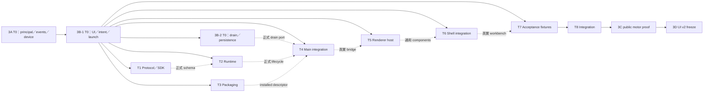

# 宣告式 UI、命令與內建程序生命週期設計（第三階段 3B-1）

日期：2026-10-17  
狀態：子專案設計，供 T0 契約凍結與後續實作；尚未實作或驗收。Plugin API **1.6.0**，UI resource **v1**。

- Binding authority：[第三階段總體規格](2026-10-17-plugin-system-stage-3-design.md) §2、§3.3–3.4、§3.6、§4、§5.2、§7、§9。本文細化 3B-1，不變更其決策、版本順序、生命週期矩陣及 hotspot ownership。
- 上層：[主規格](2026-10-14-plugin-system-design.md)；結構與整合方式沿用 [2C §11](2026-10-17-plugin-system-2c-static-languages-design.md#11-實作切分)，並承接 [2A](2026-10-16-plugin-system-2a-build-chain-design.md)、[2B-1](2026-10-16-plugin-system-2b1-diagnostic-source-design.md)、[2B-2](2026-10-16-plugin-system-2b2-language-services-design.md) 的身分與隔離原則。
- 盤點依據為 §1 各列的 repository 來源及本文就近引用的程式碼；下列「現有」均已核對實際程式碼。其餘型別、欄位、方法、路徑及測試名稱若標示「新增」，皆為本次設計，不能當成已存在 API。

## 1. 範圍、基線與交付邊界

3B-1 交付通用 UI v1 資源、驗證器、catalog、state patches、表單命令與訂閱、main 可撤銷的 panel／gesture lifetime、renderer panel／status host、optional builtin 管理、shipped Node launch、supervisor 接線及 core recovery view。JS MessagePort 與 Python stdio 使用同一公開契約。以 fixture 驗證公開路徑，再交給 3C 完成 motor 垂直證明。

本專案不實作 EV3 motion engine／broker（3A）、settings／record storage／export／copy／drain wire（3B-2）、motor 功能（3C）、charts／tables／dialog／Lab recorder 與 UI v2（3D），或 device UI 與 legacy composition 最終移除（3E）。不加入 HTML、任意 React、CSS、JS expression、跨插件命令匯流排、provider RPC、一般第三方安裝器或管理 Python runtime。提供 core stop view 不代表設備已停止。

| 已核對來源                                                                                                                                                                                                                          | 現況與本專案變更                                                                                                                                                                                      |
| ----------------------------------------------------------------------------------------------------------------------------------------------------------------------------------------------------------------------------------- | ----------------------------------------------------------------------------------------------------------------------------------------------------------------------------------------------------- |
| [`methods.ts`](../../../packages/plugin-protocol/src/methods.ts)、[`rpc.ts`](../../../packages/plugin-protocol/src/rpc.ts)                                                                                                          | `command/execute` 僅 `{command}` → `null`；`initialize` 為 strict object；numeric RPC error 無 `data`。保留這些 envelope，另協商新命令與 UI 方法。                                                    |
| [`manifest.ts`](../../../packages/plugin-protocol/src/manifest.ts)、[`limits.ts`](../../../packages/plugin-protocol/src/limits.ts)                                                                                                  | API 1.4.0；manifest 外層 loose；static 禁 commands／permissions。新增 UI 宣告的 strict variants，不能讓未知外層欄位成為權限。                                                                         |
| JS [`index.ts`](../../../packages/plugin-sdk-js/src/index.ts)、Python [`_plugin.py`](../../../sdks/python/kobrixa/_plugin.py)                                                                                                       | JS `CommandHandler` 只有 `signal`，有可選 `deactivate`；Python 有 async command／task cancellation，shutdown 尚無 callback。兩者須增加同等 UI／結果／訂閱及合作式 teardown。                          |
| [`registry.ts`](../../../packages/plugin-runtime/src/registry.ts)、[`manager.ts`](../../../packages/plugin-runtime/src/manager.ts)                                                                                                  | builtin source 必須 builtin runtime；所有 builtin 禁停用；`#register` 跳過 builtin／static。拆開 trust、policy、runtime，加入 resource participants。                                                 |
| [`supervisor.ts`](../../../packages/plugin-runtime/src/supervisor.ts)                                                                                                                                                               | 按需啟動、3 次／5 分鐘 crash limit、initialize 10 秒、command 30 秒、shutdown request 2 秒；`stop()` 自身預設最長 6 秒，manager shutdown 另有 4 秒總界線。本文保留 manager 的較短界線並先執行 drain。 |
| [`launchers.ts`](../../../apps/desktop/src/main/plugins/launchers.ts)、[`builtin.ts`](../../../apps/desktop/src/main/plugins/builtin.ts)、[`forge.config.ts`](../../../apps/desktop/forge.config.ts)                                | 已有 `utilityProcess.fork`／MessagePort，但只有 Basic Plus／EV3 compiler raw resources；Forge 無 feature entries。新增固定 installed layout，不使用外部 Node。                                        |
| [`controller.ts`](../../../apps/desktop/src/main/plugins/controller.ts)、[`state-store.ts`](../../../apps/desktop/src/main/plugins/state-store.ts)、[`session.ts`](../../../apps/desktop/src/main/plugins/session.ts)               | 啟用路徑要求 developer mode；持久 state v2 已可保存 source keys；session marker 只追蹤第三方程序／靜態語言。新增 optional policy 與各 contribution 的 cold recovery barrier。                         |
| [`app.tsx`](../../../apps/desktop/src/renderer/app.tsx)、[`tools-panel.tsx`](../../../apps/desktop/src/renderer/device/tools-panel.tsx)、[`monitor-workspace.tsx`](../../../apps/desktop/src/renderer/device/monitor-workspace.tsx) | 右側欄 `rightPanel`、`ToolTab` 的 connection／monitor／files 與 readings／lab 由私有 React 組裝；CSS hidden 仍 mounted。新增通用 pane，不以 mounted 推論可見。                                        |
| [`shared/plugins.ts`](../../../apps/desktop/src/shared/plugins.ts)、[`main/plugins/ipc.ts`](../../../apps/desktop/src/main/plugins/ipc.ts)                                                                                          | 管理型 IPC 與 DTO；新增通用 UI bridge，正式型別 type-only re-export，無 feature-specific channels。                                                                                                   |

## 2. 決策紀錄

| 決策                                                                      | 理由與後果                                                                                                                                                                                                                                                                                               |
| ------------------------------------------------------------------------- | -------------------------------------------------------------------------------------------------------------------------------------------------------------------------------------------------------------------------------------------------------------------------------------------------------- |
| D01：UI 描述、form draft、feature state、core safety state 分開           | JSON 描述固定結構；host 管 draft 與輸入驗證；feature 只能 patch 已宣告 data slots；安全狀態由 broker 覆蓋顯示，不接受 feature 宣告停止成功。                                                                                                                                                             |
| D02：保留 `command/execute`，新增協商後的 `command/invoke`                | 舊 SDK 的 strict params 與 `null` result 不被破壞；有表單／context 的動作不可降級成空參數舊命令。                                                                                                                                                                                                        |
| D03：面板位於右側獨立「插件工具／Plugin tools」pane                       | 依 [umbrella §2 決策 11](2026-10-17-plugin-system-stage-3-design.md#2-決策紀錄)，`rightPanel:"plugins"` 與 EV3 legacy／collaboration pane 互斥；motor／Lab／device-ev3 為同級 tabs，motor 離開 monitor card。這是已核准的產品配置。                                                                      |
| D04：UI v1 以平坦 nodes 表及受限條件樹表示                                | depth／cycles／references 可明確驗證，JSON Schema exporter 不需允許任意 recursive schema。沒有 eval、regex 或字串路徑查詢。                                                                                                                                                                              |
| D05：表單只在動作時傳快照                                                 | 每次輸入與 range drag 不發 command；patch 不覆寫正在編輯的欄位，防止讀值更新搶走焦點及 draft。                                                                                                                                                                                                           |
| D06：main 發 panel heartbeat challenge；host 控制 hold renewal            | renderer freeze 不能靠排隊的舊 heartbeat 無限續命；plugin 無 mint／renew API。所有 motion 綁 panel，jog 額外綁 gesture。                                                                                                                                                                                 |
| D07：一般 events 與 8 個 control slots 分離                               | 有界 coalescing 不丟掉 terminal／authority／stop；無法交付時先撤意圖、保留權威 snapshot，拒絕補造成功。                                                                                                                                                                                                  |
| D08：builtin allowlist 同時決定 required／optional 及 launch descriptor   | manifest 無法自授 trust；三個設備功能可停用，`kobrixa.ev3` compiler 仍必要。                                                                                                                                                                                                                             |
| D09：shipped process 為獨立、完整 bundled CJS，連同 manifest／JSON unpack | 避免 utility process entry、cwd 與 ASAR 虛擬路徑差異；SDK／protocol JS bundled，feature 無 native dependency。                                                                                                                                                                                           |
| D10：撤權同步，stop 與 drain 並行，程序 teardown 有界                     | revoke 不等待保存或 callback；storage drain 10 秒，device stop/readback 15 秒，3A journal commit 最多另 5 秒，全部 disposition 後進 4 秒 manager teardown。正常 close 仍可能被未確認／保存失敗阻擋。                                                                                                     |
| D11：UI 壞資源隔離 contribution；crash 撤銷 execution bindings            | 不因一份錯誤 JSON 停掉 compiler；舊 process 不得重新建立 UI，resource retry 不恢復 motion 權限。                                                                                                                                                                                                         |
| D12：沿用 umbrella 數值，新增細項採更小上限                               | v1 不提前加入 Lab charts，也不提高 frame。效能門檻列於 §14，實作無證據不能宣稱已通過 T0 budgets 驗收。                                                                                                                                                                                                   |
| D13：Electron 單一實例                                                    | 依 [umbrella §2 決策 10](2026-10-17-plugin-system-stage-3-design.md#2-決策紀錄)，desktop integration owner 在啟動任何 profile writer 前呼叫 `app.requestSingleInstanceLock()`；第二次啟動聚焦既有視窗後退出。不新增 native file-lock addon，也沒有第二實例降級模式。                                     |
| D14：Disconnect 是一次使用者動作                                          | 依 [umbrella §2 決策 12](2026-10-17-plugin-system-stage-3-design.md#2-決策紀錄)，core 先顯示進度並協調 motor stop/readback、recording end/save，成功後斷線；plugin `devices/disconnect` 遇其他 owner 工作仍回 busy，不獲得強制斷線權。                                                                   |
| D15：OS suspend 停止並保存，wake 不續作                                   | 依 [umbrella §2 決策 13](2026-10-17-plugin-system-stage-3-design.md#2-決策紀錄) 與 §4.7 suspend 列，main 撤 motion intent、結束背景錄製並 bounded drain/save；wake 不自動恢復 recording／motion。                                                                                                        |
| D16：optional builtins 預設啟用且一般使用者可切換                         | 依 [umbrella §2 決策 14](2026-10-17-plugin-system-stage-3-design.md#2-決策紀錄)，三個 feature 的獨立開關不要求 developer mode；保留既有 user disables 及 safe-mode 抑制。                                                                                                                                |
| D17：EV3 file-transfer exchange 保留 10 秒                                | 依 [umbrella §2 決策 15](2026-10-17-plugin-system-stage-3-design.md#2-決策紀錄) 與 §4.8，3A provider 的 file-transfer exchange 維持 [`session.ts`](../../../packages/device/src/session.ts) 現有 10 秒，其他普通 exchange 為 5 秒；UI 及 lifecycle 不縮短它，也不因此延長 24 秒 cleanup／25 秒外層期限。 |
| D18：維持既有 safe-mode lock 規則                                         | 依 umbrella §2 決策 16，unclean exit 僅第三方／development 風險或 renderer unresponsive 觸發 lock；optional builtins 單獨 crash 不觸發，由 supervisor crash-loop limits 與 core fault journal／checkpoint recovery 處理。                                                                                |
| D19：contributed settings 逐欄立即套用                                    | 依 umbrella §2 決策 17，SettingsFormPort 每個有效欄位變更走 core validator／atomic CAS／field error；無 Apply 按鈕，單欄 Reset 同路徑。一般 feature command forms 仍按 D05 的動作快照。                                                                                                                  |

## 3. 版本、宣告與握手

### 3.1 版本規則

API 批次固定為 3A **1.5.0** → 本專案 **1.6.0** → 3B-2 **1.7.0** → 3D **1.8.0**。同步 `PLUGIN_API_VERSION`、schema `$id`、JS／Python `API_VERSION`、Python bundled schema、fixtures。UI v1 最低 API 1.6.0；v2 最低 1.8.0，v2 host 保留完整 v1，不把 charts 塞進 v1。下文新增 schema 均為 strict object；外層 manifest 的既有 loose 行為不變。

新增 `ui/negotiate`，方向 host → plugin，在既有 `initialize` 成功後才傳：

```ts
// 新增；Result<T> 使用 3A 凍結的 {ok:true,value:T}／{ok:false,error}。
type UiNegotiateParams = {
  commandEnvelopeVersions: [1];
  uiResourceVersions: number[]; // 1.6.0 host 精確為 [1]
};
type UiNegotiateValue = {
  commandEnvelopeVersions: number[]; // 只接受 [] 或 [1]
  uiResourceVersions: number[]; // 1.6.0 SDK 只接受 [] 或 [1]
};
```

`initialize` params／result 欄位完全不變；先檢查 manifest range 包含 host API，再檢查 SDK 回報與已宣告能力最低版本相容，不再只比 major。僅 SDK 回報 ≥1.6.0 且同 major 時發 `ui/negotiate`；10 秒 initialize budget 包含協商。雙方 intersection 決定可用 UI 能力，3A 的 devices capability discovery 不移至此方法。未知 host 後續 UI versions 可在協商陣列忽略，**resource 本身的未知 version 必須報錯**。舊 SDK 不收到新 notification／required fields。

有 UI／context command 宣告但 SDK 太舊、未支援 envelope 1 或協商失敗，該 executable activation 回既有 `PLUGIN_E_HANDSHAKE`，UI 顯示不可用；不以 legacy command 執行。舊 manifest＋新 SDK 可協商能力，但未宣告的 UI／command 仍不可使用。SDK activate 階段可註冊 handlers，不得等待需要「協商完成」的 UI／devices 呼叫來完成 initialize；SDK 明確拒絕這種過早呼叫，避免握手死鎖。

新增 host → plugin `ui/ready {}` → `Result<{}>`，只在 UI 協商成功後發出。main 先建立 initial panel／status bindings，再開放 UI 查詢／訂閱／patch router，最後送 ready；SDK 呼叫新增 JS `PluginDefinition.ready(context)`／Python `@plugin.ready` async callback。callback 可初始化 subscriptions／讀 snapshots，不能在沒有使用者 invocation 時取得 motion／export intent。host 收 ready 成功才 dispatch 第一個 command；initialize＋negotiate＋ready 共用同一 10 秒期限，不各得 10 秒。舊 SDK 不收到 ready，新 SDK 未註冊 callback 則回空成功。此安排讓第一次開 panel 無須先點一個初始化命令，也避免 activate 等握手的循環。

### 3.2 Manifest 增量

以下全為新增。`Id` 沿用 `namespacedIdSchema`；同 source 的 contribution ID 必須以 `manifest.id + "."` 開頭。`Text`、`LocalId` 定義於 §4。

```ts
type UiResourceDeclaration = {
  version: number; // header 為 integer 1–65,535；本批次只支援 1
  path: string;
};
type PanelDeclaration = {
  id: Id;
  title: Text;
  location: "right";
  resource: UiResourceDeclaration;
};
type StatusDeclaration = {
  id: Id;
  title: Text;
  resource: UiResourceDeclaration;
};
type ContextCommandDeclaration = {
  id: Id;
  title: Text;
  invocation: "context-v1";
  arguments: Record<LocalId, ValueSpec>; // 最多 32；所有 declared keys 必填
};
// contributes.panels?: PanelDeclaration[]，最多 4。
// contributes.status?: StatusDeclaration[]，最多 2。
// contributes.commands 保留舊 {id,title}；有 invocation 時須完整符合上型別。
```

v1 的 `ValueSpec` 是 §4 的有限 scalar 型別，不引入任意 JSON Schema。舊 command 未宣告 `invocation` 時，不得出現 `arguments`。UI v1 actions 只可引用同 source 的 `context-v1` commands；commands 不接受跨 source alias。沒有 UI 的 command 也能使用 context envelope，例如管理頁的明確使用者點擊。

新增 activation event `onPanel:<panelId>`，必須指向同 source 的 panel；既有 `onCommand:<id>` 保留，所有 activation events 合計仍 ≤64。開啟 panel 隱含按需 activation，無須每個 panel 再列一筆 event；不增加 `onStartup` 或 status 自動啟動。status resource 在 catalog 可見，但動態狀態要等使用者的 panel／command 啟動 process 後更新。

panel 要求 `ui.panels`，status 要求 `ui.status`；缺 permission 是 manifest 語意錯誤。`runtime:static` 仍只允許既有 languages／diagnosticHelp，顯式拒絕 `panels`／`status`，包含空陣列。Node／Python 的 UI JSON 可在 process 尚未啟動時驗證／列 catalog，這不等於 static runtime，也不授予執行權。

resource path 使用現有 diagnostic-help／packaged JSON grammar：最多 600 ASCII 字元、7 層目錄、每 segment 最多 64，必須 `.json`；拒絕 absolute、`..`、反斜線、URL、symlink escape、非 regular file。resource 內容不再重複 `version`。重複 ID、錯 namespace、permission／activation mismatch 使 source invalid；resource 內容錯只隔離該 contribution。duplicate plugin 身分沿用 registry 衝突政策，不自行選 winner。

manifest 的 resource header schema 先驗 strict `{version:positiveInteger,path:string}`，path 長度 1–600；支援版本與 packaged-path grammar 在 contribution validator 判定。如此未知正整數 version 回 `PLUGIN_E_UI_VERSION`、非法 resource path 回 `PLUGIN_E_UI_RESOURCE`，只隔離該 contribution，不先被 literal(1) 抹成整個 source 的 manifest error。version 型別錯、缺必要欄位／多未知 header 欄位仍是 `PLUGIN_E_MANIFEST`。本批次的 validated resource／catalog schema 只接受 version 1。

3A 擁有 consumer capability declaration 與 availability 結果；本專案直接使用其 frozen 型別。panel host 顯示缺 provider／version 的 unavailable 原因，不自行發明 `requiresPlugin`、啟用 provider 或解決安裝依賴。

## 4. UI resource v1

### 4.1 基本型別、資料與翻譯

下列皆為新增 public types；wire 不含 `undefined`、函式、DOM、Date、NaN、Infinity、BigInt。數值為 finite JSON number；所有 generation、UI revision／sequence 直接使用 [3A §3.1](2026-10-17-plugin-system-3a-device-broker-design.md#31-固定詞彙與-handle) 的 `Counter`（0 至 `Number.MAX_SAFE_INTEGER` 的整數）。所有 host-issued handle／epoch 直接使用同節 `Handle` schema：canonical lower-case UUID v4，永不重用，不以內容解析權限。非 capability 的 renderer inputToken 也採 `Handle` 格式，但其本身不授權。revision 的表示法由各 domain 決定；本文 UI revision 為 `Counter`，3B-2 settings／records 使用其正式 revision 型別，兩者不得轉型、排序或跨 API 比較。

```ts
type LocalId = string; // ASCII ^[a-z][a-z0-9-]{0,31}$
type Text = { en: string; "zh-TW"?: string };
type Scalar = string | number | boolean | null;
type ValueSpec =
  | { type: "string"; maxLength: number; nullable: boolean }
  | { type: "number"; min: number; max: number; integer: boolean; nullable: boolean }
  | { type: "boolean"; nullable: boolean }
  | { type: "enum"; values: string[]; nullable: boolean };
type DataSlot = { schema: ValueSpec; initial: Scalar };
type Field = {
  schema: ValueSpec;
  initial: Scalar;
  required: boolean;
  requiredWhen?: Condition;
};
type ValueRef = { scope: "data" | "form"; key: LocalId };
type DisplayValue = { literal: Scalar } | { ref: ValueRef };
type DisplayText = { text: Text } | { ref: { scope: "data"; key: LocalId } };
type PanelResourceV1 = {
  kind: "panel";
  data: Record<LocalId, DataSlot>;
  fields: Record<LocalId, Field>;
  root: LocalId;
  nodes: UiNodeV1[];
};
type StatusResourceV1 = {
  kind: "status";
  text: DisplayText;
  tone: "neutral" | "info" | "success" | "warning" | "error";
  data: Record<LocalId, DataSlot>;
  visibleWhen?: Condition;
};
```

`Text.en` 必填且非空；`zh-TW` 可省略但不能空白值。選目前語系，缺譯回 `en`，不以 ID 當 label。每個 locale 值最多 4,000 Unicode code points；title／label 限 200。允許 tab／newline 的 display body，label／ID 不允許換行；拒絕未配對 surrogate、NUL 與其他控制字元。無 HTML／Markdown／URL 自動連結、模板插值或 ICU expression。純文字以 text node 渲染；數字格式由宿主依 locale 處理，wire／比較仍是原值。

`DisplayText.ref` 必須指向 string slot，內容是 feature 提供的純文字，例如設備名稱／錯誤細節；feature 自有 UI 文案仍應用 `Text`。宿主可即時切換宣告翻譯、theme，無須重啟 process。`ui` snapshot 帶當前 locale，環境變更事件通知 feature 重算動態文案；不得因此自動重執行命令。

每 resource 最多 64 data slots，panel 最多 32 fields；key 不重複。`ValueSpec` 所有欄位必填，無隱含 coercion／default：string `maxLength` 1–4,000；number `min ≤ max`，integer=true 時 bounds／initial 皆 integer；enum 1–32 個不重複、非空 string，每個 ≤128 code points。`nullable` 控制 null；`required` 只控制 action 的有效表單判斷，不改 JSON 型別。initial 必須符合 schema，required 的未填欄位可用 nullable null，但 command 前必須驗證。

integer 限 ±`Number.MAX_SAFE_INTEGER`，number 的其他 finite fractional 值不 coercion。effective required 為 `required || requiredWhen` 的求值；可見且 enabled 的欄位為 null、或 string 空字串時才視為未填，false／0 不是未填。textInput 的 initial／使用者值另要求單行；一般 data string 可多行。所有條件在一次不可變 draft／data snapshot 上計算，之後才對 outbound form 遮蔽 hidden／disabled values，不能在遮蔽後反覆求值形成顯示回授。

fields 是 host-owned draft；data 是 feature-owned state。使用者輸入的空 number／尚未完成的 `-` 由 renderer 保存 raw text，未形成合法值時 canonical value 為 null，`valid:false`；不能轉 NaN 或悄悄 clamp。可見且 enabled 的 field 才參與 action validation；disabled／hidden field 保留 draft，但送到 feature 的 canonical snapshot 值為 null。這允許 jog／timed／angle 只驗當前模式欄位，feature 仍須驗證跨欄位規則，broker 再驗設備參數。

### 4.2 元件集與完整欄位

每 node 共通 `{id:LocalId,type,visibleWhen?:Condition,enabledWhen?:Condition}`；`visibleWhen` 預設 true，`enabledWhen` 預設 true。下表列出的欄位以外全部拒絕；`?` 表示可省略。元件不接受 className、style、DOM attributes、event callback 或 arbitrary icon。

| `type`       | 其他欄位及語意                                                                                                                                                                                            |
| ------------ | --------------------------------------------------------------------------------------------------------------------------------------------------------------------------------------------------------- |
| `group`      | `label?:Text, help?:Text, layout:"stack"\|"row", children:LocalId[]`。1–32 children；row 在窄欄自動換行。root 必須 group。                                                                                |
| `text`       | `value:DisplayText, emphasis:"normal"\|"strong"`。純文字段落。                                                                                                                                            |
| `help`       | `value:DisplayText`。純文字補充，不接網路 link。                                                                                                                                                          |
| `textInput`  | `field:LocalId, label:Text, help?:Text, placeholder?:Text`。field schema 為 string，單行輸入，長度由 schema 限制。                                                                                        |
| `number`     | `field, label, help?, step:number, unit?:Text`。step >0；number schema；輸入保留 invalid draft，integer 欄位 step 為正整數。                                                                              |
| `range`      | 同 number。宿主呈現一組 slider＋numeric input，共用同一 draft；step 格點以 min 為起點，誤差判斷使用明定的 1e-9 相對容差；不強制資料自動四捨五入。                                                         |
| `choice`     | `field, label, help?, presentation:"select"\|"segmented", options:{value:string,label:Text}[]`。enum field；options 與 schema.values 集合相等且順序作為顯示順序；segmented 最多 8 個，select 最多 32 個。 |
| `boolean`    | `field, label, help?`。boolean field，以 checkbox 呈現。                                                                                                                                                  |
| `action`     | `label:Text, action:UiAction, variant:"normal"\|"primary"\|"danger"`。只在明確點擊／鍵盤 activate 執行；沒有 mount action。                                                                               |
| `holdAction` | `label:Text, command:Id, arguments:ArgumentBindings, help?:Text`。只支援同 source context command；host 管 begin／end／cancel，不能變成 toggle。                                                          |
| `status`     | `text:DisplayText, tone:"neutral"\|"info"\|"success"\|"warning"\|"error"`。狀態文字，非安全權威。                                                                                                         |
| `alert`      | `text:DisplayText, severity:"info"\|"warning"\|"error"`。live announcement 依 §10 節流。                                                                                                                  |
| `progress`   | `value:DisplayValue, max:number, label:Text`。max>0；value 必須 number 或 null，0≤value≤max；null 表示 indeterminate，不解讀為完成。                                                                      |
| `keyValue`   | `rows:{id:LocalId,label:Text,value:DisplayValue,unit?:Text}[]`。1–16 rows，row id 唯一；null 顯示宿主的「無資料」，保留 gap 意義。                                                                        |

所有 fields 必須恰被一個 input node 引用；range 的兩個 DOM controls 算一個 node。所有 node ID 唯一，所有 children 存在、只有一個 parent；root 可達全部 nodes，禁止 cycle、orphan、共享 child／template 展開。root 深度為 1，最深 8，總數 ≤256。data slots 可未被使用，但仍計 quota。每 reference 的型別須符合消費元件；dynamic 值超界時整個 patch 拒絕，不能把 stop 按鈕所在 subtree 部分套用。

status contribution v1 是 footer 的一段 text／tone／visibility，沒有表單、任意 node tree、open／stop actions；**3D v2** 才擴充 status 的 action schema。3B-1 的 core safety footer 另有 core open／stop，不受此限制，也不是 feature 偽裝成 status action。

### 4.3 條件及 actions

新增 `Condition` 為下列四種嚴格 variant，最多深度 4、每個 expression 最多 32 個節點、整份 resource ≤256 個 condition 節點：

```ts
type Condition =
  | { op: "eq" | "ne"; left: ValueRef; right: Scalar }
  | { op: "lt" | "lte" | "gt" | "gte"; left: ValueRef; right: number }
  | { op: "all" | "any"; items: Condition[] } // 1–8
  | { op: "not"; item: Condition };
type ArgumentBindings = Record<LocalId, DisplayValue>;
type UiAction =
  | { kind: "command"; command: Id; arguments: ArgumentBindings }
  | { kind: "core"; action: "openPanel"; panelId: Id }
  | { kind: "core"; action: "stop"; operation: { scope: "data"; key: LocalId } }
  | { kind: "core"; action: "disconnect"; session: { scope: "data"; key: LocalId } }
  | { kind: "core"; action: "openRecovery" };
```

eq／ne 採 JSON primitive 同型別相等，不轉字串、不做 truthiness；null 只可和 nullable reference 比較。數值比較只接受 number ref；invalid draft 的數值比較為 false。all／any 短路，但驗證必須檢查全部分支；不接受空 items、regex、任意屬性遍歷、時間／網路查詢。條件只管 presentation；無論 disabled 顯示如何，main／broker 都重新檢查實際能力與 authority。

`ArgumentBindings` keys 必須精確符合目標 command arguments 宣告，literal／ref 型別相容；合計 ≤16 KiB。不接受字串拼接或跨 resource reference。resource 可用固定 string slot 接受 operation handle，core stop 的 ref 必須指向該 nullable string slot，null 時只顯示不可用；handle 仍由 broker 查 owner／generation／session，並非知道字串就可停止別人。core `openPanel` 只能同 source；`openRecovery` 打開核心 recovery view；core `stop` 只停止屬於 caller panel／principal 的原 operation，不能要求任意設備廣播 stop。core action 不經 feature callback。

core `disconnect` 是 umbrella §2 決策 12 的使用者入口，`session` 只引用 nullable string data slot；main 將值按 3A `Handle` schema 驗證並確認目前 session。它只在 trusted bridge 收到真實使用者 activate 時，依 §13.1 mint `CoreActionReference` 綁目前 session，再進 core coordinator；不經 feature callback，plugin RPC 沒有此強制入口。core 顯示「正在停止／正在保存／正在斷線」，先透過 [3A §9.6](2026-10-17-plugin-system-3a-device-broker-design.md#96-host-only-session-quiescedisconnect) 的 `DeviceSessionControlPort.quiesce` 與 §11.4 的 `PersistenceParticipant.endReservation`／`drain` 協調 motor stop/readback、recording end/final save，再呼叫 `DeviceSessionControlPort.disconnect`；不 retire 健康 owners。先擋該 session 新工作；stop／save 失敗保留 blocker 與 retry，不直接斷線或顯示成功。斷線不改 user enabled state。一般 plugin `devices/disconnect` 仍依 3A busy 規則，不能終止其他 owner 的工作。

core stop／disconnect／openRecovery 不受 form validation 或 feature `enabledWhen` 阻擋；host 另保留不可被 feature 條件隱藏的 safety strip。一般 action／hold begin 才檢查表單。若 condition 將正在 hold 的 node 隱藏／disable、或使用者切換其作用的模式／欄位，先 cancel gesture 再更新視圖。stop／release 絕不因目前欄位 invalid 而失效。

## 5. Limits、驗證與錯誤

新增 `UI_RESOURCE_VERSION = 1` 與不可變 `UI_LIMITS_V1`；保留 umbrella 所有上限。bytes 是實際序列化 UTF-8 bytes；resource bytes 是原檔，含 BOM／空白，不用 parse 後 stringify 低估。data snapshots／patches 另外按最終傳輸文字計量。Unicode 字元限額用 code points，JS／Python 共同 fixtures 驗證非 BMP。

| 類別              | 精確上限與拒絕方式                                                                                                                                              |
| ----------------- | --------------------------------------------------------------------------------------------------------------------------------------------------------------- |
| RPC／manifest     | 1,048,576／65,536 bytes；commands／activation events 各 64。沿用 `PLUGIN_LIMITS`。                                                                              |
| Resource          | 每份 262,144 bytes，每 source 引用合計 1,048,576，host eligible catalog 合計 8,388,608；相同 path 每次引用仍計。                                                |
| 結構              | 256 nodes、depth 8；64 data slots、32 fields；string 4,000 code points、label／title 200；條件限制依 §4。                                                       |
| Panels／status    | 宣告及 live instances 都限制每 source 4／2、host 16／16；同 contribution 每 window 最多一 instance，所有 windows 合計計 quota。                                 |
| State／form       | 每 instance data snapshot 65,536 bytes；form snapshot 16,384 bytes；status data 16,384 bytes；不因 source 多 panel 放寬任何單筆 frame。                         |
| Patch             | 每次 65,536 bytes、最多 64 set entries；每 panel／status 每 rolling 1,000 ms 最多 10 次，待送 ≤4 個；host 合併已接受的一般更新。                                |
| Command           | arguments 16,384 bytes，整個 invoke params ≤65,536 bytes；結果 ≤16,384 bytes；每 source ≤16 pending 普通 RPC，host 256。                                        |
| Events            | 每 source 32 subscriptions；telemetry ≤64 frames／65,536 bytes per batch，一般 event queue 262,144 bytes／source。UI 事件 ≤65,536 bytes／batch。                |
| Control           | 沿 3A：每 source 8 個獨立 slots，每筆 ≤16,384 bytes，第 8 個保留 resync；不占 telemetry／patch queue。overflow 立即撤銷相關 intent，保留 core snapshot。        |
| Gesture／liveness | 每 source 同時 1 active hold；100 ms challenge／renew cadence、350 ms expiry；panel heartbeat 同值，不能由插件提高。                                            |
| Deadlines         | resource source read budget 5,000 ms；initialize 含 UI 協商 10,000 ms；普通 command 30,000 ms；UI query／patch／subscribe 5,000 ms；shutdown request 2,000 ms。 |

resource global admission 依 `(sourceKey, contributionId)` 排序，逐項預留後讀取，不先把全部檔案留在記憶體；超量拒絕整個 contribution 並釋放暫存，再處理後項。已接受 catalog 不因新開 panel 重新配額；live instance quota 滿時只拒絕新 open，既有面板不被暗中關閉。狀態、form、條件的最大合法組合仍必須同時符合 bytes，不能以 nodes 合法跳過 bytes。

新增 UI detail schema：`{kind:"ui",reason, contributionId?, fieldPath?, limit?, allowed?, actual?}`。`reason` enum 為 `read`、`path`、`schema`、`reference`、`cycle`、`translation`、`limit`、`renderer`、`version`、`negotiation`；`fieldPath` 最多 256 ASCII 字元，只含 schema 欄位／index；`limit` 為本節常數鍵；allowed／actual 為非負安全整數；其餘 ID 按共用 schema。detail 合計 ≤4 KiB，message ≤2,000 code points，無 native path／stack／任意 JSON。UiDetail 不含 currentRevision，也不承載 runtime revision／owner／closed／rate／overflow；這些一律使用正式 ResourceErrorDetail。`Result<T>` 是 3A `BusinessResult<T,UiDetail | 既有共用Detail>` 的本文簡寫；共同 permission／resource errors 沿 3A detail，UI errors 才用 `kind:"ui"`，不改共同 error reason。

依 [3A §5.1](2026-10-17-plugin-system-3a-device-broker-design.md#51-共用結果與錯誤) 的版本擴充規則，1.6.0 加入 `kind:"ui"`，1.7.0 的 `kind:"persistence"` 留給 3B-2。`PLUGIN_E_PERMISSION_DENIED` 使用正式 `PermissionErrorDetail`（`kind:"permission"`）及其 closed reasons，包含 `user-action-required`；stale／quota／rate／queue 使用正式 `ResourceErrorDetail`（`kind:"resource"`），UI binding resource 成員依 3A 的分批擴充 enum 接入。不得替 shared code 另造 UI／persistence reason，亦不在本文複製這兩份 detail schema。`kind:"ui"` 僅可搭配 `PLUGIN_E_UI_RESOURCE`（read／path／schema／reference／cycle／translation／limit／renderer）或 `PLUGIN_E_UI_VERSION`（version／negotiation）；shared stale／resource-limit code 配 ui detail 一律 schema invalid。

| 問題                                                           | 對外表示與處置                                                                                                   |
| -------------------------------------------------------------- | ---------------------------------------------------------------------------------------------------------------- |
| 壞 JSON-RPC、未知 method、形狀錯誤／未知欄位                   | 現有 numeric `invalidRequest`／`methodNotFound`／`invalidParams`；不新增 `error.data`。                          |
| UI file／schema／component／translation／reference／靜態 limit | `PLUGIN_E_UI_RESOURCE`＋上述 reason；隔離 contribution，整個 panel 不渲染。                                      |
| 未知 resource version                                          | `PLUGIN_E_UI_VERSION`，不降級、不略過未知元件。                                                                  |
| runtime permission 不足                                        | 3A `PLUGIN_E_PERMISSION_DENIED` business result；舊 `ui/showMessage` 保留 numeric permissionDenied。             |
| 已撤銷 binding／foreign handle／stale revision                 | `PLUGIN_E_STALE_RESOURCE`；foreign 不洩漏資料。                                                                  |
| live quota／rate／queue 滿                                     | `PLUGIN_E_RESOURCE_LIMIT`；保留已 committed state，core stop 永遠不經普通限流。                                  |
| lifecycle 拒絕／timeout／crash                                 | 沿用 umbrella 的 disabled／safe-mode／shutting-down／timeout／cancelled／crashed codes；不能當作 physical stop。 |

跨欄位語意與總 bytes 由 browser-safe validator 驗證，wire Zod 不用 transform／coercion。條件樹以最大 4 層有限展開 schema，nodes 平坦表示，避免現有 [`json-schema.ts`](../../../packages/plugin-protocol/src/json-schema.ts) 的 `cycles:"throw"` 被迫放寬。所有結構及語意 validator 都有共享正反例；Python 不只執行 JSON Schema 而漏掉 resource references／code-point 等規則。

## 6. Catalog、instances 與 state patches

### 6.1 Catalog 與 renderer bridge

新增 `UiCatalog` 由 runtime 在 main 建立。source／generation／digest 由 host 填入，不接受 resource 自稱。資源 descriptor 與原始 bytes 分開傳送；**8 MiB catalog 不得塞進一個 1 MiB frame**。

```ts
// 新增 host-owned DTO；不是 feature 可寫入的 registration request。
type UiOwner = {
  sourceKey: string;
  pluginId: Id;
  uiResourceGeneration: Counter;
};
type UiCatalogEntry = UiOwner & {
  id: Id;
  kind: "panel" | "status";
  title: Text;
  version: 1;
  resourceDigest: string; // SHA-256，64 lower-case hex
  resourceBytes: number;
  availability: "available" | "unavailable";
  problem?: { code: string; message: string }; // 使用正式共用 error enum
};
type UiCatalogPage = {
  hostEpoch: Handle;
  revision: Counter;
  entries: UiCatalogEntry[];
  nextCursor: Handle | null;
};
type UiBinding = {
  contributionId: Id;
  panelInstance: Handle; // status 亦為 host-issued instance，kind 區分用途
  kind: "panel" | "status";
  uiResourceGeneration: Counter;
  generation: Counter;
  hostEpoch: Handle;
  processEpoch: Handle;
};
type UiStateSnapshot = {
  binding: UiBinding;
  revision: Counter;
  data: Record<LocalId, Scalar>;
  formRevision: Counter;
  form: Record<LocalId, Scalar>;
  valid: boolean;
  visible: boolean;
  locale: "en" | "zh-TW";
};
```

public snapshot 的 form 是最近一次 host-accepted action 快照，非每個 keystroke 的鏡像；首次為 canonical initial。status 的 form 必為 `{}`、formRevision=0、valid=true；status condition 不允許 form refs。plugin 不取得 raw input、window ID、room role 或 DOM details。

新增 renderer-only `PluginUiBridge`（正式 preload 的 `plugins.ui`），方法如下。所有 request 經現有 trusted main-frame wrapper；sender window 由 main 推導。這些不是 feature SDK 方法，也不是可任意轉送的 RPC tunnel。

| 方法            | 輸入 → 輸出                                                                                                                                                                      |
| --------------- | -------------------------------------------------------------------------------------------------------------------------------------------------------------------------------- |
| `catalog`       | `{cursor?:Handle}` → `Result<UiCatalogPage>`；每頁最多 16 entries／256 KiB，cursor 綁 hostEpoch／revision，30 秒過期。                                                           |
| `resource`      | `{sourceKey,id,uiResourceGeneration,resourceDigest}` → `Result<{owner:UiOwner,id,version:1,resource:PanelResourceV1\|StatusResourceV1}>`；單資源一次，payload ≤512 KiB。         |
| `open`          | `{sourceKey,id,uiResourceGeneration}` → `Result<UiStateSnapshot>`；只接受 panel，原子 reserve instance quota，再按需 activate／協商／binding。                                   |
| `close`         | `{binding}` → `Result<{closed:true}>`；立即撤 scope，無需等待 plugin；同 owner 的重複 close 冪等。                                                                               |
| `visibility`    | `{binding,visible:boolean,reason:"tab"\|"sidebar"\|"collapse"\|"document"\|"window"}` → `Result<{accepted:true}>`；false 先撤 intent。                                           |
| `invoke`        | `{binding,nodeId,formRevision,form}` → `Result<CommandValue>`；host 解析 action／arguments／context，renderer 不指定 command ID 或 authority。                                   |
| `hold`          | `{binding,nodeId,phase:"begin"\|"end"\|"cancel",inputToken:Handle,formRevision,form}` → `Result<{gesture:Handle\|null}>`；begin 才驗 form，end／cancel 使用原 gesture snapshot。 |
| `pulse`         | `{binding,challenge:Handle,gesture:Handle\|null,inputToken:Handle\|null}` → `Result<{accepted:true}>`；只回答 main challenge。                                                   |
| `snapshot`      | `{binding}` → `Result<UiStateSnapshot>`；不啟動已撤銷 process。                                                                                                                  |
| `reportFailure` | `{sourceKey,id,uiResourceGeneration,catalogRevision,reason:"validation"\|"renderer",fieldPath?:string}` → `Result<{accepted:boolean}>`；沒有自由文字 stack。                     |
| `onEvent`       | listener 接收 catalog invalidation、state revision、heartbeat challenge、instance revoked；回傳 dispose，不暴露任意 IPC channel。                                                |

`onEvent` 的事件為 strict discriminated union：`{type:"catalog",hostEpoch,revision,owners:UiOwner[]}`、`{type:"state",binding,revision}`、`{type:"pulse",binding,challenge}`、`{type:"revoked",binding,reason}`；owners 為當前有效 resources 的去重清單，最多 32。reason 採 §9 的 revoke reason enum。state 是 invalidation，renderer 依 revision 抓 snapshot，最多一筆 in-flight；後續 v2 可增加 payload variant，不能在 v1 偷放未知欄位。

renderer 先 subscribe 再 fetch，保存 highest observed revision；page cursor 必須同 epoch／revision，全頁齊備才公開新增 entries。新 owners 清單立即撤銷已消失／換 resource generation 的 instances，不能等下載完再撤。過時 catalog／snapshot／resource reply 不可復活舊 UI。main 在 renderer subscription 首次建立及斷線恢復時提供當前完整 invalidation；沒有事件仍須能抓 snapshot。

resource 讀取／重試採現有 [`readPackagedJson`](../../../packages/plugin-runtime/src/packaged-json-resource.ts) 的有界與 realpath 模式，但新增 UI validator。resource replace／明確 retry 遞增 `uiResourceGeneration`，撤銷舊 panel／gesture／binding；不改 `staticGeneration`，也不讓舊 execution 權限重新有效。renderer adapter throw 時隔離整個 contribution 至明確 retry；禁止 effect 反覆自動重試。

`uiResourceGeneration` 是每 source 的 counter；任一 UI resource／宣告／隔離結果變更即增加，保守撤該 source 舊 bindings，避免僅靠 owner 清單漏掉同 source 被移除的一個 panel。catalog revision 另為 host-global counter；同 epoch 整數耗盡必須重建 host epoch，不 wrap 到 0。status 先可展示已驗證 initial resource；process ready 後才取得 execution binding，process crash 時撤動態 state 並明示 unavailable，不保留假的 recording 狀態。

C-G1：generic renderer 在同 workbench 以 host-private memory best-effort 保留自願關閉 panel 的 field draft（含選取與未提交 invalid raw），不使用 storage、不新增 wire／SDK API。identity 為 sourceKey／pluginId／id＋hostEpoch／uiResourceGeneration／resourceDigest，並要求新 binding 的 execution generation／processEpoch 相同；close 通知只表示該 instance 關閉，不能當成 owner retirement。只沿 admitted fields 複製 scalar／raw，不合併任意屬性；payload 皆為 clone。最多 16 contributions，serialized draft＋raw 每筆 ≤32,768 bytes、總計 ≤524,288 bytes，deterministic LRU；oversize 整筆不保留、不截斷，raw 每欄仍 ≤4,000 code points，不 coercion invalid raw。每次 reopen 新建 state store／intent／binding，僅還原 draft／raw，private edit generation 僅追蹤 restoration／edits，不作 wire formRevision；wire formRevision 只在實際 feature action／hold begin 以最近 accepted host formRevision +1 提交一次；不繼承 snapshot／revision／gesture／operation／authority／command／error，不觸發 invoke、edit telemetry 或 private setForm，也不改 resource initial。invalid start 仍被 UI validation 阻擋，實際新 action 由 main 重驗。source／host／resource digest 或 generation 變更、execution retirement／process replacement、quarantine、safe-mode withdrawal 與 renderer disposal 清除 affected drafts；無 live record 的 retirement 亦清除，延遲舊 open／patch 不得復活。host registry 以每 execution／workbench 一筆、至多 256 筆 closed notification receipt（僅 owner／UiOwner／binding metadata，無 draft／resource、無 timer）保留 retirement 通知路徑；retireExecution／retireResource 清除並沿既有 revoked event 通知，無 live binding 亦然，不撤 catalog 或啟動 process。滿額淘汰最舊 receipt 時先送既有 overflow revoked，renderer 清除該 execution volatile drafts。hide／tab 在 live binding 內的既有行為不變；ui/patch 仍只改 data。

### 6.2 Feature 公開 UI 方法

新增下列 plugin → host requests；owner 一律由 process channel 決定，request 不接受 sourceKey。`Result` 沿用 3A；成功 value 一律 object。

| Wire method             | Params → success value                                                                                                                                               |
| ----------------------- | -------------------------------------------------------------------------------------------------------------------------------------------------------------------- |
| `ui/instances`          | `{}` → `{instances:UiBinding[]}`；只列本 process 的 live bindings，最多 6。                                                                                          |
| `ui/state`              | `{binding:UiBinding}` → `UiStateSnapshot`。                                                                                                                          |
| `ui/patch`              | `{binding,baseRevision:Counter,set:Record<LocalId,Scalar>}` → `{revision:Counter}`。                                                                                 |
| `ui/subscribe`          | `{topics:("instances"\|"visibility"\|"environment"\|"form"\|"state")[],binding?:UiBinding}` → `{subscriptionId:Handle,sequence:0,snapshot:UiSubscriptionSnapshot}`。 |
| `ui/snapshot`           | `{subscriptionId:Handle}` → `{sequence:Counter,snapshot:UiSubscriptionSnapshot}`。                                                                                   |
| 3A `events/ack`         | `{subscriptionId:Handle,sequence:Counter}` → `{acknowledged:Counter}`；沿用共用 method，不新增 UI alias。                                                            |
| 3A `events/unsubscribe` | `{subscriptionId:Handle}` → `{removed:boolean}`；沿用共用 method。                                                                                                   |

`ui/instances` 不替插件建立 UI；open 只由使用者／同 source core action／受控 restore 觸發。status bindings 在 process 協商完成時建立；不因 footer mount 啟動 process。`ui/subscribe` topics 非空、去重、最多 5；不帶 binding 只可訂閱 instances／environment，帶 binding 可訂閱其餘三項。總訂閱計入 source 的 32，包含 3A devices 及後續 settings watchers，不是各 API 各得 32。

`UiSubscriptionSnapshot` 嚴格為 `{instances:UiBinding[],states:UiStateSnapshot[],locale:"en"|"zh-TW",theme:"light"|"dark"}`；binding 篩選後 state 最多一筆，無 binding 時 states 為空；instances 同樣按 filter，不暴露其他 source。`ui/snapshot` 是原子 barrier，和 events sequence 的規則見 §8。

### 6.3 Patch 原子性及 backpressure

`ui/patch` 只能改該 resource 已宣告的 data slots；不能改 nodes、condition、Text、field draft、command target、title、visibility lifetime、owner 或 version。`set` 1–64 keys，每個值重新驗 schema，先驗整筆才原子 commit；revision 初始 0，每個成功 patch +1，空 patch 拒絕。revision 不由插件指定終值。`baseRevision` 必須等於 host committed revision；失配回 stale，不套一半、不自動重放。SDK 只可重新讀 state 後讓作者決定新 patch，不能重送 side effect。

accepted state 已同步提交到 main，renderer 待送佇列至多 4；合併以最新 snapshot／revision invalidation 代替舊一般更新，不依賴套用中間 patch。超 rate 的 producer request 直接 resource-limit，不配置第 5 個未提交 patch。`ui/state` 隨時可讀 authoritative committed data。status 用相同演算法及 10 Hz 上限。

一般 feature progress 可能 coalesce；broker 的 terminal／authority／stop 不是 data patch，走 §8 control lane 與 core safety strip。即使 feature 發出 `"stopped"` 文案，也不能覆蓋 broker 的 stopping／unconfirmed。收到 binding revoked 先鎖 UI 並取消 gesture，再移除或顯示 unavailable shell；不得沿用舊 data 假裝仍連線。

## 7. Command arguments、context、result 與 cancellation

### 7.1 新舊路徑

新增 `command/invoke`，方向 host → plugin，只在 `ui/negotiate` 確認 envelope 1 後使用。未宣告 `invocation` 的舊 command 永遠用現有 `command/execute {command}` → `null`，即使 SDK 新版也不偷偷更換結果。舊 manager／preload `execute(commandId)` 的 result shape 保留；新 UI bridge 使用本節 `Result<CommandValue>`。

```ts
// 新增；所有 context 欄位由 host 建立。
type CommandInvocation = {
  version: 1;
  invocationId: Handle;
  command: Id;
  arguments: Record<LocalId, Scalar>;
  context: {
    contextRef: Handle | null; // 3A Handle；null 表示未綁 workbench，不是自行宣稱 role／holder
    origin: "panel" | "management";
    locale: "en" | "zh-TW";
    binding?: UiBinding;
    motionScopeRef?: Handle; // 3A DeviceIntentPort 發的 Handle，僅 panel context
    actionRef?: Handle; // host 真實使用者動作；§11.4 的 persistence action port
    form?: { revision: Counter; values: Record<LocalId, Scalar> };
    trigger:
      | { kind: "activate" }
      | { kind: "hold"; phase: "begin" | "end" | "cancel"; gestureRef: Handle };
  };
};
type CommandValue = {
  output: Record<LocalId, Scalar>; // ≤32 keys；非任意 deep JSON
  fieldErrors: { field: LocalId; message: Text }[]; // ≤32
};
// command/invoke result = Result<CommandValue>
```

`origin:panel` 必須有 binding 與 form；management 不得有 binding／form，trigger 只能 activate。management arguments 只能 `{}`，因此管理頁只顯示 arguments schema 為空的 context command，其餘引導開 panel。hold end／cancel 使用 begin 的 form 快照與同一 gesture，host 先執行安全處置，再以 control 優先序 best-effort 交付通知性 invocation；release handler 的回覆不能改變已生效的停止。

panel 的 `motionScopeRef` 只在 3A port 已接齊且有 live panel scope 時存在；management 不得有此欄位。SDK 對每個 invocation 分別保存 `contextRef`／`motionScopeRef`／trigger 的 `gestureRef`，供 3A `devices/motion/prepare` 使用；不以「最後一個 command」全域變數傳遞。普通 arguments 中同名字串不會被提升為可信 context。新 UI methods 的業務失敗、普通 result 和 core action result 都使用本節的結構化 union；core action 成功時 `CommandValue` 為 `{output:{},fieldErrors:[]}`，實際停止結果由 broker safety snapshot 呈現。

`invocationId` 為 host-issued handle，與 JSON-RPC request ID 不同；一次 UI 操作只有一筆。host 在 dispatch 前記入 in-flight registry，repeat pointer click／keydown 不重發。SDK 對同 process 相同 invocationId 不再次執行 handler；host 不承諾 crash 後恢復 handler cache，因此重啟永不自動重送。in-flight 最多 16，完成後保存最近 64 個 invocationIds／結果，最多 30 秒；超出 retention 的舊 invocation 不可由 renderer 要求重送。這個 cache 不取代 3A 的 inert operation reference／start tombstone。

`invocationId` 只作 dedupe／結果關聯，不是 export／copy 授權。只有實際使用者 activate／hold begin 才可另發 `context.actionRef:Handle`；hold end／cancel、ready、timer、事件 callback 不取得它。1.7.0 的 `ctx.actions` 只轉交 `actionRef`，3B-2 wire params 的 `action` 也必須是該 reference，絕不能改傳 invocationId。相同 actionRef 至多 claim 一次，不能先 copy 再 export；普通 command 正常返回不延長其 5 秒期限。

host completed-invocation cache 另限 256 筆／4 MiB，先淘汰最舊完成項；不淘汰 pending 來接受新工作。cache miss 不能觸發 replay，renderer bridge 只接受 node action，沒有「重送 invocationId」方法。

arguments 與 form 分開：arguments 是已宣告 bindings 計算出的 command input；form 是動作時 canonical fields，讓 feature 返回 fieldErrors。每個 feature 動作先本地驗證，只提交 accepted host formRevision +1；private edit generation 用於抵擋 edit 後 late fieldErrors，不隨 submission 遞增。前次 submission 結果不確定（含拒絕、transport rejection／lost reply）時，下次明確動作先經既有 snapshot 對齊 accepted host formRevision，再送一次新動作；不得自動重試或重放副作用。hold end／cancel 使用 begin 原始 submission 快照，先 stop。trusted bridge 將完整 typed draft（包括 hidden／disabled 的暫存值，invalid 值為 null）交 main，main 先求 conditions，再遮蔽不可用欄位、驗 arguments，最後建立公開 context。plugin 只收到遮蔽後 form，不收到 raw input 字串。main 重驗最新 binding；renderer 不能傳 caller、window、role、holder、processEpoch 的任意替代。resource 可要求條件，但不能自授 collaboration authority。

`fieldErrors` 只允許該 form 內的 field ID，每欄一筆；management 必須為空。結果抵達時只對同 invocation、binding 及 formRevision 顯示 field errors，若使用者已修改不覆蓋新 draft。`ok:true` 表示 handler 回傳有效結果，不代表 motion 已完成；operation 進度／終態由 devices snapshots／events 取得。output 中帶 operation ID 仍須後續 broker 查權；feature 回傳 JSON 無權生成 capability。

### 7.2 取消與 admission

沿用 `$/cancelRequest`。JS `AbortSignal`、Python `asyncio.CancelledError` 都能中斷合作式 handler；SDK 的出站 requests 使用對應 cancellation，把 pending futures 清除、保留 late-reply guard。停止／安全 cleanup 使用獨立 signal，不沿用已 abort 的一般 command signal。

30 秒 command timeout 回 `PLUGIN_E_TIMEOUT`；使用者取消回 `PLUGIN_E_CANCELLED`。host 撤 invocation 的新工作 admission；若它已建立設備操作，要求停止原 operation 並由 core 保留 query／stop。5 秒 cancellation grace 後仍不合作，沿用 supervisor 的 unresponsive termination，但 host 不等這 5 秒才撤 motion 權限。timeout 不代表「沒有送達」；只能查詢／停止原 operation，不能自行重跑 command。

同一 panel action pending 時相同 action 不可再次 start，但 stop／hold end／cancel、core recovery 及 query 不受普通 command pending gate 阻擋。普通 RPC 限額滿回 resource-limit，安全路徑有獨立 slots；UI 只 disable 啟動動作，不能把整張 form 包含 Stop 一起 disabled。

command callbacks 的未捕捉例外以既有 `PLUGIN_E_COMMAND_FAILED` business error 交付，detail 無 stack／path；schema 錯誤為 numeric invalidParams；peer 掛斷仍是 transport connectionClosed，SDK 可轉成 typed transport exception，不能偽裝成 device outcome。業務 `Result` 預設原樣返回，JS／Python 都不把所有 `ok:false` 抹平成字串。

## 8. Subscriptions 與 event delivery

3A 是共用 principal／event envelope owner。直接使用 [3A §5.6](2026-10-17-plugin-system-3a-device-broker-design.md#56-訂閱與事件基礎) 的 `events/deliver`、`events/ack`、`events/unsubscribe` 與 `EventEnvelope`，不建立 `ui/event` 或第二套 owner registry。kind 依同一 registry 按 API 批次擴充：1.5.0 devices、1.6.0 下列 UI kinds、1.7.0 的 `settings.changed` 由 3B-2 加入；各批次維持 strict kind/data pairing，不接受任意字串。本專案 UI kinds 只在 UI 協商及訂閱成功後交付。

```ts
// API 1.6.0 註冊的 UI kinds；EventEnvelope 直接匯入 3A 正式型別。
type UiEvent =
  | { kind: "ui.instances"; data: { instances: UiBinding[] } }
  | { kind: "ui.visibility"; data: { binding: UiBinding; visible: boolean } }
  | { kind: "ui.environment"; data: { locale: "en" | "zh-TW"; theme: "light" | "dark" } }
  | {
      kind: "ui.form";
      data: { binding: UiBinding; revision: Counter; values: Record<LocalId, Scalar> };
    }
  | { kind: "ui.state"; data: { binding: UiBinding; revision: Counter } }
  | { kind: "ui.revoked"; data: { binding: UiBinding; reason: UiRevokeReason } };
type UiEventEnvelope = Omit<EventEnvelope<UiEvent["data"]>, "kind" | "data"> & UiEvent;
```

subscription 建立與 snapshot 原子化：baseline sequence=0，初態已在 snapshot，之後 event sequence 從 1 嚴格遞增；後續 `ui/snapshot` 回當前 watermark。每 subscription sequence 獨立；不以 timestamp 排序，也不以 revision 當 sequence。SDK 先裝 listener 再呼叫 subscribe，host 等 subscribe response 發出才釋放該 handle 的 events；SDK 仍需有界暫存 await continuation 前抵達的事件，避免丟第一筆。

ack 為 cumulative、只接受已交付的 sequence；重複／較小 ack 冪等，future sequence 為 invalidParams。所有 delivery classes 一律引用 3A 的 ack 規則：SDK 驗 schema 並成功進入 bounded local queue 才 ack；不等待使用者 callback 完成。local control queue 同為 8 slots，滿額停止 ack／要求 resync，不能收到 bytes 就無界排 callback。每 subscription callback 串行，但 telemetry／control 由獨立 dispatcher 處理；control 不排在昂貴 telemetry callback 後。Python reader thread 同樣有界，transport bytes 高水位不能旁路配額。

instances／environment／state invalidation 可 last-value coalesce；form event 只在 action submission 時產生，不用每 keystroke。visibility=false、revoked，以及 3A 的 terminal／authority／stop 為 control。control 的狀態先寫 authoritative ledger，再嘗試通知，不能由 feature patch 刪除。普通 telemetry batch 維持 64 frames／64 KiB，256 KiB queue；recording 原始樣本由 3A 保留或明確 gap，不能因 UI 顯示合併而悄悄消失。

coalescing／queue drop 的缺口依 3A 共用規則只由 sequence 不連續辨識，不新增 UI 專屬 gap kind。consumer 停止由該 stream 推論連續狀態，呼叫 snapshot 取得 watermark，再丟棄 ≤watermark 的 events。snapshot 不表示過去 motion 成功，操作結果仍取 broker ledger。可重建的 UI state snapshot 與不可重建的 raw samples 明確分開。

8 個 control slots 是每 source 所有訂閱共用，單筆 16 KiB；最多 7 筆普通 control，第 8 格只送 3A `events.resyncRequired`，data 為 `{reason:"overflow"|"ack-timeout",affected:Handle[]}`，affected ≤32。terminal 不能被 progress 取代。control slots 滿或最舊 control 10 秒未 ack，host 撤該 source intent／要求 stop、結束受影響 streams，保留 core snapshot；consumer query 後重新 subscribe。通道斷線直接走 retirement，無法送 revoked 不能省略本地撤權。350 ms heartbeat 仍獨立執行，10 秒 ack deadline 不延長 motion。健康 consumer 的終態可逐筆交付；慢 consumer 的終態只保證權威 snapshot 可恢復，無「無限可靠 queue」承諾。

unsubscribe 對同 principal 曾擁有的 handle 沿 3A 冪等語意：第一次 removed=true、同 owner tombstone 重送 removed=false，foreign／unknown／old generation 統一 stale。retention 與 host 256 subscriptions 上限直接使用 3A 共用 ledger，不再另外建立 UI tombstone quota。close panel 自動撤 binding subscriptions；background devices subscriptions 不因 panel close 一律消失，Lab 可繼續錄製。disable／retire／process crash 清除該 execution generation 全部 ordinary subscriptions，drain 的窄化通道另依 3B-2。

上述 `{removed:boolean}` 同樣適用 3B-2 settings watcher；SDK 可提供 `settings.unwatch` convenience，但 wire 仍是 `events/unsubscribe`，不註冊 `settings/unwatch` alias，也不把重複解除回值改成空 object。

## 9. Hold gesture、panel heartbeat 與 3A ports

### 9.1 Host intent lifetime

新增 `UiIntentRegistry` 位於 main，驗證 UI lifetime 並呼叫 3A `DeviceIntentPort`；3A broker 仍是 motion scope／gesture 權限的唯一 registry。feature SDK 沒有 `beginGesture`、`renewGesture` 或 panel heartbeat 方法；public context 只攜帶 host 已發的 references。renderer 的 trusted generic bridge 才可回答 challenge。`UiRevokeReason` 固定為 `release`、`pointer-cancel`、`focus-loss`、`hidden`、`closed`、`form-change`、`action-disabled`、`heartbeat-expired`、`authority-lost`、`generation-retired`、`resource-replaced`、`renderer-gone`、`process-gone`、`provider-gone`、`safe-mode`、`shutdown`、`overflow`。

panel lifetime 不只是 React mounted。host shell 計算 selected right pane、selected panel tab、祖先 collapsed／hidden、document visibility、window focus／visible／minimized／destroyed；任一不成立就使 motor intent 無效。main 同時監聽 native window loss，不只依 renderer 通知；CSS hide 由 shell 的受控 state transition 在更新 DOM 前送 revoke。generic renderer 不允許 feature 自訂 CSS，因此沒有插件藏掉 UI 卻維持 heartbeat 的入口。

每個 visible panel instance 在 main 每 100 ms 發一個不可預測的 challenge，保存 monotonic issuedAt 與綁定 epoch；最多 4 個尚未到期 challenge。renderer 於下一輪事件處理確認 view 仍 visible／focused 後回 `pulse`，帶目前 active gesture 或 null。每個 challenge 只可用一次，過 350 ms 拒絕；不允許 batch 補送。UI registry 的保守 freshness deadline 為 `issuedAt + 350 ms`；延遲回覆不能取得「收件後再 350 ms」。合法回覆轉成 3A `pulsePanel`／`pulseGesture` 的 trustedSequence，3A 另以 main receipt 起算自身 350 ms clock；兩者取先到者撤 scope。這保留 3A 不接受 renderer 自報 timestamp 的契約，又避免排隊舊 heartbeat 延後 UI expiry。timeout 比較使用 `now >= deadline`。

初開 panel 尚無 pulse 時不得開始 motion；第一次合法 pulse 才成為 live。expiry／hide 後舊 instance 可保留 UI draft，但其 intent epoch 已失效；重新 visible 重新 challenge，仍不能續用舊 operation／gesture。新動作必須有新的使用者 event。有效 panel pulse 只維持 timed／angle 的既有 UI scope，不延長 firmware duration，也不證明使用者仍按住 jog。

### 9.2 Pointer／keyboard 規則

1. primary pointer button 的 trusted pointerdown 或未 repeat 的 Space／Enter keydown，通過目前 visible／focused／enabled／valid 檢查，建立 renderer inputToken；main 檢查當前 binding、authority、單 source hold quota，再 mint gesture，之後才 dispatch begin。
2. pointer capture 綁定該 pointerId；pointerup 為 normal end。pointercancel／lost capture／context menu／Escape／blur 為 cancel。多 touch、第二個 pointer／key、keydown repeat 一律不建立第二個 hold，也不重啟 10 秒上限。
3. 每次 pulse 只有在原 pointer／key 仍 pressed、同 node 與同 inputToken 時才可帶 gesture；main 驗證與 begin 紀錄一致。fake plugin timer、不同 window／node、舊 challenge 都不能續租。trusted UI 的事件驗證不是 OS sandbox；此處防 feature RPC 偽造，不聲稱能防已控制整個 renderer 的本機攻擊者。
4. keyup／pointerup 即使 begin 尚在等待 process initialize／prepare／start 回覆，也先在 main 關閉 gesture 並撤原 scope。晚到 begin 回覆只返回失效結果，不發動新 start。取消 tombstone 由 3A operation registry 保留，不靠 feature 是否收到 end。
5. normal end 通知 3A `release`，允許原操作選定的 brake／coast；其餘 reason 是 forced stop，升級 brake。後到 normal end 不可降級已受理的 forced stop。mode／direction／power draft 改變先 cancel hold，不能把一個 hold 變成新的參數。

release 不先等待 command queue、不要求合法 form，也不等待 feature 的 end callback。begin invoke 綁 host context，3A prepare 得到 inert reference 後即已綁 panel／gesture；start 前及每次 arm／pulse 由 3A 檢查 intent。即使 command handler 早已回覆成功，motion 的 panel lifetime 仍在 main 保存至終態。

### 9.3 雙向 ports

以下為**新增 host-only interfaces**，不是 wire 或目前已有 code symbols。直接接 [3A §9.1](2026-10-17-plugin-system-3a-device-broker-design.md#91-ui-authorityliveness-port) 已提出的 `DeviceIntentPort`；3B-1 提供 trusted window／UI binding 與 pulses，3A 實作 scope／gesture registry。`ResourceOwner`、`Handle`、`Counter` 直接匯入 3A 正式型別，禁止複製另一套 DTO。

本節只 type-only import 3A §9.1 的 `MotionScopeBinding`／`DeviceIntentPort`；方法簽章與 reason enum 以該節為唯一來源，不在本文重宣告。

`workbenchInstance` 與 contextRef 由 main 的 trusted sender／authority binder 提供，不從 command arguments 取值。首次 live panel 建 scope；begin 呼叫 port 取得 gestureRef，結果加入 §7 context。3A prepare 保存 scope／gesture association，之後逐步查即時狀態，不依賴普通 command request 是否仍 pending。scope expired 後不允許 pulse 復活；重新 visible 重新 bind，新使用者 action 才可開始新操作。

`release` 映射 endGesture(released)；pointer-cancel／form-change／action-disabled 映射 endGesture(cancelled)。hidden／heartbeat-expired 先 cancelled 再 revokeScope(hidden)，closed 用 closed，focus／renderer loss 用 window-lost，generation／resource／process／safe-mode／shutdown 用 resource-retired；原始詳細 reason 留 core log。失權／provider loss 由 3A 同步撤自己的 scope，UI 接 control event 撤本地 input。3A 提供 operation association、quarantine／journal、normal release／forced brake、critical events 與 retained結果。3B-1 不自行建立第二個 motor timer／provider lock。

core 使用 3A 的 `DeviceRecoveryPort.snapshot/subscribe/stopCurrent/reconcile/clearResolved`；trusted core 點擊才由 3B-1 mint §13.1 唯一定義的 `CoreActionReference`，綁已選 fault／current session／physical identity evidence，3A 重新驗證，不再接收孤立的 actionToken。snapshot 只描述可用 action，不自行發放可重播 token。普通 panel core stop 走同 owner `devices/motion/stop` router，core recovery stopCurrent 則可在 feature 消失後建立新的 cleanup operation；二者不可混為任意 `stopAll`。provider disable 的 stop／reservation revoke 由 3A 發生並透過 participant 觸發 drain，不要求 UI process 轉送。

### 9.4 時間線與實體限制

| 時間                            | host 行為與不能推論的事                                                                                                                            |
| ------------------------------- | -------------------------------------------------------------------------------------------------------------------------------------------------- |
| 最後有效 challenge issuedAt `t` | panel／gesture freshness 最晚至 `t+350 ms`；100 ms cadence 只為更新，不是硬體取樣。                                                                |
| release／hide／失權 `r`         | 收到事件即撤 admission，開始原 operation stop；若 renderer freeze 無事件，main 在 expiry 檢查撤銷。                                                |
| revoke 後                       | 3A 禁止下一個 start／arm／pulse；等待 bounded in-flight exchange，再 stop／readback。沒有「350 ms 內實體一定停止」保證。                           |
| firmware                        | jog pulse ≤400 ms、hold ≤10 秒；timed 100–5,000 ms；angle arm 2 秒、movement 10 秒、result grace 2 秒。均沿用 3A，heartbeat 不延長。               |
| cleanup                         | stop/readback ≤15 秒，超過則 quarantine／unconfirmed；disconnect／main hang 時仍依 firmware finite limits，不能承諾 host 可以強制中斷 native I/O。 |

測試使用 monotonic fake clock 分別注入 renderer freeze、main delay、network latency；不把 timer 排程的觀測值誤寫成即時系統保證。

## 10. Renderer panel／status host、accessibility 與 bootstrap

新增 `renderer/plugin-ui/`，由 core React 實作 generic renderer。每個 window 一份 catalog store、instance store、intent controller；個別 component 訂閱需要的 slot，progress 不讓 editor root 每筆重 render。schema／validator 放 browser-safe protocol，main 與 renderer 共用；renderer 再驗 DTO 是防整合錯誤，main 才是權威。

### 10.1 工作台位置

- 在現有右側可調寬工具區加入 core「插件工具／Plugin tools」入口，新增 shell 選項 `rightPanel:"plugins"`。使用現有 device sidebar 寬度與 splitter；和 EV3 legacy pane／collaboration pane 互斥顯示。core recovery 入口獨立保留，不能因沒有任何 plugin panel 而消失。
- `location:"right"` 的 panels 在此 pane 用通用 tab selector 呈現；每 contribution 每 window 一個 instance。排序依 `(pluginId, panelId)`，不讓插件用 priority 擠走安全控制；title 顯示譯文及可查 provider 名稱。多 panel 時 selector 可滾動，320 px 下沒有橫向內容溢出。
- motor／Lab／device-ev3 都是同級 tabs，互不私有嵌入、不依賴另一個 feature enabled。3E 將既有 connection／monitor 導覽指向公開 panels，保留 EV3 files legacy pane 與 core 相鄰 build／deployment summary；不再由 monitor card 私有掛載 motor。這是 umbrella §2 決策 11 核准的可見產品變更，雙語操作文件與 smoke 必須同步。
- close tools 隱藏 pane；關閉個別 tab 銷毀 instance。兩者都觸發 matrix 的 motor stop，Lab 的 background reservation 保留。切換到 collaboration／legacy EV3、收合 sidebar、顯示 settings overlay 導致 window／panel 不可操作時，均須撤 motor intent，不能只用 `toolTab === "monitor"` 判斷。
- footer 加通用 status area，最多 16 items；窄畫面使用可鍵盤操作的 overflow 清單，core safety／save-error 固定顯示且不被 overflow 藏掉。v1 status 純展示；Lab v2 open／stop 將由 3D 明確擴充。

保存的 layout 只含 sourceKey／panelId／selected tab／寬度，沒有 binding、gesture、operation 或 pending command。restore 先過 safe-mode／catalog barrier，只還原 eligible 的 view；process 可因 visible panel 按需啟動，**不得自動連線、start、record 或重放 command**。不還原 motor draft 為執行意圖；per-port 未提交 draft／invalid raw 由 §6 的 generic renderer volatile cache 保留，公開 action data 只含 accepted action 快照，不能保存未提交 raw；跨 app 不持久化。

### 10.2 Accessibility、theme、i18n

所有 input 有可見 label、help／error 的 `aria-describedby`；required／invalid 使用標準 aria 與文字提示。group 使用 fieldset／legend 或有 accessible name 的 group；choice segmented 是 radio group，方向鍵移動，Tab 進出；range 與 number 都可鍵盤設定。Tab 選單用既有 [`TabList`](../../../apps/desktop/src/renderer/components/tab-list.tsx) 的 tabs 語意接法，hidden subtree 不可聚焦。

hold button 同時支援 pointer、Space、Enter，附「按住執行，放開停止」及 10 秒上限說明；不能只靠 hover。取消／forced stop 不須二次 confirmation。元件更新保持 DOM key／focus；條件隱藏目前 focused field 時移至相鄰可見 group／action，若 active hold 先 cancel。禁用 start 要提供可讀 blocked reason；僅 core stop／disconnect／openRecovery 忽略 form invalidity、feature enabledWhen 與 ordinary pending，仍檢查 active／current binding／visibility，且各 node 至多一筆 core pending，獨立於 ordinary busy。core 不消耗 feature formRevision，不取消普通 pending；openPanel 不自動豁免。

progress 有 accessible name、min/max/current；indeterminate 不設假 value。status 使用 polite live region，最多每秒一次；alert 的新錯誤、unconfirmed 與 authority loss 即刻 announcement，相同文字／revision 去重。不要每個 telemetry sample 都打斷 screen reader。danger 不只靠紅色，light／dark 都用 host semantic color tokens、focus ring 與現有字級／spacing；不接受 plugin CSS 或顏色字串。

核心管理、loading、provider unavailable、停止未確認、保存失敗皆有 en／zh-TW 文案，沿現有 [`copy.ts`](../../../apps/desktop/src/renderer/i18n/copy.ts) 與 [`plugin-copy.ts`](../../../apps/desktop/src/renderer/settings/plugin-copy.ts) 接線。resource 文案按 §4 fallback；語系切換只重繪，不丟 form draft／focus，不將本地數字格式回寫 wire。縮放 125%、320 px 以及全鍵盤為必要 MANUAL；v1 不聲稱完成 v2 dialog／chart 的驗收。

### 10.3 Bootstrap

順序為：設定 userData → 取得 Electron single-instance lock → administration state／session marker → safe-mode 決定 → optional eligibility → provider／UI／static／settings catalog → core shell → renderer 訂閱／一致 snapshot → restore panels／documents。延用 2C 的首次 5,000 ms renderer bootstrap 上限；UI 與 static barrier 並行，不累加 N 個 5 秒。UI 逾時用空 plugin catalog，core manager／recovery 和文件仍可開啟，之後新一致 revision 才加入 UI。

依 umbrella §2 決策 10，desktop integration owner 在 [`main/index.ts`](../../../apps/desktop/src/main/index.ts) 現有 userData 選擇之後、任何 profile writer／service／contribution 啟動之前呼叫 `app.requestSingleInstanceLock()`。失敗的第二實例直接退出，由第一實例的 `second-instance` handler 還原 minimized 視窗並聚焦既有工作台；啟動中尚無視窗時延至首次視窗 ready，不建立另一個 profile writer。成功結果接至 [3A §9.4](2026-10-17-plugin-system-3a-device-broker-design.md#94-唯一-profilewriterlock) 定義的 `ProfileWriterLock`，供 journal 與 3B-2 persistence 共用；本文只消費該 port，不重定義它。鎖保持到所有 cleanup／writers 結束，不採 native file-lock addon 或 degraded second instance。

任何 contribution 在 publish 前先通過 eligibility，safe mode 不讓 optional builtin 的 raw JSON「先註冊再移除」。core recovery 不等待 optional resources、process initialize、devices discover 或 storage plugin callback；無可用 session 時仍顯示 journal 的 uncertainty。

## 11. Optional builtin、supervisor 與 shutdown

### 11.1 Trust、policy、runtime 分離

新增 host-only `BuiltinPolicy = "required" | "optional"`；policy 只在 host allowlist。manifest 宣告 `builtin`／`required`／launch path 不授權；外部 source 仍不能使用 builtin runtime 或 deviceProviders。

| sourceKey                    | Host policy        | Runtime／行為                                                             |
| ---------------------------- | ------------------ | ------------------------------------------------------------------------- |
| `builtin:kobrixa.basic-plus` | required           | 現有 builtin compiler／language／static；不能停用，safe mode 保留。       |
| `builtin:kobrixa.ev3`        | required           | 現有 `ev3-native` compiler；與 device provider 生命週期無關。             |
| `builtin:kobrixa.motor-test` | optional，預設啟用 | shipped Node process；最低 API ^1.6.0。                                   |
| `builtin:kobrixa.sensor-lab` | optional，預設啟用 | shipped Node process；完成版最低 ^1.8.0，內容由 3D 交付。                 |
| `builtin:kobrixa.device-ev3` | optional，預設啟用 | main provider factory＋shipped Node UI；完成版最低 ^1.8.0，單一功能開關。 |

registry 接受 allowlisted builtin Node execution；第三方只能開發模式 node／python／既有 static。新 builtin 缺 allowlist policy 是建置錯誤及 runtime invalid，不能默認 required 取得特權。未交付 feature entry／manifest 不在 catalog 冒充可用；packaging scaffolds 不提供產品功能成功結果。

`PluginSummary` 新增 host-derived `required:boolean, canToggle:boolean`；不能以 `source === builtin` 決定有無開關。optional enable／disable 無需 developer mode；development enable 仍要求。reload 對 optional builtin 可用、但不刪除 shipped 檔案；unlink／relink 僅 development。state store v2 已保存 string source keys，沿用格式，無須為 optional disables 升版；只將 disabled 集合語意擴至 allowlisted optional builtin。

disable 必須先同步撤 admission，再嘗試 atomic 持久化；磁碟慢不能延後停止。寫入失敗維持本 session disabled、回 `persisted:false`＋`PLUGIN_E_STATE_SAVE` 可見問題，不能顯示「下次啟動仍停用」；core recovery 提供 retry。enable 則必須先成功保存，再發新 generation／註冊，保存失敗維持 disabled。state corrupt／無法讀取 fail closed：所有 development 及 optional builtin 抑制，required stage-2 保留；不以 defaults 覆蓋使用者的停用選擇。

### 11.2 Safe mode 與 cold recovery

CLI safe mode、persisted safeModeLock、state corruption、renderer unresponsive 與符合決策 16 風險條件的 unclean session 都在讀 executable／data-only contributions、provider registration 及 restore 前生效。退出 safe mode 為明確管理操作；僅清 lock，不清 user disabled keys，不自動 connect／record／motion。

依 umbrella §2 決策 16，保留 `SessionMarkerFile` 的第三方／development 風險與 renderer unresponsive lock 規則，不新增 optionalContributions lock marker。既有第三方程序／`thirdPartyStaticContributions` 風險涵蓋仍保留，新增 `thirdPartyUiContributions:boolean`（舊檔預設 false）只記第三方 UI／settings contributions；其載入前 checked 持久化 true、sticky 至 clean exit，unclean exit 依同一第三方風險規則鎖定，不因沒有 development folders 漏掉已記錄風險。optional builtin provider／UI／settings／process 不寫此第三方風險 marker，預設安裝的 optional-only crash／斷電／force quit 不鎖 safe mode。

第三方 checked marker 寫入失敗，拒絕交付相關第三方 contributions，回 state-save 並保留 core UI；不因 optional builtin 單獨載入而要求此 marker。renderer unresponsive 立即撤 gestures／window authority 並設定既有 renderer recovery reason／safe-mode lock；一般 render-process-gone 仍執行撤權／drain，不能單憑 optional builtin 已載入就增加 lock 條件。optional process 的 crash-loop 由 §11.3 supervisor 處理。3A pending-motion journal 與 storage checkpoint recovery 在有無 safe-mode lock 時都保留；session marker 不能取代實體 uncertainty 或資料保存證據。

### 11.3 Generation、crash-loop 與按需啟動

execution generation 在 disable／retirement／crash／restart／reload／executable metadata change 失效；每個新 process 都有新 processEpoch，app 啟動有新 hostEpoch。sourceKey 是持久 namespace，uiResourceGeneration 與 staticGeneration 獨立。所有 launcher resolution、initialize continuation、RPC handler、event callback、patch／unsubscribe 都比較完整 owner；晚到舊結果不觸碰新 process／panel／lease。

supervisor 在 launch／handshake／protocol failure／unexpected exit 時通知 runtime participant **先撤權再更新 UI**。5 分鐘 rolling window 內 3 次失敗進 `PLUGIN_E_CRASH_LOOP`，狀態 failed／stopped；第三次後不因時間經過自行解鎖。只有明確 reload 或 disable→enable 重新建立 supervisor 才清計數，仍不 replay。launch failure 也計入，修補目前 launcher rejection 只回 idle、未列 crash history 的缺口；正常 disable／shutdown 不計 crash。

未達門檻仍不設自動重啟 timer；後續明確 open panel／command 才啟新 instance。既有開著的 unavailable shell 不因 render effect 或 telemetry 自行重啟。crash 撤銷全部 execution-bound UI bindings，舊 resource descriptor 可留 catalog 以呈現 failure／明確重試；不讓 data-only resource 的有效性延長舊 process 權限。

device-ev3 UI process crash 只撤該 process owned operations／subscriptions，不關掉仍健康的 provider 或其他 feature 的 reservation。**source disable** 才同時 retire provider 及 UI，3A 先停止／readback、結束 consumers，再 teardown factory。motor／Lab 不永久跟著 provider disabled；它們顯示 unavailable，provider 恢復也不重播。

### 11.4 Lifecycle participants 與 3B-2 drain port

manager 唯一 runtime owner 接入 [3A §9.2](2026-10-17-plugin-system-3a-device-broker-design.md#92-lifecycle-participant-與-drain-port) 的新增 `DeviceResourceParticipant` 及 [3B-2 §8.2](2026-10-17-plugin-system-3b2-settings-storage-design.md#82-提供給-3b-13a-的-host-only-ports) 的新增 `PersistenceParticipant`；不另外要求兩者改成一個虛構的泛型 participant。manager 不 import EV3／Lab internals。

3A 的 `ResourceOwner`、`RetirementReason`、`DeviceDrainGrant`、`DeviceDisposition`、`DeviceResourceParticipant`、`DeviceSessionControlPort`、`SessionQuiesceCause`、`SessionQuiescence`、`ReservationBindingPort`、`ReservationEnded`，以及 3B-2 的 `PersistenceOwner`、`DrainReason`、`DrainOffer`、`DrainDispatcher`、`DrainReport`、`PersistenceRecoverySnapshot`、`PersistenceParticipant` 均 type-only import 各自正式 module；本文不重宣告其 shape，不增設第二套 drain port／session。3B-2 §8.2 是 `freeze` 四參數簽章的唯一來源。

對需要 owner retirement 的事件，coordinator 在同一同步回合先呼叫 `DeviceResourceParticipant.retire(owner, deviceReason)`，立即把回傳的 `drain` 交給 `PersistenceParticipant.freeze(owner, storageReason, deadline, deviceDrain)` 第四參數；`drain === null` 時省略該參數，不傳 `null`。兩者都完成 admission freeze 後才 await `settled`／dispatch drain；不能先等待 device stop，讓 10 秒 storage window 被吃掉。device grant 的 owner、reservation、lastSequence、截止沿正式型別帶入 storage token，採較早期限、不續租。crash 則依下表走 `ownerLost`，不向死亡 process dispatch。

`retire` 回傳前與 `freeze` 同步段不等待 I/O／callback，禁止新命令、devices 寫入／續租、ordinary storage writes／watchers；device grant 在 host registry 記下原 owner／reservation／lastSequence／10 秒截止。`freeze` 只對 retirement 前已登記 recording／write 發 bounded drain token；原 generation 雖已撤普通權限，仍可透過專用 token 完成一次 final replacement／既有 write，不可發新工作。token 可用於該次 final 的 begin／chunks／seal／commit，不能把「一次」誤作只能送一個 chunk；deadline 不可續期，綁原 owner／record 清單，不能因 enable 轉給新 process。

`DrainOffer` 保存 immutable owner／reason／deadline／token／accepted tickets，`DrainDispatcher` 只向仍健康的原 process 發 3B-2 `storage/drain`。`DrainReport.state` 精確採 `saved`／`retryable`／`checkpoint-only`／`uncertain`；同時讀 pendingSettings、records 的 committedRevision／final／payload／expiresAt 與 errors，不以 callback 回 submitted 當保存成功。`DeviceDisposition` 需同時 stopConfirmed 與 journalCommitted，否則 close blocker。**wire storage methods 仍由 3B-2 的 API 1.7.0 批次擁有**；本專案 1.6.0 不偷發布。T0 step 3 將上述投影與正式型別接齊。

本節是 coordinator event → retirement／drain 路徑對照的唯一來源，3A／3B-2 引用本表與各自正式 enum，core 另保留原始事件；無 retirement 的列不能傳虛構的 RetirementReason。

coordinator 在任何 checkpoint binding 可接受前安裝唯一 `ReservationBindingPort.onEnded` listener。每個 event 同步轉交 `PersistenceParticipant.endReservation(event, deadline)`，deadline ≤ `event.endedMonotonicMs + 10_000` 且不晚於 grant；以完整 owner／reservation 去重並保留至 final／recovery 對帳完成的 session→report 索引（受 checkpoint／recovery quota 限制），將健康原 process 的非 null offer 以 `drain(offer, dispatch)` 排到本同步回合的 retire／freeze 完成後；event.drain 為 null／通道已失聯時合併 `ownerLost(owner)`，不 dispatch。listener 不 await broker，也不依 plugin events ack；pending registration 的 ended 對帳歸 3B-2。若同回合或後續 freeze，採同一 record offer／token／較早期限，不能雙重 dispatch。一般 non-retirement 路徑只封住該 checkpoint target 的普通寫入，保留健康 owner 的 settings／其他 records／commands；不呼叫 retire／freeze 或 manager shutdown。

core Disconnect：以真實 `CoreActionReference` 呼叫 `DeviceSessionControlPort.quiesce(sessionId, {reason:"core-disconnect", action})`，`ended` 僅對帳 onEnded 已排定的報告，不再次 dispatch。平行等待其 `settled` 與所有相關 recording drain（包括先前已 ended 而仍未完成的同 session binding）；stopConfirmed／journalCommitted 與保存全部成功後才 `DeviceSessionControlPort.disconnect(sessionId, action)`。action 在 quiesce claim 一次，disconnect 是同一 host 操作的 continuation，沿 3A §9.6；失敗保留 gate／progress／core retry，不能先斷線。suspend 改用 `quiesce(sessionId, {reason:"suspended"})`，不需 user action、不做 owner retirement；wake 依原 deadlines 對帳後才由 `resume(sessionId)` 解除純 suspend gate，不重建舊操作。

| Core event                           | 3A `RetirementReason`         | 3B-2 路徑／`DrainReason`                                                                                                                                                           |
| ------------------------------------ | ----------------------------- | ---------------------------------------------------------------------------------------------------------------------------------------------------------------------------------- |
| disable                              | `disabled`                    | `freeze`：`disable`                                                                                                                                                                |
| reload                               | `reload`                      | `freeze`：`reload`                                                                                                                                                                 |
| remove                               | `disabled`                    | `freeze`：`remove`                                                                                                                                                                 |
| crash                                | `crashed`                     | `ownerLost(owner)`；這是方法，不是 `DrainReason` 值                                                                                                                                |
| renderer loss                        | `renderer-lost`               | `freeze`：`renderer-crash`                                                                                                                                                         |
| provider loss                        | 無（健康 consumer 不 retire） | `endReservation` → `drain`：`reservation-ended`，event.reason=`disconnected`；provider source 自身 disable／replace 仍走 disable／reload                                           |
| window destroyed                     | `renderer-lost`               | `freeze`：`window-destroyed`                                                                                                                                                       |
| shutdown                             | `shutdown`                    | `freeze`：`shutdown`                                                                                                                                                               |
| update                               | `shutdown`                    | `freeze`：`update`                                                                                                                                                                 |
| safe-mode                            | `safe-mode`                   | `freeze`：`safe-mode`                                                                                                                                                              |
| suspend                              | 無                            | `DeviceSessionControlPort.quiesce`；`endReservation` → `drain`：`reservation-ended`，event.reason=`suspended`；wake 不續作                                                         |
| reservation ended without retirement | 無                            | `endReservation` → `drain`：`reservation-ended`；正常 Lab stop recording=`released`，source change／limit／overflow 使用 3A 原 reason；只收尾對應 checkpoint                       |
| core Disconnect                      | 無                            | `DeviceSessionControlPort.quiesce`；`endReservation` → `drain`：`reservation-ended`，event.reason=`core-disconnect`；兩邊 disposition 成功後 `DeviceSessionControlPort.disconnect` |

provider loss／suspend／Disconnect 須涵蓋 session 的全部 recording bindings（含 hidden views 及 pending final），不 retire 健康 consumers；window destroyed／renderer loss 則 retire 所有受影響 workbench owners。重複通知與退役沿 §11.5 合併，不建立第二份 grant 或新期限。

健康 process 的 drain 最長 10 秒，可在期限內提交 final payload；process crash 則不能呼叫不存在的 deactivate 取得未送達資料，只能標示最後 committed checkpoint。renderer crash 的 retirement 與 provider loss 的 non-retirement 可能仍有健康 feature process，均給首次 end 起相同最多 10 秒 drain。host 若留有已 staging payload，core 可 retry；沒有就明講只剩 checkpoint，不把「可重新啟動插件」描述成能救回記憶體尾端。

程序去向固定如下：一般停錄、Disconnect、suspend 的健康 feature process 存續，execution generation／processEpoch 不變；suspend 撤舊 motion scopes，wake 只以 fresh context／scope 與 snapshots 恢復 UI 可用性，需新使用者動作才能開始。provider loss 的健康 consumer process 同樣存續，panel／status 顯示 unavailable；provider 恢復後讀新 session snapshot／重新訂閱，不重用舊 device handles 或續錄；被 disable／replace 的 provider source 本身仍 teardown。renderer loss／window destroyed 的健康 feature process 在 bounded drain 後 manager shutdown，舊 execution 及 panel／status bindings 不存續；renderer reload 可先顯示 core/catalog unavailable shell，只有 policy 允許的明確 open／command 才 lazy launch 新 generation／processEpoch 並建新 bindings、subscriptions／ready snapshot；renderer reload／wake 本身不構成該動作。若 renderer unresponsive 已鎖 safe mode，先維持抑制，不能用 reload 繞過。

1.6.0 沒有 storage participant 時使用**顯式 empty participant**，僅允許沒有 storage／recording 資源的 fixtures／motor；不得把尚未連線的 3B-2 adapter 回傳為 Lab 保存成功。coordinator 使用 3A onEnded 與 3B-2 binding registry 涵蓋 active／pending-final recording owners；manager 不只掃 UI instances。

另提供兩個新增 sibling ports。`UserPersistenceActionPort.claim(context,purpose)` 由 3B-1 驗證 `actionRef` 的真實點擊／鍵盤來源、owner／panel／window／resource generation，purpose 只為 `storage.export`／`ui.clipboard`；5 秒內一次性 claim 成為用途限定 handle。`actionRef` 在 1.6.0 已保留 context 欄位，1.7.0 才公開 `ctx.actions` accessor／export／copy RPC，皆只傳 `actionRef`，不以 invocationId 代替；timer、ready callback、事件 replay、hold renewal 不取得新的 user action。core recovery 僅使用 §13.1 的 `CoreActionReference`／`CoreWindowScope`，feature actionRef 不能升格；save dialog 等待使用 3B-2 的 120 秒期限，不沿用 motor 350 ms。

`SettingsFormPort` 由 3B-2 提供 settings resource／baseline／draft／per-key errors，3B-1 提供核心 controls 接線 `open/replaceSnapshot/showFailure/dispose`。core settings 一次顯示 16 fields，有效欄位變更／單欄 Reset 立即由 core CAS action 執行，無 Apply 按鈕（boolean／enum change；text／number blur 或 Enter），不把最多 64 KiB values 塞進 16 KiB plugin command。這是同一視覺元件的 host-only adapter，不是額外 feature panel 或放寬 UI resource v1；settings 型別與 4 KiB strings／number enum 仍由獨立 settings schema 驗證，不能直接把較寬 settings descriptor 當 v1 resource 接受。

settings 的 dotted keys／numeric enum controls encoding 直接使用 [3B-2 §4.3](2026-10-17-plugin-system-3b2-settings-storage-design.md#43-watch-payload-與-ui-行為) 的 host-only mapping；3B-1 不另定編碼、不放寬 `LocalId` 或 string-only `choice`。adapter 回傳前還原 settings 原型別與 key，再由 3B-2 schema／CAS 驗證。

### 11.5 關閉與停用時間線

以下時間線只適用 owner retirement／app close；non-retirement endReservation 不執行 manager shutdown，session quiesce 仍沿相同 stop／storage／journal deadlines。`t0` 同步進 retiring／close admission gate、撤 intent、withdraw command routing／active UI、停止接收新樣本；同一個 retiring promise 合併 disable／shutdown／update，理由可升級，不能產生第二組 stop 或更長 deadline。

| 自 t0 起                       | 有界工作                                                                                                                                                                                     |
| ------------------------------ | -------------------------------------------------------------------------------------------------------------------------------------------------------------------------------------------- |
| 0–15 秒                        | 3A 使用原 ownership stop/readback，持續保留 core status；不受普通 command signal／process kill 影響。                                                                                        |
| 0–10 秒                        | 與 stop 並行：全部 sources 共用一段 3B-2 drain／final commit；健康 process 尚可使用窄化 token。沒有資料工作可立即結束。                                                                      |
| 最多第 20 秒                   | 3A stop 後另有最多 5 秒 journal commit，等 `DeviceDisposition.journalCommitted`；storage token 第 10 秒已過期，等待 journal 不續給 ordinary／drain 權限。                                    |
| 兩邊 disposition 後最多另 4 秒 | manager 現有 4 秒 shutdown bound，內含 2 秒 shutdown request／exit、kill escalation、force margin；不另外等待 supervisor 預設 6 秒。最晚第 24 秒完成這次嘗試，late launch 出現時 forceKill。 |
| 外層最多第 25 秒               | 1 秒 coordinator safety margin；收集 blockers／uncertainty，不因到點就回 safe 或強制退出。                                                                                                   |

正常 app close／update preparation 必須等 stop confirmed、data committed、processes 已處理才成功；任何 unconfirmed／save error／未證實 process exit 都保留核心 blocker，可取消 close／retry，不能 `catch(() => undefined)` 後直接完成。provider cleanup 在安全 disposition 後才 teardown；超時僅留下 bounded cleanup handle 供明確 stop retry，不保留一般操作權。

與 [3A §8.2](2026-10-17-plugin-system-3a-device-broker-design.md#82-motion-與-shutdown-時序) 及 [3B-2 §8.3](2026-10-17-plugin-system-3b2-settings-storage-design.md#83-時間線與-retention-規則) 共用 `max(10,15+5)+4=24` 秒 cleanup、25 秒外層 safety net。storage 10 秒、stop/readback 15 秒、journal 5 秒、manager 4 秒均保留各自期限；整合驗收以完整 disposition 為準。

force exit 為使用者明確動作：3A 既有 pending marker 先已落盤，3B-2 標記已 committed checkpoint／是否有 host-held payload，再終止程序；不能因此宣稱 physical stop 或 final save。main 同程序 provider hang 無法保證被 kill，必須以 journal／firmware limits 說明。管理 disable 可以完成「已禁止使用」而仍有 recovery blocker，管理結果需分別呈現 disabled、persisted、cleanupDisposition，不能只一個成功勾。

[`installPluginQuitCleanup`](../../../apps/desktop/src/main/plugins/quit.ts) 現在只等 manager process shutdown，不能獨自代表新的 stop／save guard。desktop integration owner 使正常 close／update 共用上述 coordinator；will-quit safety net 在 coordinator 之後，避免先 4 秒殺掉仍在 drain 的 process。取消 owner retirement／close 後只能以新 execution generation 恢復 lazy availability；`DeviceSessionControlPort.resume(sessionId)` 專指 suspend gate，保留健康 process 的 generation。兩者都不清 journal、user disables 或重新錄製。

依 umbrella §2 決策 13，desktop integration owner 將 [`main/index.ts`](../../../apps/desktop/src/main/index.ts) 現有 `powerMonitor` suspend hook 接到 `DeviceSessionControlPort.quiesce(sessionId, {reason:"suspended"})`，立即撤 motion intent、結束 background recording，新樣本停止後由 onEnded／endReservation 給健康 process 最多 10 秒 final drain，不 retire process。OS sleep 可能在 I/O 完成前凍結程序，不能宣稱一定保存成功；wake 先檢查原 deadlines／dispositions，不以暫停的 process clock 續命。core 呈現 committed checkpoint、host-held retry payload 或 unconfirmed；`resume(sessionId)` 僅在原 blocker 釐清後恢復 session admission，不自動接續 recording／motion 或重發命令。

## 12. Shipped Node process 與 installed paths

### 12.1 Source、entry 與 launch descriptor

新增 feature 檔案配置如下，由 3C／3D／3E 分別擁有內容；3B-1 只擁有通用建置與 launch 合約。測試 fixture 放獨立 test directory，不冒充這三個已完成 feature。

| Feature   | 新增 source entry                | 新增 manifest／resources                                                          | Installed leaf |
| --------- | -------------------------------- | --------------------------------------------------------------------------------- | -------------- |
| motor     | `plugins/motor-test/src/main.ts` | `plugins/motor-test/kobrixa-plugin.json`、`ui/panel.json`                         | `motor-test/`  |
| Lab       | `plugins/sensor-lab/src/main.ts` | `plugins/sensor-lab/kobrixa-plugin.json`、`ui/panel.json`、`ui/status.json`       | `sensor-lab/`  |
| device UI | `plugins/device-ev3/src/main.ts` | `plugins/device-ev3/kobrixa-plugin.json`、`ui/connection.json`、`ui/monitor.json` | `device-ev3/`  |

所有 feature manifest 的 `runtime` 為 `{kind:"node",entry:"main.cjs"}`；resource paths 相對 installed leaf，開發 build 也產生相同 layout。device provider factory 位於 3A main 模組，由 host allowlist 組裝；UI process 不能從 package entry 註冊 native provider。

新增 host-only `BuiltinLaunchDescriptor`：

```ts
type BuiltinLaunchDescriptor = {
  sourceKey: string;
  pluginId: Id;
  policy: "optional";
  runtime: "node";
  packageRoot: string; // host 解析後的 absolute real directory，永不送到 renderer／plugin RPC
  entry: "main.cjs";
  manifest: "kobrixa-plugin.json";
  resourceIndex: "resource-index.json";
};
```

`PluginSource` builtin variant 新增 host policy 與可選 launch descriptor；required builtin 保留目前 bundled manifest／raw resources，不被迫建立程序。optional source 從 allowlist 指定 installed root 讀 manifest／index／resources，轉成同一 validated resource provider；manifest ID 必須與 descriptor 的 pluginId 相符，runtime entry 必須等於固定 entry，否則 `PLUGIN_E_MANIFEST`／`PLUGIN_E_ENTRY`。descriptor 不接受 renderer 路徑、不從 manifest 載入 arbitrary factory，也不對外公開。

### 12.2 Vite／Forge artifact contract

新增 `apps/desktop/vite.plugin.config.ts` 共用 builder，以及三個薄 config：`vite.plugin-motor.config.ts`、`vite.plugin-lab.config.ts`、`vite.plugin-device.config.ts`。每個 wrapper 固定自己的 slug／source entry；Forge `build` 新增三筆 `{entry:"../../plugins/<slug>/src/main.ts",config:<對應檔>,target:"main"}`。不假設 Forge 自動掃描 plugins 目錄。

每個 build 寫到 `apps/desktop/.vite/build/plugins/<slug>/`，entry 為 `main.cjs`；固定 CJS、單 bundle、`inlineDynamicImports:true`、不產生共用 runtime chunks、不把 workspace packages externalize。各 build 的 emptyOutDir 只清自己的 leaf，不能清 `.vite/build` 刪掉 main／language／build worker。`@kobrixa/plugin-sdk`、`@kobrixa/plugin-protocol` 與其 JS dependencies 編入每個 entry；使用 SDK 既有 `runPlugin`／`electronParentPortChannel`，合法 `process.parentPort` 是 transport，不是 feature import Electron。build 產生 source maps 供現有 [`collectBundledNotices`](../../../apps/desktop/packaging.ts) 收集 notices 及 dependency audit；maps 是 build evidence，不是 runtime 載入依賴。

打包步驟從 feature manifest 解析所有已宣告 JSON resources，逐筆用同一 path grammar 複製**原始 bytes**，並產生新增 index：

```ts
type BuiltinResourceIndex = {
  version: 1;
  pluginId: Id;
  files: { path: string; bytes: number; sha256: string }[];
};
```

index 列 `main.cjs`、`kobrixa-plugin.json` 及所有宣告 resources，按 path 排序、去重；index 本身不列入。最多 32 files、index ≤16 KiB、單 executable bundle ≤16 MiB，UI bytes 另依 resource version 計量。path 對 JSON 用 packaged grammar，`main.cjs` 為唯一執行檔例外；hash 固定 64 lower-case hex。build 缺 source entry／manifest／resource、ID 不符、index 超限或引用未支援 version 均使該 feature build 失敗，產品封裝不可放半套 artifact。

本專案的 fixture packaging gate 使用相同 builder／index format；三個產品 build entries 的接入依內容交付序列：3C 後 motor 必填，3D 後 Lab 必填，3E 後 device 必填。在相應 feature 尚未合入前，host allowlist 將它列未交付而不 publish contribution，不能用空 handler 假裝 feature 可用。3E 最終產物必須三份齊全，檢查不允許跳過缺檔。

Synthetic input 為 `tests/desktop/fixtures/builtin-process`，plugin ID `acceptance.ui`，可信 resolver slug `acceptance-builtin`；fixture config 使用 Vite 最終解析的 `build.outDir`，同目錄輸出 `main.cjs`、`kobrixa-plugin.json`、`resource-index.json` 與 declared resources。不新增產品 builtin registry entry。

Forge 現有 whitelist 已包含 `.vite`；packaging owner 明確加入 feature payload 驗證，ASAR unpack 規則同時保留 `.node` 與整個 `.vite/build/plugins/**`（使用能同時涵蓋二者的 glob，例如 `{**/*.node,**/.vite/build/plugins/**}`，以產物 manifest 實測）。Node feature entry、SDK bundled code、manifest、index、UI JSON 全部位於 `app.asar.unpacked/.vite/build/plugins/<slug>/`。`node-hid` 維持原 provider native packaging，不進 feature leaf；不得藉 bundle external 依賴開發機 `node_modules`。

### 12.3 Installed resolution 與 launch

新增 `resolveBuiltinLaunch` 位於 main plugins 模組，由 packaging owner 實作：

1. packaged 模式以 `app.getAppPath()` 所指的 `app.asar` 為根，取其相鄰 `app.asar.unpacked/.vite/build/plugins/<allowlisted-slug>`。非預期 archive layout 顯式 unavailable，不猜 source fallback。
2. development app 模式使用 main build output 相鄰 `plugins/<slug>`；仍只讀編譯產物，不讀 repository 的 `plugins/*/src`，不靠 cwd、workspace symlink 或 PATH。測試注入 app path／build root，不覆寫安全檢查。
3. realpath containment、regular-file、index size／hash／manifest 一致性完成後才建立 descriptor；package root、entry 不可 symlink escape。bytes／hash 防缺件／損壞，**不宣稱簽章或 OS sandbox**。
4. 由 manager 轉成現有 `LaunchablePlugin` 所需的 resolved `directory`／`entry`，以 `utilityProcess.fork` 啟動，cwd 為 installed leaf。維持 `MessageChannelMain` 與 `kobrixa-plugin-port` handoff；禁止呼叫 PATH `node`、runtime download、dev entry fallback。
5. process env 不攜帶權限；shipped launcher 移除影響載入的 `NODE_OPTIONS`／`NODE_PATH` 等注入設定，使用必要平台環境；grant／locale／context 仍經正式握手。Python 開發 launcher 維持使用者指定 interpreter，不屬「shipped app 無外部 Node」的例外捷徑。

沿用 10 秒 spawn timeout；所有 early exit／timeout／MessagePort failure 清除 timer、關閉 ports、kill pending child，晚到 spawn 也 forceKill。installed payload missing／digest mismatch 使用 `PLUGIN_E_ENTRY`／`PLUGIN_E_LAUNCH` 並附不含 physical path 的 reason，管理 UI 顯示 unavailable；不試著走私有 preload 或內嵌 feature controller。

## 13. Core recovery／stop view 與失效矩陣

### 13.1 獨立 core view

新增 `renderer/plugin-ui/core-recovery.tsx` 與 main `CoreRecoveryPort`，為核心管理 UI，不是三個 optional plugin 的 contribution。它接 3A fault journal／operation snapshots 與 3B-2 retained storage failures，延伸現有 [`PluginRecoveryNotice`](../../../apps/desktop/src/renderer/settings/plugin-recovery.tsx) 的復原入口，不能用 plugin handler 當 stop／retry 唯一路徑。

新增 core-only DTO：

```ts
// 新增 host-only 型別；3A DeviceRecoveryPort／DeviceSessionControlPort 與 3B-2 PersistenceParticipant
// 僅 type-only import 本定義，不各自定義 actionToken 或 scope variant。
type CoreWindowScope = {
  hostEpoch: Handle;
  workbenchInstance: Handle;
};
type CoreActionReference = {
  actionToken: Handle;
  scope: CoreWindowScope;
};
type CoreRecoveryItem = {
  id: Handle;
  sourceKey: string;
  kind: "device" | "storage" | "process";
  state:
    | "preparing"
    | "running"
    | "stopping"
    | "completed"
    | "stopped"
    | "timeout"
    | "failed"
    | "unconfirmed"
    | "resolved"
    | "save-failed"
    | "interrupted"
    | "process-failed";
  title: Text;
  detail: Text;
  operation?: Handle;
  actions: {
    kind: "stop" | "reconcile" | "clear-resolved" | "retry-save" | "manage";
    id: Handle;
  }[];
};
type CoreRecoverySnapshot = {
  hostEpoch: Handle;
  revision: Counter;
  items: CoreRecoveryItem[];
  nextCursor: Handle | null;
};
```

每頁 ≤16 items／256 KiB；底層 journal 容量仍由 3A 64 筆／8 KiB per entry／8 MiB 含替換空間決定，storage records 另按 3B-2。`title`／`detail` 使用受限 Text，public view 不帶 native device／record path。新增 `CoreRecoveryPort` 提供 `snapshot({cursor?}) → Result<CoreRecoverySnapshot>`、`act({itemId,actionId}) → Result<CoreRecoverySnapshot>`、`onChanged(listener)`；cursor 同 §6 revision／30 秒規則。snapshot 的 action id 是可用選項，不是授權 token；trusted core 的實際點擊才在 main mint `CoreActionReference`，綁 sender workbench／item／action／5 秒期限，由接收 port 在 admission 原子消耗。main 依保存的 action descriptor 取得 fault／session／identity evidence，request 不接受自稱 method、provider、physical identity 或 arbitrary record body。core 選目前 session／辨識設備的 confirmation 亦由 main 建 binding，非 feature 可偽造資料。

`CoreWindowScope` 的兩個欄位皆由 main 從 trusted sender 決定；`workbenchInstance` 是本次 window／renderer lifetime 的 `Handle`，renderer replacement／window destroyed 就撤銷，不能用可重用的 Electron numeric window ID。scope 不含 plugin owner，也不讓 renderer 自報。`CoreActionReference` 只在 host ports 間傳遞，main ledger 將 token 綁定 scope、所選 item／action、fault／current session／physical identity 或 recovery record、5 秒 monotonic deadline 與 consumed 狀態；接收 port 以此 ledger 原子 claim 一次，驗當下 target，不能只比對 token 格式或僅收裸 actionToken。snapshot 的 `actions[].id`、feature `context.actionRef` 與 invocationId 都不能代替它；core retry／discard 各需新的明確動作，不自動 mint／重送。

顯示順序為 active stopping／unconfirmed → save failure／interrupted → process failure；core footer 顯示最嚴重未解決狀態與 open／stop，feature 停用也不消失。面板說明「已要求停止」「已確認停止」「無法確認」三者差異；`completed` 與 `stopped` 分開，device stop 不把 earlier motion outcome 補成成功。

有現存 session／cleanup handle 才有可用 Stop；provider 已撤銷、冷啟動未連線或 unplug 時保留 uncertainty 與明確復原說明，不能為了按鈕偷偷 enable／connect。reconcile 由 3A 對使用者明確選定的同 physical identity 做 read-only idle confirmation；只能解除目前 quarantine，不重建以前結果。全部 optional 關閉時仍可開管理頁、讀 journal／checkpoint 說明；沒有可用 adapter 就如實說明目前無法傳送 stop。

storage 顯示 host-held payload 可 retry，或 checkpoint-only 的最後保存點／未保存尾端不在 host；只有 3B-2 發可重試 token 時才有 Retry save。cold safe mode 可以展示已 committed records 的復原／匯出說明，正式 explicit export 契約屬 3B-2；不能把「重新啟用 Lab」描述成一定可救回 crash 前尾端。

### 13.2 Failure matrix

此表是驗收義務，不是已有測試結果；所有列都需 automated failure injection，並按 §14 補人工觀察。

| Trigger                                                | 即刻處置                                                                                                                       | 保存／恢復與可見結果                                                                                                    |
| ------------------------------------------------------ | ------------------------------------------------------------------------------------------------------------------------------ | ----------------------------------------------------------------------------------------------------------------------- |
| panel hide／sidebar switch／CSS hidden／collapse       | 撤 panel intent、gesture，3A 停止 jog／timed／angle；preview demand 可撤                                                       | Lab background recording／checkpoint 繼續；core safety／status 保留。                                                   |
| panel close                                            | 先撤權／stop，再銷毀 instance／UI subscriptions                                                                                | Lab reservation 不因 view close 結束；late start／patch stale。                                                         |
| blur／window hide／minimize／document hidden           | motor stop；無需 renderer handler 成功                                                                                         | Lab 繼續；重新 focus 不恢復 motor。                                                                                     |
| window destroyed／最後視窗關閉                         | 撤 window authority；stop、reservation revoke、健康 process drain                                                              | 正常 close 有 blocker；資料失敗由 core 保存，非單純 close panel。                                                       |
| renderer freeze                                        | main challenge 過期撤 intent，發 stop                                                                                          | 不能依 renderer setInterval 自救；core 下次 reload／cold boot 仍能顯示 fault。                                          |
| renderer crash                                         | native health hook 立即 revoke，stop；健康 recorder bounded drain                                                              | 失聯只恢復 checkpoint；健康 process drain 後 teardown，明確 open 才新 bindings；僅符合 §11.2 lock 條件才鎖 safe mode。  |
| feature disable／reload                                | 先禁新工作、撤 commands／bindings，stop／drain，bounded exit                                                                   | user disable 持久化；save 失敗、stop 未確認不因 row disabled 而清空。                                                   |
| provider disable／replacement／disconnect              | 3A 禁新作業、stop／readback／revoke session；對 recording owner 發 drain                                                       | 健康 consumer process 保留 enabled／同 generation 但 unavailable；新 provider／session 需新 bindings，不續錄或 motion。 |
| device UI process crash                                | 撤該 execution owned resources                                                                                                 | 健康 provider／其他 source 的工作不被當成 source disable；core 仍可 stop。                                              |
| motor／Lab plugin crash／protocol failure              | host 回收該 generation resources、stop／結束 reservation，拒絕晚到資料                                                         | Lab 只承諾 committed checkpoint；後續明確使用可按 crash policy 啟新 instance。                                          |
| 三次失敗／五分鐘                                       | crash-loop stopped，不再自動 activation                                                                                        | 明確 reload 或 disable→enable 才重設；無 replay。                                                                       |
| args／resource／patch 超限，未知版本／元件             | admission 前整筆拒絕；resource 隔離 contribution                                                                               | 不截掉 Stop／安全提示；core view 繼續可用。                                                                             |
| stale catalog／form／patch／generation／foreign handle | 拒絕或丟棄晚到 reply；不能修改新 instance                                                                                      | 重新讀 snapshot，不暗中重送 command。                                                                                   |
| event gap／慢 consumer／control overflow               | data gap 可 resync；control overflow 撤 intent／stop 並取消 subscription                                                       | authoritative terminal／fault snapshot 保留，無無限 queue。                                                             |
| optional state save 失敗                               | disable 仍立即有效，enable 不生效                                                                                              | `persisted:false` 與 retry；不能保證下次重啟維持未落盤選擇。                                                            |
| app shutdown／update                                   | admission gate；並行 drain ≤10 秒、stop/readback ≤15 秒，journal 再 ≤5 秒後 process teardown ≤4 秒；cleanup ≤24 秒、外層 25 秒 | 正常完成要求 confirmed／committed；force exit 留 journal／checkpoint。                                                  |
| cold safe mode／administration corruption              | contributions／provider／process／panel restore 前抑制 optional＋第三方                                                        | required compiler、core recovery 可用；無自動連線／錄製／motion。                                                       |
| 使用者 Disconnect                                      | core gate 擋該 session 新工作，顯示 stop/readback、recording end/save 進度，完成後才斷線                                       | stop／save 失敗保留 blocker；一般 plugin `devices/disconnect` 遇其他 owner 活動仍回 busy。                              |
| OS suspend／wake                                       | quiesce reason=`suspended`；onEnded → endReservation／`reservation-ended` drain，保留健康 process；不等待 renderer             | 保留真實 save／stop disposition；wake 不續錄、不續 motion、不重送 command，逾時轉 core recovery。                       |
| 第二次 app 啟動                                        | single-instance lock 失敗即退出，第一實例還原／聚焦既有視窗                                                                    | 第二實例不開 writer／provider／plugin，不建立降級 UI；既有使用者工作不重播。                                            |
| installed missing entry／resource／hash 不符           | unavailable，不啟動 process                                                                                                    | 無 checkout／PATH Node／私有 IPC fallback。                                                                             |

## 14. 遷移、安全與驗收

### 14.1 現有程式遷移

1. Protocol integrator 在 1.5.0 基準加入 UI modules、manifest declarations、methods、permissions `ui.panels`／`ui.status`、UI errors，產出 1.6.0 schemas；保留 numeric errors 與 legacy command。3B-2 的 `ui.clipboard` 及 settings／storage 不提前混入。
2. Runtime owner 改 registry trust/runtime 限制、manager generation／retirement、supervisor activation／router／failure accounting，接 participant ports。靜態語言／diagnosticHelp、required compiler resolver 不改語意。
3. Packaging owner 改 builtin registration／launchers、Vite／Forge／index；產品 feature entry 由其 owner 交付，缺檔失敗，不加 hardcoded fallback。
4. Desktop integration owner 改 controller 的 source-aware enable、state／session marker、IPC trusted bridge、preload／shared type-only exports，main composition 安裝 single-instance gate、intent／recovery／shutdown coordinator 與 suspend hook；共同 `ProfileWriterLock` 由 3A 提供，第二次啟動只聚焦第一視窗。現有 `plugins.execute`／管理 result 保持相容，新增 path 不反向打破舊按鈕。
5. Renderer integration owner 加通用 pane／status／recovery、settings optional switches、bootstrap 與 visibility hooks；面板位置依決策 11，預設啟用／免 developer mode 依決策 14。本專案以 fake-device fixture 驗 UI；3C／3D／3E 移除私有 mount 時才換真實 feature，不能在 manager 塞 motor／Lab 特判。
6. 3C 更新雙語 motor visibility 文件與 `tests/desktop/motor-test-smoke.mjs` 的「切換側欄 timed 繼續」舊斷言；補 pending start hide。3D 移除私有 Lab controller／recorder 接線；3E 撤舊 `MonitorWorkspace` composition，保留 remote-files 子例外及 core build summary，並將使用者 Disconnect 接至 §4.3 core action 的 stop/save/progress 流程。

API gate、resource gate、runtime implementation availability 分開發布；contract 已合入但 adapter 未接齊時明確 unavailable。不得把 3B-1 fixture 通過寫成 3C／3D 完成，亦不關閉 stage-2 V01–V04 的人工／環境例外。

### 14.2 安全邊界

main 以 channel 綁 principal，renderer／plugin 都不能自選 sourceKey、generation、window authority。每個 request 驗 owner、permission、resource／execution epoch、instance、當前 capability；core action whitelist 不是萬用 method dispatch。safe-mode／user disable 在貢獻載入前執行，靜態 resource 也不能旁路。

resource path containment、byte／node／depth／condition limits 在 render 前驗證；純文字不插 innerHTML、不載 URL、不執行 expression。unknown fields fail closed，不接受 prototype keys 作 map keys；public maps 只許 LocalId，解析以 own-property／安全 map 操作。structured errors 不洩漏檔案路徑或他人的 handles。

process isolation 僅提供故障隔離；Node／Python 本機程式仍可直接讀檔／連網，manifest permission 只限制 Kobrixa API。本階段仍是可信 development consumers 與 shipped builtins，沒有不可信 OS sandbox。motor public-only audit 必須檢查 source、transitive bundle 與 RPC trace，不能只看 manifest。host packaged hashes 識別損壞，不代替發行簽章。

### 14.3 Conformance fixtures 與自動化

新增共用 wire／resource fixtures 置於 protocol integrator 的 `packages/plugin-protocol/test-fixtures/declarative-ui-v1/valid.json`、`invalid.json`、`maximum.json`，接入既有 conformance runner；各 host／renderer owner 的直接 unit fixtures 留在其具名 test 檔案，不另建第二套共用 fixture tree。以下 ID 是計畫名稱。每個 limit 交付 limit−1／limit／limit+1，對 UTF-8 bytes 和 code points 分別測；Zod、exported JSON Schema、JS SDK、Python bundled validator 皆跑相同結構案例，host semantic validator 另跑 reference／owner／timing cases。

本案驗收報告的唯一位置為 `docs/superpowers/plans/2026-10-17-plugin-system-3b1-acceptance.md`，由實作計畫 3B1-T9 建立，停止後交接給 3B1-T10。U12 的真實 persistence 部分由跨案 X-T1 在 1.7.0 整合後補證，不以空 participant 宣告通過。

| Fixture／測試群          | 必要證據                                                                                                                                                                                                                                                                                                                                                                                                                                                                                                                                                                                                                   |
| ------------------------ | -------------------------------------------------------------------------------------------------------------------------------------------------------------------------------------------------------------------------------------------------------------------------------------------------------------------------------------------------------------------------------------------------------------------------------------------------------------------------------------------------------------------------------------------------------------------------------------------------------------------------- |
| U01 resource-complete-v1 | 全部 14 元件、group 深度、nullable／invalid draft、choice／range、translation fallback、form errors；status 無 action。 SettingsFormPort 逐欄 immediate／Reset、field validation／CAS error、無 Apply 按鈕；一般 command form 仍為動作快照。                                                                                                                                                                                                                                                                                                                                                                               |
| U02 resource-negative    | 未知 version/component/field、missing en、HTML 當純文字、cycle／orphan／duplicate ID、錯 ref 型別、非法 path／symlink、條件超深／regex／proto key。 拒絕 shared PLUGIN_E_STALE_RESOURCE／PLUGIN_E_RESOURCE_LIMIT＋kind:ui 及非法 UI code→reason 組合。                                                                                                                                                                                                                                                                                                                                                                     |
| U03 resource-budgets     | 256 nodes／depth 8／256 KiB／source 1 MiB／host 8 MiB 邊界、重複 path 重計、最大 Text Unicode、global admission deterministic。                                                                                                                                                                                                                                                                                                                                                                                                                                                                                            |
| U04 catalog-races        | subscribe-before-fetch、分頁 revision 變更、resource 遲回、retry generation／static generation 分離、resource adapter throw、close 後 late patch。                                                                                                                                                                                                                                                                                                                                                                                                                                                                         |
| U05 patches              | 原子拒絕、不覆寫 draft／focus、baseRevision mismatch、10 Hz／4 queue／64 KiB、loss gap 後 snapshot、terminal 不被 progress 蓋掉。 stale／rate／queue 必用 kind:resource，UiDetail 不含 currentRevision 或 runtime reasons。                                                                                                                                                                                                                                                                                                                                                                                                |
| U06 legacy-negotiation   | 真正保存的 1.4.0 JS／Python fixtures；initialize 四欄、execute→null、不送新 notification；新 SDK 舊 command 仍走舊 envelope；UI 宣告配舊 SDK 明確失敗。                                                                                                                                                                                                                                                                                                                                                                                                                                                                    |
| U07 command-context      | args schema／16 KiB、formRevision race、管理頁無 binding、跨 source／偽造 context、same invocation 去重、actionRef 與 invocationId 不可互換／claim 一次、exception／timeout／cancel／lost reply 不 replay。                                                                                                                                                                                                                                                                                                                                                                                                                |
| U08 events               | 32 subs、16 ordinary pending、64-frame／64 KiB／256 KiB、8 control slots、所有 delivery 在 validation＋bounded enqueue 後 ack、慢 callback／ack future、sequence gap／snapshot barrier、unsubscribe 首次 true／重送 false／foreign／retire leak；settings sugar 不新增 wire alias。                                                                                                                                                                                                                                                                                                                                        |
| U09 intent-clock         | 100 ms cadence、350 ms 邊界、舊 challenge／inputToken／gesture、pointercancel／keyup／lost capture／repeat／multi-pointer、normal coast 被 forced brake 升級。                                                                                                                                                                                                                                                                                                                                                                                                                                                             |
| U10 motion-lifetime      | 用正式 3A fake provider 注入 prepare／start／arm／pulse 前後 hide、失權、取消、renderer freeze／crash、plugin kill；所有舊 start 不復活，core fault 不消失。                                                                                                                                                                                                                                                                                                                                                                                                                                                               |
| U11 policy-recovery      | 三個 optional 預設啟用、獨立切換／持久保存、developer mode off 可切 builtin、required 拒絕；optional-only crash／force quit／斷電後不鎖 safe mode，supervisor crash-loop 與 journal／checkpoint 仍可見；第三方／development 風險 unclean exit、renderer unresponsive 才鎖；冷啟動零 optional registration／spawn、corrupt／第三方 marker write failure、退出 safe mode 保留 user disables。                                                                                                                                                                                                                                |
| U12 drain-close          | 正常 Lab release／Disconnect／suspend／provider loss 的 onEnded → endReservation／drain，不 retire／freeze 健康 consumer；只封對應 target，其他 settings／record 權限保持，重複 end／late registration／retirement 合併不雙 final／不續期；Disconnect stop＋save 成功後才 disconnect。renderer loss／window destroyed bounded drain 後 process teardown，明確 open／command 才新 generation／panel／status bindings；原 token 不能轉移。retire().drain 原樣傳 freeze 第四參數；10 秒 drain／15 秒 stop／5 秒 journal／4 秒 manager＝24 秒 cleanup、25 秒外層、host-held retry／checkpoint-only、disable 與 shutdown 競合。 |
| U13 crash-loop           | rolling 5 分鐘 3 次、launch／handshake failure 計數、正常 shutdown 不計、明確 reset、lazy restart／無 replay、late spawn forceKill、無 orphan。                                                                                                                                                                                                                                                                                                                                                                                                                                                                            |
| U14 installed            | artifact 清單／hash／ASAR unpack、任意 cwd、離線／無 PATH Node／無 checkout／無 workspace node_modules、三個 entries 最終齊備、missing-file 拒絕、正常退出 PID 全消失。                                                                                                                                                                                                                                                                                                                                                                                                                                                    |
| U15 renderer             | 真實 host components 鍵盤／focus／條件切換／theme／兩語系／320 px；core recovery 在全部 optional disabled 可用；三個 sibling tabs 與 EV3／collaboration pane 互斥、motor 無 monitor-card mount；React remount 不重複 subscription／gesture。                                                                                                                                                                                                                                                                                                                                                                               |
| U16 core-actions         | `CoreActionReference`／`CoreWindowScope` 唯一定義；偽造 sender、expired／consumed token、old workbench／host epoch、錯 item／session／record、以 actionRef／invocationId 代用皆拒絕；單次 Disconnect 先 stop/readback、end/save 再 disconnect，失敗保留 blocker，plugin 不能強停其他 owner。                                                                                                                                                                                                                                                                                                                               |
| U17 startup-suspend      | 第二次啟動聚焦第一視窗且零 writer／provider／plugin；suspend 經 DeviceSessionControlPort.quiesce 停止 motion／recording 並保存，reason=suspended；健康 process／generation 存續，wake 只重綁 fresh context／scope、無自動續作。sleep 中未完成 I/O、過期 token、checkpoint-only／retry；provider loss 同樣保留健康 consumer，renderer loss 不保留 process／bindings。EV3 file exchange 10 秒、普通 exchange 5 秒、關閉總期限不延長。                                                                                                                                                                                        |

U10 使用正式 broker adapter 才可關閉，UI unit mock 只可作前置；U12 依 3B-2 正式 port，尚未合入前報「port fixture 通過，整合待驗證」。3C／3D／3E 產品 acceptance 另記。方法 schemas 必須從 Zod export，現有 `scripts/export-schema.mjs` 同步 Python bundled copy，不能手修生成 JSON。

### 14.4 JS／Python SDK parity

新增 JS `commands.registerContext(id,handler)`、Python `@plugin.context_command(id)` 對應新 invocation；保留 JS `commands.register`／Python `@plugin.command` 舊 handler 簽章。JS handler 收 `{arguments,context,invocationId,signal}`，Python `CommandContext` 增加同等唯讀屬性並以 task cancellation 對應 signal；兩者明確 return `Result<CommandValue>`，無回傳值在新路徑視為 handler protocol error，不暗轉 null。

新增 `ui.instances/state/patch/subscribe/snapshot` 對應各 UI wire methods；Python 採相同簡短命名，既有 `show_message` 保留。subscription object 沿 3A 暴露 `id`、`snapshot`、`lastSequence`；JS `dispose():Promise<void>`、Python async `close()`／context manager 都呼叫共用 `events/unsubscribe`。callback 串行／ack／bounded queue／gap 由 SDK 共用語意實作，作者仍看得到 gap，不自動補值。新增 ready callback 依 §3.1 初始化 UI 訂閱；JS `deactivate` 與新增 Python `@plugin.deactivate` 都是合作式 convenience，host cleanup 不依賴它們。

共享 schema 與 protocol tests 之外，須實際啟動一個 utilityProcess JS fixture 和一個 stdio Python fixture，由相同 JSON UI 操作 number／choice／hold、patch、訂閱／取消，經正式 3A fake provider discover／read／finite motion／stop。比較結果 codes、outcome、event ordering、取消及 stale generation；不能只測 JS wrappers，不能以 Python import schema 成功代替 transport。Python generated TypedDict 仍屬第四階段。

### 14.5 效能與有界性門檻

T0 沿用 umbrella 數值；下列是本專案新增的驗收預算，不是假造量測結果。測試報告記 app artifact、OS／architecture、CPU／RAM、scale、locale、樣本數及 p50／p95／max；同 artifact warmup 5 秒、量測 60 秒、至少 3 次。

- 最大合法 16 panels／16 status、每份 256 nodes／depth 8；host resource bytes 最大 8 MiB，active panel 10 patches/sec。單筆 renderer apply p95 ≤16 ms、max ≤50 ms；一般 key input 到 paint p95 ≤100 ms。超 budget 不藉提高 quota 解決，先分割 store／減少無效 render。
- trusted renderer 收到 release／hide 到 main revoke 登記 p95 ≤50 ms、max ≤100 ms（健康環境）；renderer 完全阻塞時 fake clock 必須在 350 ms expiry 撤權，實際測試報 event-loop scheduling 誤差，不宣稱硬即時。安全 stop 不等待 data queue 清空。
- 60 秒 10 Hz 滿載下，UI subsystem 相較空 catalog 的 main＋renderer retained heap 增量 ≤64 MiB；1,000 次 open／close／subscribe／unsubscribe 後 host live counters 為 0，穩定 GC 後殘留增量 ≤2 MiB。記錄量測工具與 GC 方法，不能只看單一 RSS 截圖。
- slow consumer 注入後 queue bytes／slots 永不超表列上限；30 秒內持續 overflow 亦不得線性增長。no-orphan 測試在正常 close 後 5 秒檢查 child PIDs 不存在；若 OS 未證實退出則測試失敗，不以 manager promise resolved 代替。

3D 另用最大 charts／records 重跑 input／stop／editor latency，沿 umbrella 的 6,400 display points，不以本專案無 chart fixture 代簽。

### 14.6 MANUAL acceptance

以下全部待實作後由人記錄，不以自動化 fixture 勾選。報告列測試者、日期、OS／architecture、app artifact、設備／firmware、每項觀察及失敗／未測平台；只完成自動化時結論為「實作已交付，待驗收」。

1. 實際 light／dark、en／zh-TW、320 px、125% scale，鍵盤開 panel、切 tab、數字 invalid draft、segmented／range、hold Space／Enter／Escape，確認 focus 不跳動、錯誤可讀、screen reader 不被 telemetry 洗版。
2. 實體 USB／Wi-Fi EV3 分別驗 jog／timed／angle，pending start hide、切 sidebar／tab、collapse、blur／minimize、pointer release、plugin kill／disable、失權、拔線。記「要求停止」與實際觀察停止分開，unconfirmed 保留；此項依 3C／3A 真實路徑。
3. Lab 隱藏繼續、OS suspend 停錄保存／wake 不自動恢復，使用者一次 Disconnect 顯示 stop/save 進度後才斷線；最後 window destroyed／renderer crash 停錄與 drain、disk-full 保存失敗、retry payload 與 checkpoint-only 文案；依 3D／3B-2 真實實作，3B-1 不先核銷。
4. 三個 optional 全關仍可開 core management／recovery／stop uncertainty；冷啟動 safe mode 無 optional spawn／provider registration／自動連線。真正卡住 renderer／殺 process 後下次啟動可個別停用及 restore，user disable 仍保留。
5. 第二次啟動還原／聚焦既有視窗且不另開工作台／writer；首次三個 optional 預設啟用，一般模式可各自切換；Plugin tools 三個 sibling tabs 與既有 panes 互斥，motor 不在 monitor card。每個實際交付 OS／architecture 的乾淨安裝環境，卸除 checkout 存取、無使用者 Node、離線、不同 cwd，公開 feature smoke、獨立 disable／re-enable、正常 quit 無殘留程序。開發機旁複製 bundle 不取代此證據。

### 14.7 文件更新清單

實作階段由文件 owner 更新 `docs/en/architecture.md`、`docs/zh-TW/architecture.md`，新增雙語 `plugin-declarative-ui.md`、SDK samples／README 與 lifecycle／installed-layout／可信本機程式說明。3C 負責雙語 motor visibility／public-route 操作文件；3D 負責 Lab background／suspend 停錄保存及 wake 不續作；3E 負責 device settings、單次 Disconnect 的停止／保存進度、EV3 file-transfer exchange 維持 10 秒的說明、roadmap、umbrella criterion matrix 與過渡例外帳。3B-1 文件與 smoke 另明列 umbrella §2 決策 10／11／14 的單一實例聚焦既有視窗、Plugin tools 同級 tabs／motor 離開 monitor card、optional 預設啟用及免 developer mode 開關等可見行為變更；決策 16 的 optional-only unclean exit 不鎖 safe mode 與決策 17 的 settings 逐欄立即套用／無 Apply 按鈕亦列入文件及 smoke。本文不修改這些檔案，也不將已有 stage-2 待驗收項目改成通過。

## 15. 平行實作切分與 T0 freeze step 2

本節是後續實作分工，不是本次撰寫已啟動的子任務。沿用 umbrella：3A 先凍結 principal／event／result／capability／provider／stop／fault；3B-1 再凍結 UI／command／intent／builtin launch；3B-2 接著凍結 drain／persistence；整合 owner 才發布 baseline。沒有對應正式 adapter 的契約先有 unavailable state，不以私有 fallback 維持表面可用。

### 15.1 T0 必須發布的具體 artifacts

1. 本文 resource v1 全部 schemas／semantic checks／limits，UI declarations／negotiation／legacy 與新 command envelopes、catalog pages、patches、subscriptions、error reasons、正反例 JSON。
2. 3A 的正式 `ResourceOwner`／event／result 型別，以及 §9 `DeviceIntentPort`、`DeviceRecoveryPort` 的實際 signatures、fake implementation、clock／authority／stop fixture。雙方對齊 100／350 ms 與 15 秒 stop 時線；不改 broker ownership。
3. runtime participants、source trust／required policy、launch descriptor、installed artifact index、resource／execution generations、renderer bridge／bootstrap／recovery ports（含唯一 `CoreActionReference`／`CoreWindowScope` 及 3A `ProfileWriterLock` 接線），及 §11.5 含 journal disposition 的 24 秒 coordinator／25 秒 safety-net。
4. 3B-2 提交 §11.4 所需 drain projection 的正式型別；step 3 完成後接入同一 T0 baseline。wire storage APIs 仍只在 1.7.0 發行，不由 UI writer 搶改。
5. 每檔唯一 writer、branch point、scaffold 交接、tests／mocks ownership；schema exports 以 1.5.0→1.6.0 序列產生。實作量測未完成前 T0 只凍結預算與驗收方法，不填不存在的效能數據。

### 15.2 互斥 write sets

表內 `main/`、`renderer/`、`shared/`、`preload/` 均位於 `apps/desktop/src/`；各任務同時獨占對應直接 unit tests／mocks。新增檔名均為本設計的新模組。未列出的共用檔案先由 integrator 指派，不能以「只補測試」跨界。

| 任務／唯一 owner                | 可寫集合                                                                                                                                                                                                                                                                                                                                                | 交付與依賴                                                                                                                                                              |
| ------------------------------- | ------------------------------------------------------------------------------------------------------------------------------------------------------------------------------------------------------------------------------------------------------------------------------------------------------------------------------------------------------- | ----------------------------------------------------------------------------------------------------------------------------------------------------------------------- |
| T0 contract freeze              | 本 spec、精確列名的最小 scaffold／fixture；開始 T1–T7 前逐檔交接                                                                                                                                                                                                                                                                                        | 固定 ports、DTO、versions、limits、時序；不與後續 writer 同時編輯 scaffold。                                                                                            |
| T1 Stage 3 protocol integrator  | `packages/plugin-protocol/` 的 UI 新 modules、既有 `manifest.ts`／`methods.ts`／`common.ts`／`limits.ts`／`rpc.ts`／`json-schema.ts`／`index.ts`、export script／schema／conformance；`packages/plugin-sdk-js/`、`sdks/python/`                                                                                                                         | 在 3A 1.5.0 後整合 1.6.0；唯一 SDK context／版本 writer。3A／3B-2 新 API modules 的內容交 patch，本任務不改其語意。                                                     |
| T2 runtime owner                | `packages/plugin-runtime/src/{manager,registry,supervisor,errors,index}.ts`、新 `ui-catalog.ts`／`ui-state.ts`／`ui-subscriptions.ts`／`ui-lifecycle.ts` 及直接 tests                                                                                                                                                                                   | owner／generations、catalog budgets、routing、optional policy、retirement、crash-loop；3A／3B-2 只提供 participants，不改 manager。                                     |
| T3 packaging owner              | `main/plugins/{builtin,launchers}.ts`／直接 tests、新 `builtin-launch.ts`／tests；`apps/desktop/forge.config.ts`、新 `vite.plugin*.config.ts`、feature resource copy／index helper 及測試                                                                                                                                                               | 固定 build／installed paths、no external Node、package fixture；不寫 `plugins/motor-test`／`sensor-lab`／`device-ev3` 內容，不改 main composition。                     |
| T4 desktop integration owner    | `main/plugins/` 的 controller／state-store／session／quit／ipc，**排除 T3 檔案及全部 `main/plugins/persistence/**`**；新 UI bridge／intent／recovery／shutdown adapters（persistence 內的 lifecycle／recovery adapters 仍歸 3B-2）；`main/index.ts`／`main/ipc.ts`、`preload/index.ts`、`shared/plugins.ts`／新 UI DTO type-only re-export 及直接 tests | 可信 sender／window authority、single-instance gate／ProfileWriterLock 接線、marker、drain／suspend coordinator、3A／3B-2 factories；umbrella 指定 hotspot 單一接線者。 |
| T5 renderer UI host owner       | 新 `renderer/plugin-ui/**`，含 catalog／state stores、components、intent controller、core-recovery 與局部 styles／tests                                                                                                                                                                                                                                 | 通用 v1 renderer、patch／focus／a11y、主題／i18n 消費端；依 T0 mock ports 開發，不改 app.tsx／產品 features。                                                           |
| T6 renderer integration owner   | `renderer/app.tsx`／直接 tests、`renderer/settings/{plugins-panel,plugin-recovery,plugin-copy,settings,settings-catalog,settings-state}` 的實際副檔名／直接 tests、`renderer/i18n/**`、既有 shell layout style                                                                                                                                          | 通用 pane／footer mount、rightPanel 選項、optional toggles、bootstrap／hide 接線。若新共用 setting key 需其他檔案，由 plan 先精確交接；不與 T5 同寫。                   |
| T7 cross-layer acceptance／docs | 新 `tests/desktop/declarative-ui-*`／`builtin-process-*`／對應 fixtures、既有 packaged／plugins smoke 的指定整合檔、`tests/desktop/preload.cjs`；雙語 UI 作者文件／architecture、samples 測試範例                                                                                                                                                       | 真 MessagePort／stdio／installed fixture、負例／資源與時序量測。正式端到端結果依 T2–T6；3A device 與 3B-2 storage 單元測試仍歸其 owner。                                |
| T8 final integration            | root `package.json` 測試命令／CI 接線；T1–T7 停止寫入並明確交接後的跨層修正                                                                                                                                                                                                                                                                             | schema drift／SDK parity／完整回歸／packaged evidence；缺陷優先退回原 writer，不同時搶寫。                                                                              |

package manifests／`pnpm-lock.yaml` 不歸 T1 預先認領；依 umbrella §7.2 由 integration owner 在 plan 逐檔指派唯一 writer，T1／T3 僅提交依賴需求。runtime `errors.ts` 的 1.5.0 import／re-export 先由 umbrella runtime owner 依 3A T0 完成，T2 接續 1.6.0，不搶前批次 writer。

T1 中同名 shared hotspots 的 ownership 是 umbrella 的單一 protocol integrator，並非 3B-1 自建另一位；T4／T6 在 3E closeout 延續同一 ownership。T3 如需修改既有 native packaging helper，只能經 plan 指派後取得，不能與 3A provider packaging 同時寫。產品 manifests 版本由 feature owner 接收 T1 發布的要求，沒有兩個 writer 直接改它。



T0 後互斥集合可平行使用 frozen fixtures；虛線是正式整合證據依賴，不表示 mocks 已證明功能完成。T8 必須把 3A 真 broker 及已交付的 3B-2 drain 換進 adapter 測試；完整 motor proof 由 3C，Lab 由 3D，installed 三 feature／MANUAL closeout 由 3E。

實作分支依 umbrella 從 `feat/plugin-system-stage-3` 對應 baseline 分出 `feat/plugin-3b1`，plan 記實際 branch point；未驗收 sibling branch 不當成隱含契約來源。子專案完成以 `--no-ff` 由使用者合回整合分支，協作者不自行 merge／commit。本次設計只寫本文。

## 16. 風險與緩解

| 風險                                          | 必要緩解／證據                                                                                                                      |
| --------------------------------------------- | ----------------------------------------------------------------------------------------------------------------------------------- |
| strict legacy SDK 因新欄位／notification 壞掉 | initialize 與 execute 保持原樣、獨立協商、保存 1.4.0 真程序 fixtures。                                                              |
| UI context 被當作永久 authority               | channel-bound principal、main intent proof、3A 每 consequential boundary 重驗；不以 command 成功續命。                              |
| queued heartbeat 延長已消失的 hold            | one-use challenge、issuedAt deadline、不同 generation 拒絕、renderer freeze／late reply tests。                                     |
| 只處理 jog，timed／angle 在 hidden 時繼續     | 所有 motion 綁 panel proof；實際 sidebar／tab／CSS／window loss matrix，更新舊 smoke。                                              |
| patch 洪水／callback 太慢擋住 Stop            | bounded data queues、8 control slots、獨立 core stop route、overflow revoke、最大合法量測。                                         |
| optional disable 提早 kill 丟掉 final payload | revoke 與 drain 權限分離、10 秒 storage 與 15 秒 stop 並行，另等 journal disposition 才進 4 秒 manager；保留真實 save disposition。 |
| provider UI crash 誤停整個 provider／compiler | process principal 與 source lifecycle 分離、required compiler ID 獨立、cross-feature 測試。                                         |
| safe mode UI 看似乾淨但 provider 已先註冊     | cold bootstrap barrier＋checked marker＋零 registration／spawn assertions，全部 optional 關閉 MANUAL。                              |
| 安裝版 entry／SDK／JSON 遺漏或偷偷讀 checkout | fixed unpacked layout、artifact index／hash、空 PATH／離線／不可存取 checkout、缺檔負例。                                           |
| 通用 v1 過早擴成任意 UI framework             | 固定元件與數值、無 HTML／expression、3C proof 後才讓 3D 發 v2。                                                                     |
| schema／ports 平行漂移                        | T0 step 1–3 序列凍結、唯一 hotspots writer、共享正反例與 1.5→1.6→1.7 批次。                                                         |
| 文件把停止要求或保存嘗試寫成成功              | core retained faults、分開 outcome／stop confirmation／commit、MANUAL 限定真實觀察，未測平台明列。                                  |

## 待使用者決定

無。
